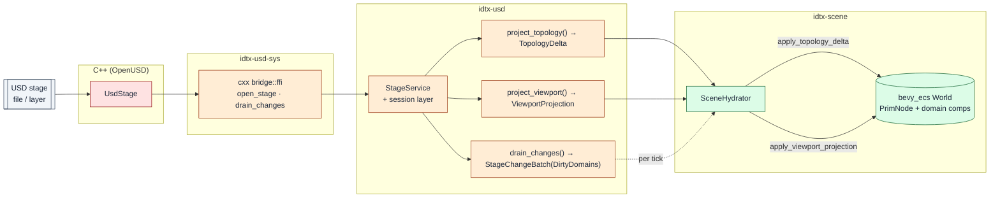
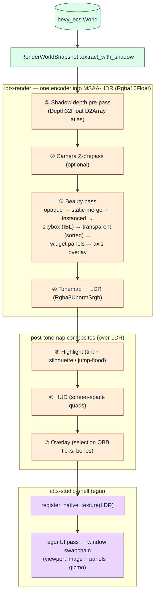
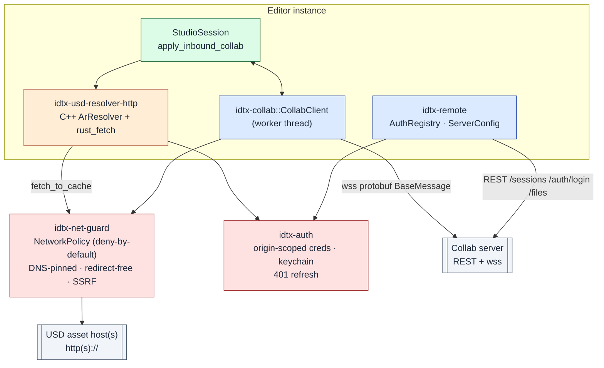
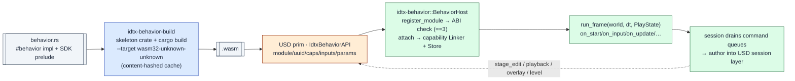
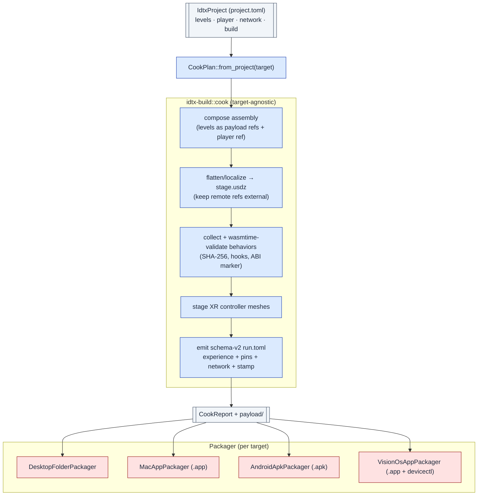
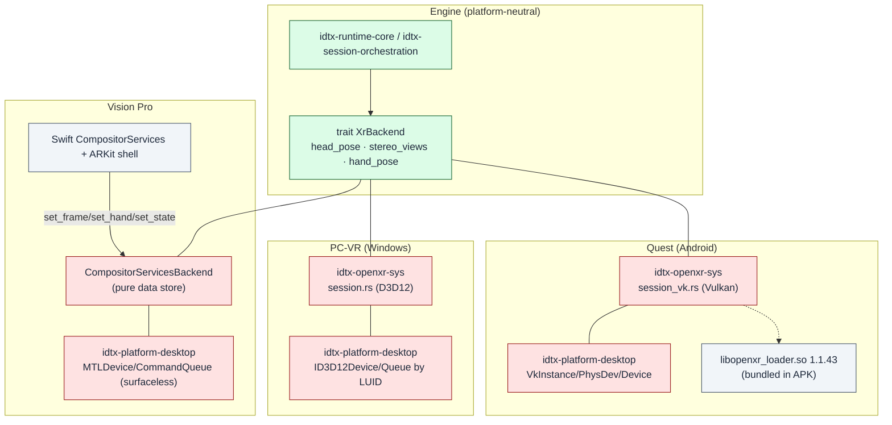

# IDTX Studio — Architecture Deep Dive

This document explains the end-to-end flows behind IDTX Studio: OpenUSD hydration,
rendering, remote live-sync, the behavior system, the Conductor's cook system, and the
Android / Apple Vision Pro specifics (including where OpenXR and ARKit fit). For the
build/bundle/test instructions and the high-level component map, see the
[README](README.md).

**Pipeline at a glance:**

```
C++ OpenUSD ─▶ cxx FFI (idtx-usd-sys) ─▶ safe revisioned stage (idtx-usd)
            ─▶ bevy_ecs projection (idtx-scene) ─▶ GPU snapshot + wgpu renderer (idtx-render)
            ── orchestrated per-frame by idtx-studio-session, composited into egui by idtx-studio-shell
```

---

## 1. OpenUSD hydration (stage → ECS)

The ECS world is a **projection** of the live `UsdStage`, not an independent copy.
A stage is opened through the single `cxx` bridge, wrapped in a safe revisioned
`StageService`, projected into batched value records, and upserted into a `bevy_ecs`
world of per-prim entities. A change-notice loop re-hydrates only the dirty domains.

### Layers

| Layer | Crate | Responsibility |
|---|---|---|
| C++ ↔ Rust FFI | `idtx-usd-sys` | The *only* `cxx` bridge + unsafe seam. POD "Raw" structs + opaque `StageHandle`. |
| Safe stage | `idtx-usd` | `StageService` owns one live stage; revision counter; `project_topology` / `project_viewport` / `drain_changes`. `#![forbid(unsafe_code)]`. |
| Custom schemas | `idtx-usd-extension` | Codeless schemas registered at runtime (`IdtxCollisionAPI`, HUD, widget) + re-exported `UsdPhysics*` names. |
| Dataflow | `idtx-usd-exec` | Coded **OpenExec** plugin: external JSON → compute chain → authored into the session layer. |
| ECS projection | `idtx-scene` | `SceneHydrator` + components; `Populator` / `SchemaHydrator` extension seams. |
| Orchestration | `idtx-studio-session` | Opens, hydrates, and ticks the stage; routes change batches. |

### Key types

- **`ViewportProjection`** (`idtx-usd`) — one batched, self-consistent snapshot of
  everything the viewport renders at a given `generation`/`revision` (and optional
  `time_code`): parallel `Vec`s of transform / visibility / bounds / mesh / gprim /
  material / camera / light records. Produced by one `project_viewport()` call.
- **`TopologyDelta`** — `upserts` + `removed` prims (the structural half).
- **`StageChangeBatch`** — what `drain_changes` returns: a list of `ChangedPrim`s each
  carrying a **`DirtyDomains`** bitset (TOPOLOGY, TRANSFORM, GEOMETRY, MATERIAL, CAMERA,
  VISIBILITY, LIGHT, ANIMATION, SKELETON, …) and a `resync` flag.
- **`PrimNode`** — the identity component on *every* spawned entity (prim id, interned
  path, type_name, state). Namespace nesting is expressed through **interned path
  strings**, not a bevy parent/child hierarchy.
- Domain components: `WorldTransform` (glam col-major), `VisibilityComp`, `BoundsComp`,
  `MeshComp` (with a `geometry_version` bumped *only* when vertex/index data actually
  changes — the render cache key), `CubeComp`/`SphereComp`/…, `MaterialComp`,
  `CameraComp`, `LightComp`, plus `CollisionComp`/`HudComp`/`WidgetPanelComp` under the
  `usd-extension` feature.

### Two extension seams

- **`Populator`** — keys on a prim's concrete `type_name` and hydrates from the
  already-projected `ViewportProjection`. Registered before the first open.
- **`SchemaHydrator`** — an FFI-scan pass against the *live* `StageService` so it can
  probe `HasAPI(...)` schemas and read arbitrary attributes the projection doesn't carry
  (collision, HUD, widgets). Runs a full additive+reconciling pass.

### Flow



**Initial open** (`idtx-studio-session`): build `TopologyDelta` from the topology →
register HUD/widget populators → `SceneHydrator::new` → `apply_topology_delta` →
`project_viewport()` → `apply_viewport_projection` → run the FFI-scan hydrators
(behaviors, player roles, collision, rigid bodies, HUD, widgets) → populate animation.

**Per tick** (`StudioSession::tick`): `drain_changes()`. If any change has the
`TOPOLOGY` bit or `resync` → reproject topology for the affected roots + full viewport +
re-run FFI-scan hydrators. Value-only changes → `project_viewport_roots(changed ids)`
only; untouched components are left as-is. Transform-only animation reuses the GPU buffer
because `geometry_version` didn't change.

> **OpenExec dataflow:** an external source authors JSON onto a `RestDatasource`'s
> `outputs:data` → the OpenExec compute chain recomputes → the result is authored into
> the **session layer** → the normal change-notice → hydrate → render path picks it up.
> Host wiring is `idtx-studio-session::tick_exec`.

---

## 2. Rendering (ECS → wgpu → egui)

`idtx-render` is a GPU-agnostic offscreen `wgpu` renderer. The ECS world is *extracted*
into a fully-owned `RenderWorldSnapshot`, run through a multi-pass graph into an MSAA-HDR
target, tonemapped to an LDR texture, and that texture is handed to `egui` as the
viewport image.

### Extraction

`RenderWorldSnapshot::extract(world, aspect, stage_basis)` queries the bevy world and
produces: `meshes` (`RenderMeshInstance`), `instanced_batches` (PointInstancer +
deduplicated pseudo-instances), `lights`, `camera`, `materials` (keyed by USD material
path), `udim_tiles`, plus the per-frame transient channels the session injects
(`highlight_tints`, `highlight_outlines`, `hud_elements`, `widget_panels`). Parametric
gprims (cube/sphere/cylinder/cone/capsule/plane) are tessellated here.

A monotonic `snapshot_serial` gates the renderer's **structural** caches (static
draw-merge bake) and is deliberately *not* bumped by the cheap warm patches
(`patch_world_matrices`, `patch_joint_matrices`, `patch_widget_panels`,
`patch_mesh_geometry`) that the session applies on frames where only transforms moved.

### The per-frame pass graph



- **Beauty pass** (one `begin_render_pass`): opaque per-mesh (depth-write on) → static
  draw-merge batches → opaque instanced → **skybox** on the far plane → transparent
  per-mesh (depth-write off, back-to-front) → transparent instanced → **widget panels**
  (depth-tested quads sharing the beauty attachments) → editor axis overlay.
- **Tonemap** reads the HDR resolve, writes the LDR `color_texture`.
- **Highlight / HUD / overlay** run in separate encoders over the LDR target.

### Material system

`RenderMaterialDesc` is a flat PBR descriptor (base color, metallic, roughness,
subsurface, emissive, transmission, opacity) + resolved on-disk texture paths + an
`alpha_policy` + a `fingerprint` cache key. Two shading paths:

- **`UsdPreviewSurface`** → `UsdPbrGenerator` emits **one universal** Cook-Torrance WGSL
  shader that branches on a feature bitmask uniform → a single compiled pipeline for all
  preview-surface materials.
- **`MaterialXStandardSurface`** → `MaterialX → GlslShaderGenerator (GLSL) → naga
  GLSL→WGSL transpile`, defensively post-processed by `wgsl_patch` (WGSL forbids `bool`
  in host-shareable structs → rewritten to `u32`). The transpiled WGSL is cached per
  material path in `StageService::materialx_wgsl_cache`.

Bind groups (`pipeline.rs`): group0 camera, group1 lights (`MAX_LIGHTS=16`), group2 mesh,
group3 sampler + 6 textures + material uniforms. `TextureCache` loads PNG/JPEG/EXR
(sRGB for diffuse/emissive, linear for normal/metallic/roughness/occlusion) and provides
1×1 null textures so bind-group creation needs no per-material branching; UDIM tiling and
resolution-cap downscaling + mip generation are handled there.

### Compositing

`StudioSession::prepare_presentation` extracts or warm-patches the snapshot and injects
the transient channels every frame; `render_one_frame` renders into the session's
`FrameTarget`; its LDR `display_view()` is registered as an egui texture and drawn as the
viewport `egui::Image`. The in-scene HUD/widget passes are custom `wgpu` passes inside
`idtx-render`; egui only draws the editor chrome and presents the final frame.

---

## 3. Remote live-sync & collaboration

Two independent channels, unified by one egress trust boundary:

1. **Control / edits** — a WebSocket (protobuf) session between editor instances
   (`idtx-collab`).
2. **Asset bytes** — HTTP(S) OpenUSD assets streamed through a C++ `ArResolver`
   (`idtx-usd-resolver-http`).

Both — plus OpenExec REST and behavior `net` requests — funnel through the single
**deny-by-default SSRF gate** (`idtx-net-guard`) with **origin-scoped credentials**
(`idtx-auth`, backed by the OS keychain).



### Live-sync protocol (`idtx-collab`)

- **Control plane (REST):** `POST /api/v1/sessions` creates a session;
  `.../commit` merges; `DELETE` ends it. Returns a `ws_url` (`http→ws`, `https→wss`).
- **Transport:** `CollabClient::connect`/`join` opens a `wss` socket, authenticating with
  an `Authorization: Bearer` **upgrade header** (DNS resolved + range-checked via
  net-guard); frames are capped at 64 KiB.
- **Wire:** one `BaseMessage` per binary frame (hand-written `prost` types) with a
  `payload` oneof (`Handshake`, `XformUpdate`/`XformBroadcast`, `CreatePrim`,
  `SetPrimActive` …), a client `request_id`, and a per-session `server_seq`.
- **Ordering contract:** `Handshake → zero+ TransformBroadcast (join snapshot) → one
  SnapshotComplete`. The client must not send before `SnapshotComplete`, tracks the
  highest applied `server_seq`, and echoes it as the *base* of every outbound update.
- **Flow control:** outbound transforms **coalesce last-writer-wins per prim** to bound
  socket traffic during drags; creates / set-active are FIFO. A `CommitGate` enforces
  byte/count budgets; inbound is applied **prefix-ordered** with ack barriers. A journal
  records every op's outcome — a lost ack on disconnect is `Indeterminate` and never
  auto-resent (it could overwrite a newer peer edit). `SetPrimActive(false)` is a
  composition-safe **soft delete**.

The glue that applies inbound edits into the live USD stage
(`StudioSession::apply_inbound_collab`, world→local conversion) lives in
`idtx-studio-session`, not in `idtx-collab`.

### Asset resolution (`idtx-usd-resolver-http`)

A C++ `ArResolver` facade armed by a Rust fetch callback. `install(cache_dir)` must be
the first OpenUSD-related call in `main()` (it registers the plugin at runtime via
`PlugRegistry::RegisterPlugins` — the env var is read too early otherwise). On
`_OpenAsset`, C++ calls `rust_fetch` → `fetch_to_cache`: validate through net-guard
(DNS-pinned, redirects disabled), attach the origin-scoped bearer token, stream to a
cache file under the response-size cap. Cache leaves are SHA-256 of the canonical
URL (query included, fragment excluded) plus an allowlisted extension; raw URL
filenames never become filesystem paths. Temporary writes, atomic replacement,
and reads use a retained `cap-std` directory capability. C++ receives an already-open
`FILE*`, not a destination path to reopen. Conductor and runtime use
`~/.idtx-studio/<project-name>` (lowercase, non-ASCII-alphanumeric characters
replaced with underscores; Windows device names get a trailing underscore).
Device fallbacks preserve that layout beneath the writable temp root; loose-file
opens use `_unscoped`. Old `usd-cache` entries are not reused or migrated.
A **401** triggers one bounded
`idtx-auth::refresh_after_unauthorized` retry, then surfaces the origin for
`idtx-remote`'s `AuthProvider` to re-login. A **packaging mode** flag makes the resolver
report remote URIs unresolvable so the USDZ localizer leaves them external during a cook.

### The egress gate (`idtx-net-guard`)

A request is permitted only if **all** hold: policy enables egress and names the host
(exact or `*.domain`; bare `*` opens nothing); scheme is http/https; no URL userinfo;
and every resolved address is public (or loopback/RFC1918 *with* an explicit
`private_hosts` grant). Link-local/metadata (169.254.169.254), CGNAT, and other
special-purpose ranges are always rejected. A mixed public/private DNS answer is rejected
as a rebinding attempt; the validated client pins DNS to the checked addresses and
disables redirects, so nothing can steer to a blocked address between validation and
fetch.

---

## 4. The behavior system

Behaviors are small, sandboxed WebAssembly modules attached to USD prims. An author
writes one `.rs` file against the SDK; it is compiled to `wasm32-unknown-unknown`,
attached via a codeless USD schema, and ticked each frame by a capability-gated
`wasmtime` host.

### Crates

| Crate | Role |
|---|---|
| `idtx-behavior-abi` | Frozen `#[repr(C)]` POD wire types (`ABI_VERSION = 3`), `no_std`. Compile-time `size_of` guards. |
| `idtx-behavior-macros` | The `#[behavior(kind="runtime"\|"editor")]` attribute macro → generates the `_idtx_*` WASM export thunks. |
| `idtx-behavior-sdk` | Author-facing safe wrappers (`ctx`, `scene`, `xr`, `input`, `physics`, `net`, …). Compiles to WASM *and* natively (so author unit tests need no host). |
| `idtx-behavior-build` | Single-file `.rs` → `.wasm` compiler with a content-aware build cache. |
| `idtx-behavior` | The `wasmtime` host: module registry, per-instance stores, capability linker, fuel/epoch/memory budgets. |
| `idtx-scene::behavior` | The `BehaviorRef` ECS component + the `IdtxBehaviorAPI` schema attrs (depends only on the ABI, not the host). |

### Authoring → run



- **ABI boundary.** Every value crossing host↔guest is a `#[repr(C)]` POD with a
  compile-time layout guard; host and guest share the identical pinned
  `glam =0.33.12` so `Vec3`/`Quat`/`Mat4` conversions are pure field moves. The guest
  exports `_idtx_abi_version`; the host refuses a mismatch.
- **Capabilities.** The manifest grants one bool per bucket (`input`, `scene_query`,
  `xform_write`, `stage_edit`, `events`, `xr_hmd`, `playback`, `overlay`, `physics`,
  `auth_write`, `net`, `widget`, `level_control`). The linker exposes **exactly** the
  host imports the granted buckets allow — an ungranted import is simply absent, so a
  module referencing it fails to link. Manifests come from the `IdtxBehaviorAPI` USD
  schema attributes.
- **Isolation & budgets.** Each (entity, uuid) instance gets its own `wasmtime::Store`
  with a memory cap, a per-frame **fuel** budget (deterministic op-count guard), and an
  **epoch** deadline (wall-clock guard). A wall-clock overrun is tolerated a few times
  then fatal; any other trap (fault, OOB, fuel exhaustion) disables the instance on first
  occurrence. A panicking behavior traps so the host never sees a half-mutated store.
- **Ticking.** `run_frame` runs three phases (HTTP completions → update → event/widget
  deliveries). The host only *surfaces* deferred commands (`stage_edit`, `playback`,
  `overlay`, `level` transitions, physics control, widget markers); the **session**
  applies them to USD — the host holds no stage handle.
- **Scope.** Entity-scoped behaviors key by their prim; **stage-scoped** behaviors bind
  to a `StageRoot` pseudo-root with `self_entity = NULL`.

### Desktop vs visionOS host

The host engine is configured per platform. Desktop/Quest use native **Cranelift JIT**.
Under the `visionos` feature the host sets `config.target("pulley64")` — the **Pulley
bytecode interpreter** — because visionOS enforces W^X (no JIT'd executable pages):
Cranelift still compiles the guest, but to portable Pulley bytecode, so no executable
pages are allocated. Pulley bounds-checks memory in software, so the host also shrinks
the per-memory virtual reservation to the behavior's cap (the default multi-GiB
reservation would exhaust the visionOS address space after a few attaches). Fuel + epoch
budgets apply identically on both.

The per-frame `tick_behaviors` glue and the authority gate (local vs server-authoritative
pawns) live in `idtx-studio-session`. Example behaviors are in
[`examples/behaviors/`](examples/behaviors) (`desktop/` and `xr/`) and compiled by the
`idtx-behavior-build` test suite.

---

## 5. The Conductor cook system

The cook turns an authored project into a launchable experience in two layers:
**Cook** (target-agnostic — flatten/localize the stage, collect+validate behaviors, emit
a stamped `run.toml` → a portable *payload*) and **Package** (per-target — wrap the
payload with the runtime binary + platform scaffolding). Both `cargo xtask` and the
Conductor "Build" menu call the same `idtx-build` library.

### Preview vs Build

- **Preview in Runtime** (`cooking` feature) spawns the separate `idtx-runtime` binary
  out-of-process and hands it a synthesized **assembly-root layer** whose sublayer stack
  composes the player prefab (XR mode) *over* the untouched world. The runtime
  self-probes for an OpenXR device and falls back to desktop; the editor keeps no XR code.
- **Build** (`build-tools` feature, Conductor only) runs the heavy `idtx_build::cook` on
  a worker thread and then a per-target `Packager`.



### Cook steps (`idtx-build::cook`)

The whole cook runs inside a `Publication` (stages into a scratch dir, then atomically
publishes — rejecting output that overlaps project source). In order:

1. Set the USD default asset search path (project roots + the built-in tree) so
   `@built-in/...@` and project-relative refs resolve during composition.
2. Compose + **flatten** the entry stage into a self-contained `stage.usdz` (preserving
   external `http(s)://` refs; keeping loose levels when the target supports it). With
   >1 level, each level is cooked as its own `levels/<id>/level.usdz` + a thin per-level
   assembly (the level-transition design).
3. **Collect + validate behaviors** — sweep asset roots for `.wasm`, do a real wasmtime
   compile of each (rejecting corrupt modules at cook time), content-hash, record hooks +
   ABI marker. Per-level behavior binding is supplied by the shell as a closure
   (`idtx-build` never depends on the shell).
4. Copy XR controller meshes into `assets/controllers/` and rewrite paths payload-relative.
5. Emit a schema-v2 `run.toml`: `[experience]` (stage, mode, levels, start/transfer
   level), `[pins]` (ABI version + wgpu/wasmtime/glam versions + required features),
   `[network]` policy (verbatim from the project), and a reproducibility `[stamp]`.
6. Stage `input_map.toml`, the `usd-schemas/` tree (so the runtime registers
   `IdtxCollisionAPI` on-device), the coded OpenExec plugin (`openexec`), and the
   `built-in/` tree.
7. Hash all staged paths/bytes into the manifest (reproducibility).

Packaging is **fail-closed**: a Quest build consumes a *pre-cross-compiled*
`libidtx_runtime.so` staged beside the editor (never cross-compiles in the cook) and
fails rather than packaging the host `.exe`; `MissingExecPlugin` / `MissingResolverPlugin`
/ `InvalidRuntimeBinary` guard against shipping a broken bundle.

### Level transitions (`idtx-session-orchestration`)

The winit-free state machine every runtime target reuses:

- **`SessionSet` / `ActiveSession`** — the live level plus an optional resident
  transfer/mask session; `current` is never `Option` (can't be dropped early → instant
  reload-free abort).
- **`StageLoader`** — non-blocking background open of the next level's assembly on a
  worker thread.
- **`TransitionDriver`** — services a transition a `level_control` behavior posted:
  `Idle` → on request, cut to the mask + request the load → `Loading` → on `Ok(new)`,
  place the player and swap current (returning the outgoing session for teardown); on
  `Err`, abort back to the resident level. Peak memory during a swap is old + transfer +
  new (deliberate, for reload-free abort). Behavior `wasmtime::Store` state does **not**
  survive a swap; persistent state belongs on the shared player sublayer via the SDK.

---

## 6. Android (Quest) & Apple Vision Pro

Both standalone targets cross-compile `idtx-runtime` to a native cdylib and reuse the
*same* `StudioSession` + transition state machine. They diverge in the XR plumbing and
the graphics binding.

### The `XrBackend` seam

Renderer / pawn / locomotion / behavior layers consume **neutral glam value types**,
never a runtime handle. The seam is the `XrBackend` trait (`idtx-platform-xr`):
`session_state`, `head_pose`, `stereo_views`, `hand_pose(Hand)`. Two implementors — the
OpenXR path (Quest / PC-VR) and `idtx-platform-visionos::CompositorServicesBackend`
(Vision Pro) — produce those neutral types; an `XrSession` or a `cp_drawable` never leaks
past the boundary.



### OpenXR: PC-VR vs Quest

Both real paths share the generic frame loop (`session_common.rs`: reference spaces,
swapchains, controller action set, `XR_EXT_hand_tracking`); they differ only in the
graphics binding, swapchain formats, and raw image handle type. The master gate is the
build-time cfg `idtx_xr = (pcvr && windows) || (quest && android)`.

- **PC-VR (D3D12 on Windows, `pcvr`).** `openxr::Entry::load`. Because Meta Quest Link
  ships no Khronos `openxr_loader.dll`, a Windows fallback reads the runtime manifest from
  `HKLM\...\Khronos\OpenXR\1\ActiveRuntime` (and Meta's `AvailableRuntimes` layout),
  `LoadLibrary`s the runtime DLL, and negotiates via
  `xrNegotiateLoaderRuntimeInterface`. The D3D12 adapter **LUID** drives wgpu device
  creation so OpenXR and wgpu share the GPU.
- **Quest (Vulkan on Android, `quest`).** `set_android_activity(vm, activity)` must be
  called from `android_main` **before** instance creation, and must hand OpenXR the real
  **Activity** jobject (not the Application that `android-activity` registers) or the
  session never leaves `IDLE`. Unlike D3D12, Vulkan needs the runtime *in the loop* of
  device creation: `xrCreateVulkanInstanceKHR`/`xrCreateVulkanDeviceKHR` passthroughs let
  it inject extensions; `idtx-studio-session::xr_vulkan` builds the `ash` create-infos,
  drives the passthroughs, then wraps the resulting `VkInstance`/`VkPhysicalDevice`/
  `VkDevice` into wgpu-hal. The OpenXR loader-for-android (1.1.43) is fetched from Maven
  and bundled in the APK's `lib/`.

### Vision Pro: CompositorServices + ARKit (no OpenXR)

Vision Pro uses Apple **CompositorServices + ARKit**, bridged through the same
`XrBackend` seam. `CompositorServicesBackend` is a **pure data store** holding no Metal /
`cp_drawable` handle; a Swift shell samples the runtime each frame and pushes results in
via `set_frame(head, left, right)` / `set_hand(Hand, pose)` / `set_state(state)`:

- **Head pose** — ARKit `WorldTrackingProvider::queryDeviceAnchor` (simulated in the
  Simulator, so head pose is live there too).
- **Per-eye views** — the `cp_drawable` views' frustum tangents + per-view transforms
  relative to the device anchor. `EyeViewInput::to_view()` converts tangents to angles so
  the `Fov` type is identical to the OpenXR path.
- **Hands** — ARKit `HandTrackingProvider`; `isSupported` is **false in the Simulator**,
  so `hand_pose()` returns `None` there; on device the shell feeds located joints.
- Lifecycle has no sync/visible handshake — `set_frame` promotes a `Ready` session
  straight to `Focused` (a presenting immersive space is focused).

The per-eye Metal render into the drawable textures lives in
`idtx-studio-session::visionos_render` (visionOS shares no code with OpenXR). Rendering is
**surfaceless** — it targets CompositorServices drawables, not a window swapchain.

**The winit-free constraint.** `winit 0.30` has no visionOS backend (it classifies the
target as a "free unix" and drags in X11/Wayland, which doesn't build). So
`idtx-platform-desktop` gates `winit` to `cfg(not(target_os = "visionos"))` and exposes
only a surfaceless `new_metal_offscreen` + a `metal_handles` extractor on visionOS, and
`idtx-runtime-core` (which pulls winit) is **not** a dependency there. This is precisely
why `idtx-session-orchestration` was extracted — so the visionOS runtime reuses the
transition state machine without touching winit.

### GPU handle extractors (`idtx-platform-desktop`)

One wgpu adapter for all platforms; three read-only raw-handle extractors feed
`xrCreateSession` / CompositorServices:

| Target | Extractor | Handles |
|---|---|---|
| PC-VR | `d3d12_device_queue_ptrs` | `ID3D12Device*` + `ID3D12CommandQueue*` (adapter picked by DXGI LUID) |
| Quest | `vulkan_handles` | `VkInstance`/`VkPhysicalDevice`/`VkDevice` + queue family/index |
| Vision Pro | `metal_handles` | `id<MTLDevice>` + `id<MTLCommandQueue>` (surfaceless; the Swift shell verifies the shared-`MTLDevice` invariant for drawable-texture import) |

### Hand-gesture recognition (`gesture-recognition`)

The OpenXR/ARKit runtimes provide only raw 26-joint poses; `idtx-platform-xr::gesture`
interprets them into named `GestureEvent`s on its own thread (so matching never stalls
the frame loop). **Pinch → grab** fires when thumb-tip↔index-tip distance < ~0.025 m;
also Fist/Point/OpenHand/ThumbsUp and temporal swipes/push/circle. Events are published as
`Gesture/<kind>/<hand>` input sources bound in `input_map.toml`. The visionOS device
runtime always builds with this feature.

### Cross-build toolchains (`tools/xtask`)

| | Android / Quest | Apple Vision Pro |
|---|---|---|
| Rust target | `aarch64-linux-android` (stable) | `aarch64-apple-visionos` (device) / `-sim` — **nightly + `-Z build-std` + `rust-src`** |
| Artifact | `libidtx_runtime.so` (ELF) | `libidtx_runtime.dylib` (Mach-O) |
| Toolchain | NDK `30.0.16248370` (known-good, ships Clang 21; min r25+, r26+/Clang 16+ for `openexec`) · clang wrapper `aarch64-linux-android30-clang` · API 30 · `arm64-v8a`; Ninja from the Android SDK | Xcode + visionOS SDK (`xros` / `xrsimulator`), deployment target 2.0, `xcrun` |
| Native stack | OpenUSD 26.11.1 + oneTBB 2021.12.0 + MaterialX 1.39.5, monolithic, imaging/python/vulkan off | same, MaterialX uses the Metal (`MSL`) generator |
| Key env | `ANDROID_NDK_ROOT`, `ANDROID_HOME`/`ANDROID_SDK_ROOT`, `IDTX_USD_DIR_ANDROID` | `IDTX_USD_DIR_VISIONOS`, `XROS_DEPLOYMENT_TARGET` |
| XR deps | OpenXR loader-for-android 1.1.43 (Maven) + Vulkan | CompositorServices + ARKit + Metal |
| Packaging / deploy | `.apk` via `xtask`/CI (JDK + Android SDK) | `.app` + `devicectl`, free Personal-Team signing (`bootstrap-visionos-signing`) |

`build-usd-android` applies several NDK libc++ source patches (RAII git-restore) and
builds oneTBB → MaterialX → OpenUSD. `build-usd-visionos` builds both device and
simulator slices (Mach-O `-dead_strip` instead of the ELF `--gc-sections`). The visionOS
runtime staging embeds the **full dylib load-closure** (asserting `libusd_ms.dylib`,
`libtbb.12.dylib`, `libMaterialX.1.dylib` are present) to avoid a device dyld crash.
`OpenExec` cross-builds additionally require NDK r26+/Clang 16+ (`PXR_BUILD_EXEC=ON`).

---

## Quick file map (for navigation)

| Topic | Start here |
|---|---|
| USD bridge | `crates/idtx-usd-sys/src/bridge.rs`, `crates/idtx-usd/src/{stageservice.rs,projection.rs}` |
| Hydration | `crates/idtx-scene/src/{hydrator.rs,components.rs,populator.rs,schema_ext.rs}` |
| Rendering | `crates/idtx-render/src/{lib.rs,renderer.rs,pipeline.rs,scene_extract/,surface_gen.rs}` |
| Live-sync | `crates/idtx-collab/src/{client.rs,proto.rs,transport.rs,session.rs}` |
| Asset resolver / egress | `crates/idtx-usd-resolver-http/`, `crates/idtx-net-guard/`, `crates/idtx-auth/`, `crates/idtx-remote/` |
| Behaviors | `crates/idtx-behavior*/`, `crates/idtx-scene/src/behavior.rs`, `examples/behaviors/` |
| Cook / package | `crates/idtx-build/src/{cook.rs,assembly.rs,package.rs}` |
| Sessions / transitions | `crates/idtx-studio-session/src/{lib.rs,physics.rs}`, `crates/idtx-session-orchestration/src/` |
| XR / platforms | `crates/idtx-platform-{xr,desktop,visionos}/`, `crates/idtx-openxr-sys/` |
| Cross-builds | `tools/xtask/src/{usd_cross.rs,quest_runtime.rs,visionos_runtime.rs}` |
