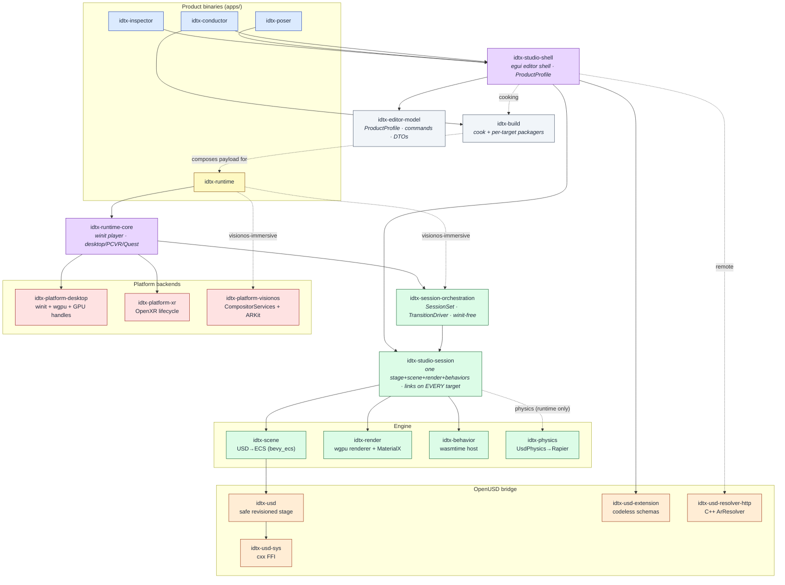

-brightgreen)


-brightgreen)


# IDTX Studio

IDTX Studio is an **OpenUSD-native authoring, preview, and runtime stack** for building
interactive 3D / XR experiences. An authored USD stage is hydrated into a `bevy_ecs`
world, rendered by an offscreen `wgpu` renderer, driven by sandboxed WebAssembly
behaviors, and cooked into a self-contained player that runs on desktop, PC-VR
(OpenXR / D3D12), standalone Quest (OpenXR / Vulkan), and Apple Vision Pro
(CompositorServices + ARKit + Metal) — all from the **same engine core**.

The product surface is four binaries built from one shared shell + engine:

| Binary | Role | Docs |
|---|---|---|
| **IDTX Inspector** | Read-only USD stage viewer | [apps/idtx-inspector](apps/idtx-inspector/README.md) |
| **IDTX Poser** | Transform & variant authoring, add/remove prims, backend live-sync | [apps/idtx-poser](apps/idtx-poser/README.md) |
| **IDTX Conductor** | Project-level authoring, behaviors, cook & deploy | [apps/idtx-conductor](apps/idtx-conductor/README.md) |
| **IDTX Runtime** | The packaged player (desktop / XR / Quest / Vision Pro) | [apps/idtx-runtime](apps/idtx-runtime/README.md) |

> Deep architecture — hydration, rendering, remote live-sync, behaviors, the cook
> system, and the Android / visionOS / OpenXR / ARKit specifics — lives in
> **[ARCHITECTURE.md](ARCHITECTURE.md)**.

---

## Core features

- **Native spatial curves and placement baking.** Linear/Bezier BasisCurves,
  shared metre-distance evaluation, editor guides, Conductor placement baking,
  and bounded snapshot-backed behavior queries. See [CURVES.md](CURVES.md).

- **OpenUSD-native, non-destructive.** The ECS world is a *projection* of the live
  `UsdStage`, never an independent copy. Authoring edits land in an in-memory
  **session layer**; the root layer is only touched on save. Incremental
  change-notices (`drain_changes`) re-hydrate only the dirty domains.
- **Offscreen `wgpu` renderer.** Cook-Torrance PBR with a 6-channel texture pipeline,
  an 8-light array, soft-shadow atlas, MaterialX shader generation
  (`MaterialX → GLSL → naga → WGSL`), image-based lighting from `UsdLuxDomeLight`,
  GPU skinning, world-space widget panels and screen-space HUD, jump-flood silhouette
  outlines. Output is composited into an `egui` editor shell.
- **Sandboxed WASM behaviors.** Author a single `.rs` file against the behavior SDK;
  it compiles to `wasm32-unknown-unknown` and runs in a capability-gated `wasmtime`
  host with fuel + epoch + memory budgets. Cranelift JIT on desktop/Quest; the
  **Pulley** bytecode interpreter on visionOS (W^X, no JIT pages).
- **Runtime rigid-body physics.** A `UsdPhysicsScene` prim activates a Rapier3D
  simulation (static / dynamic / kinematic bodies); glam-native so USD poses are the
  engine's math types, conversion-free.
- **Remote live-sync & collaboration.** WebSocket (protobuf) single-edit and multi-editor
  sessions synchronize transforms and typed attribute defaults, with ordered echoes,
  partial failure recovery, and commit barriers; HTTP(S) OpenUSD asset streaming
  through a C++ `ArResolver`. All egress funnels through one deny-by-default SSRF gate
  with origin-scoped credentials (OS keychain).
- **One cook, many targets.** The Conductor cooks a project into a portable, stamped,
  reproducible payload (`run.toml` + flattened `stage.usdz` + validated behaviors) and
  packages it per target: desktop folder, macOS `.app`, Quest `.apk`, Vision Pro `.app`.
- **Level transitions.** A winit-free `SessionSet` / `TransitionDriver` state machine
  does reload-free, mask-covered level swaps, reused identically across every runtime
  target.

---

## Repository layout

```
idtx-studio/
├── apps/                     the four thin product binaries (see per-app READMEs)
│   ├── idtx-inspector/       read-only viewer
│   ├── idtx-poser/           transform/variant authoring
│   ├── idtx-conductor/       project authoring + cook + deploy
│   └── idtx-runtime/         packaged player (desktop bin + Android/visionOS cdylib)
├── crates/                   ~37 library crates (engine, bridge, cook, platform)
├── tools/
│   ├── xtask/                workspace automation: bundle, cross-build, verify-review
│   └── build-scripts/        build_openusd.py (+ pinned openusd_config.toml)
├── examples/behaviors/       sample behavior sources (desktop/ + xr/)
├── tests/fixtures/           USD fixtures + golden renders for integration tests
└── thirdparty/               OpenUSD / oneTBB / MaterialX sources + cross-build trees
```

---

## Prerequisites

### Applying to *all* targets

| Requirement | Version / note |
|---|---|
| **Rust (stable)** | 1.90, edition 2024. `rustup target add wasm32-unknown-unknown` is required (behaviors compile to WASM). |
| **OpenUSD 26.11.1** | Built monolithic (`usd_ms`). Build it once with the helper script below; the version pin is authoritative (the C++ shim is compiled against these headers — ABI is not stable across releases). |
| **A C++ toolchain** | MSVC (Windows), Clang/AppleClang (macOS), GCC/Clang (Linux) — needed to compile the `cxx` bridge `usd_shim.cpp`. |
| **CMake + Ninja + Python ≥ 3.8 + git** | To build OpenUSD. |
| `IDTX_USD_DIR` | Environment variable pointing at the OpenUSD install prefix — honoured by both the builder and every consuming crate. |

Build (or reuse) the host OpenUSD install:

```bash
# Clones Pixar OpenUSD at the pinned 26.11.1 tag and builds the monolithic lib.
# Reuses an existing install if usd_ms + the version marker are already present.
python tools/build-scripts/build_openusd.py

export IDTX_USD_DIR=<path/to/openusd-26.11.1/install>
```

So that `cargo run`/`cargo test` can load the dylibs at runtime, put the install's
`lib/` directory on the loader path:

- **Windows:** `export PATH="$IDTX_USD_DIR/lib:$IDTX_USD_DIR/bin:$PATH"`
- **macOS:** `export DYLD_LIBRARY_PATH="$IDTX_USD_DIR/lib:$DYLD_LIBRARY_PATH"`
- **Linux:** `export LD_LIBRARY_PATH="$IDTX_USD_DIR/lib:$LD_LIBRARY_PATH"`

> The app/binary **build scripts stage the OpenUSD runtime next to the produced
> executable automatically**, so a plain `cargo run -p idtx-inspector` works once
> `IDTX_USD_DIR` is set. The loader-path export matters mostly for tests and the
> `xtask-visionos` device path.

### Applying only to *some* targets

| Target | Extra prerequisites |
|---|---|
| **PC-VR (`pcvr`)** | Windows + an OpenXR runtime (SteamVR, or Meta Quest Link — the loader is auto-discovered from the registry, including Meta's layout). D3D12 via wgpu. |
| **Remote assets (`remote`)** | Compiles a C++ OpenUSD `ArResolver` plugin → needs `IDTX_USD_DIR` at build time. Credentials via OS keychain + `~/.idtx-studio/config.toml`. |
| **OpenExec (`openexec`)** | A `PXR_BUILD_EXEC=ON` OpenUSD; cross-builds additionally need NDK r26+ / Clang 16+. |
| **Quest / Android** | `ANDROID_NDK_ROOT` — known-good **NDK `30.0.16248370`** (the `aarch64-linux-android30-clang` wrapper pinned in [`.cargo/config.toml`](.cargo/config.toml), ships Clang 21); minimum **r25+**, or **r26+ / Clang 16+** when `openexec` is on. API 30, `arm64-v8a`. Also `ANDROID_HOME`/`ANDROID_SDK_ROOT` (for Ninja), `rustup target add aarch64-linux-android`, a JDK + Android SDK for `.apk` assembly, `IDTX_USD_DIR_ANDROID`. OpenXR loader-for-android **1.1.43** is fetched automatically. |
| **Apple Vision Pro** | macOS + Xcode + the **visionOS 2.0** SDK, a **nightly** Rust toolchain with `rust-src` (`-Z build-std`; tier-3 targets have no prebuilt std), `IDTX_USD_DIR_VISIONOS`. On-device deploy uses `devicectl` + a free Personal-Team signing identity. |

The cross-compiled native stacks (OpenUSD / oneTBB 2021.12.0 / MaterialX 1.39.5) are
produced by `cargo xtask build-usd-android` / `build-usd-visionos` and staged under
`thirdparty/`. External toolchains (NDK, JDK, Android SDK, Xcode) are never bundled.

```bash
export IDTX_USD_DIR_ANDROID=<path/to/openusd-26.11.1/android-arm64>
export ANDROID_NDK_ROOT=<path/to/android/sdk/ndk/30.0.16248370>
export IDTX_USD_DIR_VISIONOS=<path/to/openusd-26.11.1/visionos-arm64>
```

---

## Building the four binaries

All builds need `IDTX_USD_DIR` set. The three editor apps (`inspector`, `poser`,
`conductor`) are thin wrappers over the shared `idtx-studio-shell`, differentiated at
runtime by a `ProductProfile`; `idtx-runtime` wraps `idtx-runtime-core`.

```bash
# Desktop editors (debug: cargo run; release: cargo build --release)
cargo run -p idtx-inspector [-- path/to/stage.usd]
cargo run -p idtx-poser      [-- path/to/stage.usd]
cargo run -p idtx-conductor  [-- path/to/project.toml]   # or --project <file>

# The packaged player
cargo run -p idtx-runtime -- --stage path/to/stage.usd [--mode xr|desktop]
```

### Per-binary feature flags

Features are opt-in because several pull a C++ plugin (needs `IDTX_USD_DIR` at build)
or a cross-toolchain. `--features <pkg>/<feat>` enables them.

| Binary | Notable features |
|---|---|
| **inspector** | `remote` (HTTP resolver), `metrics` |
| **poser** | `remote` |
| **conductor** | `cooking` *(default — pulls authoring + build-tools + behavior compiler + OpenExec cook)*, `remote`, `pcvr` |
| **runtime** | `authoring`+`physics` *(default)*, `pcvr`, `quest`, `mock-xr`, `remote`, `openexec`, `metrics`, `gesture-recognition`, `visionos-immersive` |

The runtime crate produces **two artifacts from one crate**: the desktop/XR `idtx-runtime[.exe]`
binary, and an Android/visionOS **cdylib** (`libidtx_runtime.so` / `.dylib`) — the latter
only via the `xtask` cross-builds below.

---

## Bundling the OS applications

Bundling runs *after* linking (so the fresh binary can be copied in), which is why it is
an `xtask` and not a `build.rs`. Each bundle is **self-contained**: the executable plus
every OpenUSD / MaterialX / TBB library and the plugin-discovery trees, so plugin
discovery works with no environment variable. `--app inspector|poser|conductor|all`
selects targets (default `all`).

### Windows (portable folder + zip → `dist/windows/`)

```bash
cargo xtask bundle-windows                 # all apps, release
cargo xtask bundle-windows --app conductor --remote --pcvr
cargo xtask bundle-windows --no-zip --out some/dir
```

Prereqs: run on Windows, `IDTX_USD_DIR` → a Windows install, PowerShell 5+ (for the zip).
Produces `dist/windows/<app>/<app>.exe` + DLLs + `usd/` `plugin/` `libraries/` `resources/`
`assets/` `built-in/`. Conductor also co-locates `idtx-runtime.exe` (spawned for
"Preview in Runtime").

### macOS (self-contained, ad-hoc-signed `.app` → `dist/macos/`)

```bash
cargo xtask bundle-mac                      # all apps, release
cargo xtask bundle-mac --app conductor --remote
```

Prereqs: run on macOS, `IDTX_USD_DIR` → a macOS install, Xcode command-line tools
(`install_name_tool`, `codesign`, `sips`, `iconutil`). The bundler rewrites rpaths to
`@executable_path/../Frameworks` and ad-hoc-signs inside-out (required on Apple silicon).

### Standalone headset runtimes (staged into a Conductor bundle)

A shipped Conductor can package Quest / Vision Pro apps on-site, so the bundlers can
stage the cross-compiled standalone runtime trees beside the Conductor binary:

```bash
# Windows or macOS host — cross-builds OpenUSD-for-Android + libidtx_runtime.so
cargo xtask bundle-windows --app conductor --android
cargo xtask bundle-mac     --app conductor --android      # android-runtime/
# macOS only — cross-builds OpenUSD-for-visionOS + libidtx_runtime.dylib
cargo xtask bundle-mac     --app conductor --visionos     # visionos-runtime/
```

Prereqs are the Android / Vision Pro toolchains above. The native OpenUSD cross-build is
heavyweight and reused across runs unless `--android-rebuild-usd` / `--visionos-rebuild-usd`.

### Direct standalone cross-builds (CI / advanced)

```bash
cargo xtask build-usd-android            # OpenUSD + oneTBB + MaterialX → thirdparty/android-arm64
cargo xtask build-quest-runtime --with-remote --with-openexec   # → libidtx_runtime.so + loader + USD deps
cargo xtask build-usd-visionos           # macOS only; both device + simulator slices
cargo xtask build-visionos-runtime --with-remote --with-openexec # → libidtx_runtime.dylib (device slice)
cargo xtask run-visionos-sim             # build sim slice + run in the visionOS Simulator (no device)
cargo xtask-visionos run-visionos-device # build + sign + devicectl install on a paired Vision Pro
cargo xtask-visionos bootstrap-visionos-signing   # one-time free Personal-Team cert + profile
```

> `cargo xtask-visionos …` is the alias that enables the `visionos-device` feature
> (it links the OpenUSD runtime). The `.apk` for Quest is assembled by `xtask`/CI from
> the staged `libidtx_runtime.so` — the editor cook never cross-compiles.

---

## Running the test suite (including the OpenUSD-linked tests)

Pure (host) tests need nothing special:

```bash
cargo test --workspace            # non-USD, non-GPU unit/integration tests
```

Many integration tests **link a live OpenUSD** and are therefore marked `#[ignore]` by
default (and some need a GPU). To run them, set `IDTX_USD_DIR`, put the install's `lib/`
on the loader path (see *Prerequisites*), and pass `--include-ignored` (a.k.a.
`-- --ignored`). Several suites are single-threaded because OpenUSD caches layers
process-globally:

```bash
export IDTX_USD_DIR=<install>
export PATH="$IDTX_USD_DIR/lib:$PATH"       # macOS: DYLD_LIBRARY_PATH; Linux: LD_LIBRARY_PATH

# USD hydration + authoring
cargo test -p idtx-usd   --features authoring -- --include-ignored --test-threads=1
cargo test -p idtx-scene --features usd-extension -- --include-ignored --test-threads=1

# GPU render tests (no USD needed) + USD render integration (writes PNGs to tests/renders/)
cargo test -p idtx-render -- --include-ignored
cargo test -p idtx-render --test render_integration -- --include-ignored --test-threads=1

# Session / cook / resolver
cargo test -p idtx-studio-session --features authoring,remote,openexec,physics,visionos,metrics -- --include-ignored --test-threads=1
cargo test -p idtx-usd-resolver-http -- --test-threads=1
cargo test -p idtx-build --test package_launch -- --ignored --test-threads=1
```

### The canonical way: `verify-review` evidence lanes

`cargo xtask verify-review` runs the exact, curated job set per lane and records a
revision-bound evidence manifest. This is the authoritative "full suite":

```bash
cargo xtask verify-review --lane core      # host-only: auth, collab policy, behaviors, SDK, build cache
cargo xtask verify-review --lane usd       # needs IDTX_USD_DIR: workspace check + all USD-linked suites
cargo xtask verify-review --lane windows   # Windows host: desktop + PCVR runtime builds
cargo xtask verify-review --lane cross     # macOS + Android SDK: visionOS + Quest cross-builds
cargo xtask verify-review --lane server    # live collab server (needs IDTX_TEST_SERVER_* env)
cargo xtask verify-review --lane usd --list # print the jobs without running them
```

The `usd` lane asserts `IDTX_USD_DIR` points at an `openusd-26.11.1` install with
`PXR_VERSION 2611`; the `cross` lane additionally requires `IDTX_USD_DIR_ANDROID` and
`IDTX_USD_DIR_VISIONOS`.

> **Note:** on some feature branches the `--all-targets` test *build* can be broken even
> when the code is sound. Prefer the per-lane / per-crate invocations above (and
> `cargo check` for a quick compile gate) over `cargo test --all-targets`.

---

## High-level architecture

How the four binaries re-use the engine, bridge, cook, and platform crates:



**Reading the diagram**

- **Inspector / Poser / Conductor** are thin `main.rs` wrappers that launch
  `idtx-studio-shell` with a different `ProductProfile` (capability flags). Only
  Conductor compiles the `cooking` surface (behavior compiler + Preview/Build menus) and
  depends on `idtx-build`.
- **idtx-runtime** is the only binary that does *not* use the editor shell; it wraps
  `idtx-runtime-core` (desktop / PC-VR / Quest) or, on visionOS, builds directly on
  `idtx-session-orchestration` + `idtx-platform-visionos` (winit has no visionOS backend).
- **idtx-studio-session** is the shared heart — one stage + scene + render + behavior
  host per tab/level — and links on *every* target. **idtx-session-orchestration** adds
  the winit-free level-transition state machine so visionOS reuses the exact same logic.
- The **OpenUSD bridge** (`idtx-usd` → `idtx-usd-sys` cxx) is the one unsafe seam;
  everything above it is `#![forbid(unsafe_code)]`.
- **Physics** links only through the runtime path (`idtx-runtime-core`'s `physics`
  feature) — the editor viewport never simulates; the Conductor's *preview* simulates
  because it spawns the out-of-process runtime.

---

## License

Apache-2.0 OR MIT. © ApeiroRA / IDTX Toolbox contributors / SAP.
