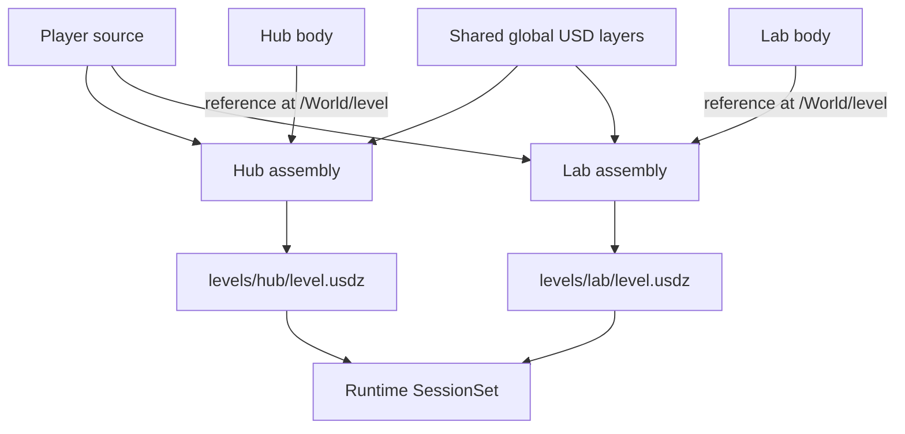
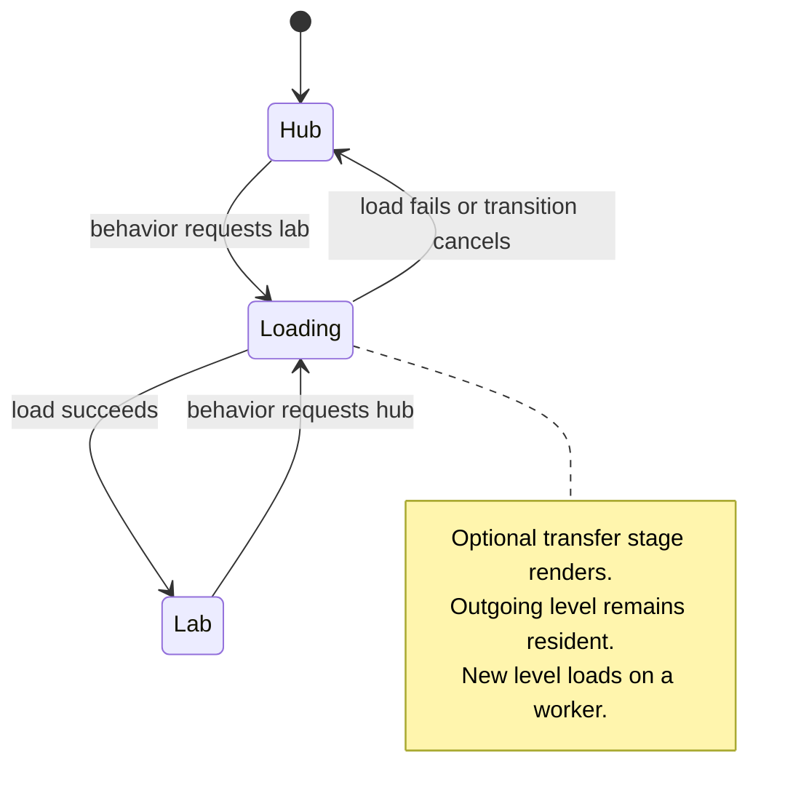

# Compose a player and move between levels

Conductor composes a world level with a player rig. The rig provides the camera, control poses, default behaviors and, in XR, controller/pointer placement. Keep reusable player content separate from individual level bodies.

## Use the built-in player first

Omit `player_stage` in `project.toml`. Both cook and preview resolve `built-in/players/Player.usd`, supplied by the authoring distribution. Its `/Player` prim has a `playerKind` variant set with `desktop` and `xr` variants. The composer references it into `/World/Player` and chooses the variant for the requested mode. You do not need to copy the built-in player into your project. Keep the installed application's asset/resource folders intact.

To customize it, choose **Project > Create Player Stage**. The action creates `stages/player.usda`, records it in `project.toml`, and opens it. Its essential form is:

```usda
#usda 1.0
(
    defaultPrim = "Player"
    metersPerUnit = 1
    upAxis = "Y"
    customLayerData = {
        dictionary idtx = {
            token stageKind = "player"
            string schemaVersion = "1"
            string displayName = "Player"
        }
    }
)

def Xform "Player" (
    prepend references = @built-in/players/Player.usd@</Player>
)
{
    # Add project-specific opinions and children here.
}
```

Re-running **Create Player Stage** writes this conventional file again. Preserve your customized player file before using that creation action a second time. For the first walkthrough, keep the default rig and author only the behaviors needed by your experience.

Player scripts use `input_map.toml` to resolve logical actions. The [complete sample input map](../example/project-files.md) provides keyboard, mouse and XR bindings. A missing or invalid map leaves actions inactive. Check bindings whenever a camera renders correctly but movement does nothing. The [SDK input reference](../reference/behavior-sdk.md) describes logical action reads.

## Understand three composition shapes

### The source level

A level body roots its scene at `/World`, with a default prim of `World`. A conventional spawn marker is `/World/Spawn`. Behavior code can use `ctx.entity()` and relative scene queries to avoid hard-coding its eventual composed path.

### The combined assembly used for single-level cook and preview

The shared assembly composer creates a level holder per file beneath `/World/Levels`. Its essential structure is:

```usda
def Xform "World"
{
    def Scope "Levels"
    {
        def "hub" (prepend payload = @hub.usda@) {}
    }
    def Xform "Player" (
        prepend references = @built-in/players/Player.usd@</Player>
        variants = { string playerKind = "desktop" }
    ) {}
}
```

This is an explanatory skeleton; Conductor authors the complete assembly for you. A single level is visible. An authored editing assembly with multiple levels initially hides all holders; the cook's combined planner selects the default-visible holder. Visibility and payload loading are distinct USD concerns.

### The cooked multi-level assembly

With two or more registered levels, cooking creates a separate flattened assembly for each level. Each assembly references the level body at **`/World/level`** and the player at `/World/Player`, then includes any `shared_sublayers`.



The source `/World/Beacon` therefore becomes `/World/level/Beacon` in a multi-level package, and `/World/Levels/hub/Beacon` in a combined preview. This is why behavior examples use their owning entity and named relative lookups. For explicit object bindings, author USD relationships and resolve them through `ctx.scene().relationship_targets()`: USD remaps the relationship targets through composition. JSON path strings remain unchanged. Inspect ordered live/unloaded/invalid target results instead of assuming every returned slot is a usable entity. See [relationship authoring](usd.md#bind-reusable-behavior-targets-with-relationships).

The composer re-surfaces a detected root `PhysicsScene` and conventional root `StageBehavior` that a default-prim reference would otherwise omit. Keep these conventional structures explicit and inspect their composed paths rather than assuming arbitrary root siblings are carried into an asset reference.

## Preview a level

Save the active level, then choose **Preview > Preview in Desktop** or **Preview > Preview in XR**. Conductor composes a temporary assembly, compiles its behavior sources using the configured Rust tools, and launches the supplied Runtime with the requested mode in a windowed preview. **Preview > Stop Preview** stops it. A missing Runtime or SDK is an incomplete authoring installation; follow [setup](../setup.md) and obtain the matching distribution.

The current project preview normally wraps the **active editor stage** with the configured player; it does not start a cooked multi-level registry or its transition driver. Preview each source level separately to test visual and local interaction behavior, then cook the project to test actual level transitions. Previewing an authored assembly tab also differs from previewing a plain level; select the intended world level before launch.

Preview now validates saved curve-placement bakes before launching the Runtime. A stale bake must be regenerated in the **Native curve / placements** inspector. Named clip transport and its status/events can be exercised in a single active level; level travel still requires the cooked registry.

The runtime injects the chosen XR controller models over the rig's bare poses. Device mapping comes from `run.toml`/controller configuration and runtime probing, with a generic fallback. Keep controller model correction transforms on a model/mount child rather than on the pose transform that is updated each frame.

## Request a level change from a behavior

Grant the `level_control` capability and request the target by its **cooked level ID**, such as `lab`. Consult the [SDK reference](../reference/behavior-sdk.md) for the exact API and the [complete sample behavior](../example/behavior-files.md) for executable code. The [interaction walkthrough](../tutorial/04-interactions.md) follows the console button from callback to transition request.

The ID comes from the parent directory of the cooked assembly (`levels/lab/level.usdz`), not its display label. A target name that is absent from the registry fails to resolve. Duplicate source stems may be renamed to `lab_2`; use simple unique source stems.

Set `transfer_level` to a small stage when a visual mask is useful. A transfer stage should be quick to hydrate, with simple geometry and little texture memory. It is not another normal story level in the registry.



Only one transition loads at a time. On success, the new session becomes current and the old session is dropped. On failure or cancellation, the retained outgoing level resumes. This recovery strategy temporarily holds outgoing, transfer and incoming resources: test peak memory on the headset, not only steady-state FPS.

At cutover, an explicit one-shot player-placement override takes precedence; otherwise the incoming level's `/World/level/Spawn` is used. Keep a spawn marker in every level and test both forward and return transitions.

## Decide what survives a transition

Referencing the same player USD into each level shares authored definitions, but each level owns a session and behavior host. A Rust struct's in-memory state on the outgoing host is dropped at cutover, including state on an authored player behavior. Use the SDK's experience-state facility for small data that must survive levels. The orchestration layer owns this store across session swaps.

Examples of suitable persistent state are a visited-lab flag, an unlock count or a chosen option. World entities and cached handles belong to their session. Reacquire entity handles when a new level starts; do not carry one level's entity ID into another.

`idtx:playerRole = "local"` marks the locally driven pawn; other role values are authority gates used by behavior attachment. These role tokens do not by themselves implement network multiplayer. Keep this tutorial's player local.

## Optional controller overrides

Author `xr_controllers.toml` at the project root when the built-in meshes do not fit your target:

```toml
[controllers.generic]
left = "controllers/generic_left.usda"
right = "controllers/generic_right.usda"

[controllers.questpro]
asset = "controllers/questpro.usda"

[controllers.questpro.mount]
rotate = [180.0, 0.0, 0.0]
```

An entry can provide one shared `asset` or per-hand `left` and `right` paths. Mount translation/rotation/scale seats the mesh in the tracking frame; the runtime also normalizes source up-axis and units. Cooking copies resolvable models into payload assets and rewrites manifest paths for the package.

## Checkpoint

Preview Hub and Lab separately, then [cook a desktop package](../delivery/cooking.md). Confirm it starts on Hub, the console travels to Lab and back, each transition places the player at the intended Spawn, and the paused/running state survives. Reacquire scene handles in the new level's behavior rather than retaining handles from the old level.
