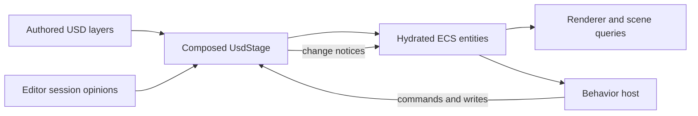

# Author the USD world

Start with a small world whose structure can be understood in a text editor: a ground plane, a pedestal, a colored beacon, a spawn marker, and lights. The [complete USD files](../example/usd-files.md) provide the example's stages. They can be authored with an ordinary text editor and opened in the installed Conductor application. This page explains the choices so you can extend them.

## The stage is the source of truth

Conductor and the Runtime compose your USD layers into a live stage. They project its prims into scene entities for rendering, queries and behavior execution. Editor edits land in a session layer; saving persists the authored result. A behavior sees the projected entities, while transform and stage-edit APIs route changes through the host. This explains why an SDK entity handle and a USD prim path represent related parts of the same scene.



Do not build a second world database in your behavior. Store small behavior state in Rust; use USD for scene structure, parameters, asset identity and authoring relationships.

## Choose a stable root and coordinate convention

```usda
#usda 1.0
(
    defaultPrim = "World"
    upAxis = "Y"
    metersPerUnit = 1
    customLayerData = {
        dictionary idtx = {
            token stageKind = "level"
            string schemaVersion = "1"
            string displayName = "Hub"
        }
    }
)

def Xform "World"
{
    def Xform "Spawn"
    {
        double3 xformOp:translate = (0, 0, 4)
        uniform token[] xformOpOrder = ["xformOp:translate"]
    }

    def Cube "Pedestal"
    {
        double size = 1
        double3 xformOp:translate = (0, 0.5, 0)
        double3 xformOp:scale = (1, 1, 1)
        uniform token[] xformOpOrder = ["xformOp:translate", "xformOp:scale"]
        color3f[] primvars:displayColor = [(0.12, 0.2, 0.28)]
    }
}
```

`defaultPrim` matters: a reference without a prim target composes the referenced layer's default prim. Root-level siblings outside `/World` do not become children of that reference automatically. `xformOpOrder` determines how authored transform operations compose. Keep a consistent transform stack, and use the SDK's local/world transform distinctions deliberately.

The `idtx` dictionary is layer metadata used for stage classification and display. It does not replace the USD prim hierarchy or the project registry. Avoid confusing a `stageKind = "level"` tag with registration in `project.toml`: you need both a valid stage and the correct project entry.

## Compose reusable assets

An asset should provide a predictable default prim and local origin. Signal Room references the supplied `assets/station.usda` into each level's `/World`. The level can then override individual child prims. This fragment uses the actual asset from the portable example:

```usda
def Xform "World" (
    prepend references = @../assets/station.usda@</World>
)
{
    over "Beacon"
    {
        color3f[] primvars:displayColor = [(1, 0.55, 0.1)]
    }
}
```

Use the composition arc that fits the content:

| USD mechanism | Use in an experience |
|---|---|
| Sublayer | Opinions sharing the same namespace, such as common definitions or a stronger presentation layer. Earlier sublayers are stronger. |
| Reference | Reusable asset default prim composed beneath a placement prim. |
| Payload | Content with a load boundary. Conductor's combined assembly uses payload holders for registered levels. |
| Variant set | Authored alternatives, such as desktop/XR player rigs or visual options. The selected variant is part of the composed result. |
| Session layer | Temporary editor/runtime opinions over the composed stage. |

The multi-level runtime uses separate sessions for levels, as described in [player and levels](player-and-levels.md). Creating payload arcs alone does not create level transitions.

## Bind reusable behavior targets with relationships

Use JSON context for values such as speed or a label. Use USD relationships for object bindings so USD remaps target paths when the asset is referenced into a preview or cooked assembly:

```usda
over "World"
{
    over "Console"
    {
        rel idtx:behavior:beacon = </World/Beacon>
        string idtx:behavior:context = '{"speed_radians":1.5,"target_level":"lab"}'
    }
}
```

The current Console behavior queries `ctx.scene().relationship_targets(ctx.entity(), "idtx:behavior:beacon", &mut targets)` and requires exactly one live target. This fragment authors an instance-level override for that same binding. The [SDK relationship reference](../reference/behavior-sdk.md#composed-relationship-targets) explains ordered target status, revision and caller-owned buffers. JSON path strings do not receive relationship remapping. Console resolves once at startup; restart it after retargeting, or implement revision-aware refresh when live retargeting is required.

Select the binding and open **Behavior > Authored context and targets**. **Apply context** authors a local override for the selected referenced instance and reattaches its behavior at a callback boundary, resetting its Rust fields. **Add scene target…** selects a composed path; **Apply targets** authors the relationship. The inspector reports resolved, unloaded and invalid/unresolved targets and unresolved forwarding chains. Editing context/targets does not require overwriting the inherited source/manifest. Save the intended level layer afterwards.

## Author native curves and bake placements

The scene-tree creation menu includes **Bezier Curve** and **Linear Curve**. These create native USD `BasisCurves`. Select a curve and open **Properties > Native curve / placements**. The panel reports its type, basis, wrap, curve count and arc length in metres. **Curve index** selects one curve from a batch.

For locally authored curves, use **Apply control points**, **Reverse each curve** or **Append segment to selected curve** to edit its geometry. **Apply route settings** records tolerance in metres, route eligibility and endpoint groups. Length and placement sampling account for the composed transform and stage units; the SDK offers [arc-distance curve queries](../reference/behavior-sdk.md#native-basiscurves-by-distance) without making live USD calls from the guest.

In Conductor, set **Spacing (m)**, reveal start/window, lateral offsets, floor normal and object-clearance half extents. **Preview spacing and loaded-scene clearance** visualizes the current settings; it considers the loaded scene. **Bake placements along curve** writes settings and native Xforms into a tool-owned Scope, at default USD time, with a maximum of 4096 placements. Save the layer after baking. These are placement transforms; they do not automatically spawn arbitrary runtime assets.

Changing geometry, composed placement or bake settings can make a bake stale. Preview and cooking reject stale curve placements and placements that now overlap loaded-scene geometry. Preview clearance and bake again with the intended settings before delivery; do not remove the stored bake signature to bypass validation. Runtime movement along a curve uses the SDK query and your own pose-ownership policy.

## Give interactive geometry collision data

Render geometry and interaction geometry are related but separate. A visible object does not automatically participate in every collision or interaction query. Apply the standard USD collision API and declare the IDTX query channels required by your experience. These schema tokens are recognized by Conductor and its supplied Runtime.

```usda
def Cube "Pedestal" (
    prepend apiSchemas = ["PhysicsCollisionAPI", "IdtxCollisionAPI"]
)
{
    double size = 1
    bool physics:collisionEnabled = true
    uniform token[] idtx:collision:channel = ["Physics", "Interaction"]
}
```

`PhysicsCollisionAPI` is the applied USD token for `UsdPhysicsCollisionAPI`. Meshes can additionally apply `PhysicsMeshCollisionAPI` and set `physics:approximation`. Use analytic primitives initially. A convex hull approximation needs pre-baked `idtx:collision:hull:points` and `idtx:collision:hull:triangles`; the runtime does not generate missing hulls.

Physics simulation requires an actual `PhysicsScene` and a runtime built with physics. For example:

```usda
def PhysicsScene "physicsScene"
{
    vector3f physics:gravityDirection = (0, -1, 0)
    float physics:gravityMagnitude = 9.81
}

def Xform "World"
{
    def Cube "FallingBox" (
        prepend apiSchemas = ["PhysicsRigidBodyAPI", "PhysicsCollisionAPI", "PhysicsMassAPI"]
    )
    {
        double size = 0.25
        bool physics:rigidBodyEnabled = true
        bool physics:collisionEnabled = true
        float physics:mass = 1
        double3 xformOp:translate = (1, 2, 0)
        uniform token[] xformOpOrder = ["xformOp:translate"]
    }
}
```

Static colliders omit a rigid body; dynamic bodies are simulation-driven; kinematic bodies set `physics:kinematicEnabled = true` and receive authored or behavior-driven poses. Test physical interactions with **Preview > Preview in Desktop**: the editor viewport does not run the runtime rigid-body simulation. Obtain a physics-enabled compatible Runtime package from your distributor when adding simulation to an experience.

## Add visual detail incrementally

Use `primvars:displayColor` for the first example, then bind `UsdShade` materials for PBR. The renderer supports `UsdPreviewSurface` and a MaterialX-to-WGSL path; verify your actual shader graph in the viewport and on the target. Standard USD validity alone does not prove every DCC shader node is supported by the supplied renderer.

Use `UsdLux` lights and, for image-based lighting, a dome light with a resolvable texture. Keep source texture paths relative to their authoring layer. Device builds default to a 2048-edge decode profile, so inspect fine text and normal-map detail on the headset before choosing a higher resolution.

For authored animation, add stage time metadata and time samples on supported properties. Skeletal content uses USD skeleton/animation bindings. The **Animation clips** inspector on an `Xform` or `SkelRoot` now authors named clip declarations: **Add clip**, target/source selection, range, speed, loop, autoplay and channel, then **Apply clip**. Its **Play**, **Pause**, **Stop**, **Release** and time-code controls preview the same clip controller used by behaviors. **Release** returns its targets to the containing timeline; **Stop** retains clip ownership at the start pose. Invalid declarations and rejected commands appear in the inspector.

The [complete animation/routing exercise](../tutorial/06-animation-and-routing.md) demonstrates clip authoring, behavior transport/status and completion events. Distinguish clip playback from a Rust behavior writing a transform every frame, and decide which system owns the pose. Cooking validates authored clip declarations before publishing.

Widgets are also stage-authored: a panel provides the surface and widget elements provide the 2D layout. They are useful for a lab's label and button, but a world-space label alone does not give it input handling. The [complete shared station](../example/usd-files.md) includes the panel and its button layout; the [interaction walkthrough](../tutorial/04-interactions.md) connects them to the SDK. Test the pointer path in desktop and XR.

Panels now support triangulated polygon backgrounds, and containers support radial button layouts. Their rendering, clipping and navigation contracts are documented with complete sources in [widgets](../reference/widgets.md). There is no dedicated radial/polygon widget editor in this edition; author those properties in USD text.

## Checkpoint

Open the level in Conductor and check: correct scale/orientation, expected default prim, intact references, visible lighting, a Spawn marker, collision geometry aligned with the visible object, and no unexpected strong-layer overrides. Then proceed to [behavior attachment](../tutorial/03-behaviors.md).
