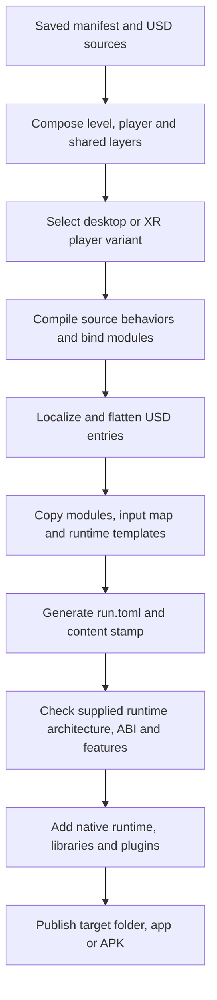

# Cook and package the experience

Cooking turns saved project files into a runtime payload: composed USD, compiled behaviors, input/controller configuration, registered spawn templates and a generated `run.toml`. Packaging adds the supplied native Runtime and its libraries in the target application's layout. You perform both steps from the installed Conductor application's **Build** menu.

## Run the first desktop build

1. Open `<projects>/signal-room/project.toml` in Conductor.
2. Save changes in each level and the project. The cook reads saved files.
3. Preview Hub using **Preview > Preview in Desktop** and check its rotating beacon, console and pointer. Stop the preview.
4. Choose **Build > Build Desktop Experience**.
5. Wait for completion and read the result, including any notes. For the sample, the output root is `<projects>/signal-room/build/desktop/`.
6. Launch the completed experience folder or app and test travel from Hub to Lab and back.

A complete authoring distribution supplies a compatible desktop Runtime beside Conductor, plus its native libraries and resources. If the result contains only `payload/`, the Runtime was not found. Obtain the complete compatible distribution, reopen the project and build again. The [installation checklist](../setup.md) covers the SDK and external Rust tools used to compile behaviors.

The **Build PCVR Experience** action needs a supplied Runtime with PCVR support. Quest and Vision Pro need their own supplied ARM64 runtimes. The menu selects a cook target; it does not build or upgrade native engine binaries. See [target preparation](targets.md) for the package contents and external tools needed by each target.

## What the build does



Conductor compiles behavior sources against the composed stage and binds the generated WASM through temporary layer opinions. A compile failure aborts the build. Your authored levels remain source files; cooking does not replace them with flattened output.

The current cook also validates native curve-placement bakes and authored animation clips in the saved sources and composed entries. A stale bake, placement now overlapping loaded-scene geometry, or invalid clip declaration aborts the cook before a replacement payload is published. Re-bake curves after changing their geometry/placement/settings, and use the clearance preview when the surrounding scene changes. Resolve invalid clip targets, ranges or source bindings before building again. The [USD authoring chapter](../composition/usd.md) describes the corresponding inspector controls.

Runtime clip commands and status are in-memory transport state. Save the clip declarations, references, relationships and behavior source that reproduce that state; playing a clip in the editor does not bake its current pose into your authored world.

Multi-level cooking repeats this preparation for each level, so the player and behavior owners are composed in the appropriate namespace. The process uses staging directories. A failed cook or packaging step preserves the previously published result, which means an existing output folder can be from an earlier build. Read the latest result before testing it.

## Inspect the sample payload

Two registered levels produce separate cooked level entries:

```text
build/desktop/
  payload/
    run.toml
    levels/
      hub/
        level.usdz
        behaviors/...
        input_map.toml
      lab/
        level.usdz
        behaviors/...
        input_map.toml
    behaviors/...
    assets/...
    input_map.toml
    ...schema and built-in resources...
  Signal Room/                    # Windows/Linux finished package
    idtx-runtime.exe              # Windows; idtx-runtime on Linux
    run.toml
    levels/...
    ...complete payload, native libraries and resources...
```

On macOS, the finished result is `Signal Room.app`; its payload is inside `Contents/MacOS/`, and native libraries are in `Contents/Frameworks/`. Generated module names and resource closures depend on the build. A configured transfer stage additionally creates a `transfer/` payload entry.

For a project with one level, the payload contains a top-level `stage.usdz` instead of the separate level registry. Preserve the whole payload or finished application, including plugins and resources. The USDZ alone is not the delivered experience.

The sample's generated manifest includes a structure like this; the actual file also contains runtime requirements and content stamps:

```toml
version = 2

[experience]
name = "Signal Room"
mode = "desktop"
target = "desktop"
fullscreen = true
levels = ["levels/hub/level.usdz", "levels/lab/level.usdz"]
start_level = "levels/hub/level.usdz"
```

Project manifest schema **1**, runtime manifest schema **2** and behavior guest ABI **3** are distinct version numbers. Paths in `run.toml` are payload-relative. Configure the source project and rebuild rather than relying on hand-edited generated manifests.

Cooked level IDs are the directory names, `hub` and `lab`. Confirm these when diagnosing a transition target that fails to resolve.

## Check runtime compatibility

The packager reads metadata embedded in the supplied Runtime. It checks its target architecture, behavior ABI/type compatibility and required features. A runtime lacking `pcvr` or an incompatible SDK/ABI is a distribution mismatch: obtain the corresponding authoring/runtime package from your supplier. Keep Conductor, the SDK and supplied target runtimes from the same compatible release together.

The final content stamp identifies the configuration and file inventory. Record that stamp with your project revision, Conductor/runtime release and test results. A hash identifies an artifact; it does not measure performance or prove successful device testing.

## Relocate the completed experience

Copy the **finished package**, not just `payload/`, to a different folder and launch it there. On Windows, for example:

```powershell
Set-Location "C:/IDTX/Releases/Signal Room"
& "./idtx-runtime.exe"
```

On macOS, open the copied `Signal Room.app`. Test both transitions, button actions and state persistence. This verifies that the delivered package resolves its own assets and native libraries without depending on your project folder. The running experience does not require the Rust compiler or authoring SDK.

## Flattening and remote dependencies

The walkthrough uses flattened USDZ entries with local assets. This makes its content closure straightforward to inspect and deliver.

`[build].loose_levels = true` requests loose asset closure for a compatible desktop/PCVR single-entry cook. It preserves source asset structure and instancing. The current multi-level cook uses its dedicated per-level path first; this flag does not produce loose per-level source packages. Quest and Vision Pro fall back to flattening for loose-entry mode with a warning.

HTTP(S) asset references remain external during cooking. Such experiences need a supplier-provided resolver-enabled Runtime, the appropriate network policy and runtime credentials. For an offline release, keep the dependency closure local and resolve every missing-reference diagnostic before shipping.

Leave **Embed dev login token** off for distributed packages. That optional development setting embeds a bearer credential in `run.toml`; an artifact containing it is intended only for your own device testing.

## Choose the target action

| Conductor action | Required supplied runtime | Output |
|---|---|---|
| **Build > Build Desktop Experience** | Matching host desktop Runtime and native resources. | Portable folder or macOS app. |
| **Build > Build PCVR Experience** | Windows Runtime with `pcvr` support. | Desktop folder configured for XR. |
| **Build > Build Quest Experience** | Android ARM64 runtime and dependency/resource tree. | Signed development APK when Android SDK/JDK tools are present; otherwise staging tree. |
| **Build > Build Vision OS > Build only** | visionOS ARM64 device runtime and resource tree. | Signed device app on macOS with Xcode/signing configured; otherwise staged unsigned app. |
| **Build > Build Vision OS > Build and deploy** | Same visionOS runtime, plus detected paired device. | Signed app with attempted installation and launch. |

Output roots are `build/desktop`, `build/pcvr`, `build/quest` and `build/visionpro` under the project. Each contains `payload/`; finished package names use the project name. A staged-only result or skipped deployment is reported in the completion note. Follow [target-device preparation](targets.md), then run the [acceptance checks](../testing.md) against the actual delivered artifact.
