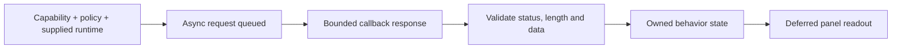

# 9. Extend the experience

Add one feature at a time and keep a visible checkpoint that identifies which subsystem owns the result. The base project needs no service, animated character or headset. The [complete specimen exercise](tutorial/05-spawning.md) is the first extension: its asset, behavior, opt-in layer and registry entry are all supplied in the book.

## Add sampled USD animation

Create assets/animated.usda in your experience with this complete stage, then open it in Conductor:

```usda
#usda 1.0
(
    defaultPrim = "World"
    upAxis = "Y"
    metersPerUnit = 1
    startTimeCode = 0
    endTimeCode = 48
    timeCodesPerSecond = 24
    framesPerSecond = 24
)
def Xform "World"
{
    def Cube "Animated"
    {
        double size = 0.25
        float3 xformOp:translate.timeSamples = {
            0: (-1, 1, -2),
            24: (1, 1, -2),
            48: (-1, 1, -2),
        }
        uniform token[] xformOpOrder = ["xformOp:translate"]
    }
}
```

Scrub the timeline to verify the three poses. At 24 time codes per second, the 0-to-48 range spans two seconds. A behavior’s dt is elapsed seconds; ctx.time_code() is the stage time code. Reference this asset into a level to integrate it, then check the composed result.

For behavior-controlled transport, use [the animation SDK](reference/behavior-sdk.md#named-events-and-animation): `ctx.animations().clip_on(owner, label)`, then Play/Pause/Stop/Seek/SetSpeed/SetLooping/Release through the corresponding methods with the playback grant. Author named clips on an actor with target/source relationships, range and channel settings; anonymous discovered groups remain available. Read `status` or `read_status` on a later tick to inspect the applied result. Use clip lifecycle events and bounded named-event posting with the events grant when another behavior needs notification. Catalog enumeration and marker subscriptions are still unavailable.

The [complete animation and routing exercise](tutorial/06-animation-and-routing.md) adds an actor clip, composed relationship binding, request event, completion handling and settled status to the local experience workflow. Its files are fully listed in the book and included as a companion exercise.

Keep sampled animation and the beacon’s rotation behavior on different transforms, or deliberately define their ownership. Accepted transport/edit commands acknowledge queueing rather than an immediately sampled pose.

## Add a dynamic physics prop

Create levels/physics.usda using this complete stage. Open it in Conductor and use Runtime preview for the falling-body check:

```usda
#usda 1.0
(
    defaultPrim = "World"
    upAxis = "Y"
    metersPerUnit = 1
    customLayerData = {
        dictionary idtx = {
            token stageKind = "level"
            string schemaVersion = "1"
        }
    }
)

def PhysicsScene "physicsScene"
{
    vector3f physics:gravityDirection = (0, -1, 0)
    float physics:gravityMagnitude = 9.81
}

def Xform "World"
{
    def Cube "Floor" (prepend apiSchemas = ["PhysicsCollisionAPI"])
    {
        double size = 1
        double3 xformOp:translate = (0, -0.1, -2)
        double3 xformOp:scale = (6, 0.2, 6)
        uniform token[] xformOpOrder = ["xformOp:translate", "xformOp:scale"]
    }
    def Cube "FallingCube" (
        prepend apiSchemas = ["PhysicsRigidBodyAPI", "PhysicsCollisionAPI"]
    )
    {
        double size = 0.3
        bool physics:rigidBodyEnabled = true
        bool physics:collisionEnabled = true
        double3 xformOp:translate = (0, 2, -2)
        uniform token[] xformOpOrder = ["xformOp:translate"]
    }
}
```

The Stage panel’s Physics section also provides **Activate Physics**, which authors the conventional root /physicsScene. This root is surfaced by level assembly composition. Inspect that scene and the body/collider attributes after composing a level with the player.

The cube should fall onto the floor in **Preview > Preview in Desktop**. The authoring viewport does not run rigid-body simulation. Register the level if it should ship, build again and test it in the finished player.

For a grab behavior, grant physics and use [Physics::body, suspend and resume](reference/behavior-sdk.md#runtime-physics-control). Suspend the tracked dynamic body while held, author its pose with StageEdit, then resume on release. Animated bodies and physics:kinematicEnabled bodies have different ownership from dynamic bodies. Attaching a generic behavior alone does not make a body kinematic.

Mesh convex hulls need prepared authoring data. Requesting a hull without its IdtxCollisionAPI hull arrays leaves it non-colliding. Begin with primitives for a reproducible exercise; use a supported authoring/baking workflow from your distribution before adding custom convex meshes. [Ray query channels](reference/behavior-sdk.md#scene-queries) distinguish interaction picking from physical collision.

## Extend the console with a readout

The [station file](example/usd-files.md) supplies the world panel, buttons and field properties. Add this child under its Console panel, adjusting positions to avoid overlap:

```usda
def IdtxWidgetFieldString "Temperature"
{
    string idtx:widget:value = "OFFLINE"
    float idtx:widget:fontSize = 30
    float2 idtx:widget:position = (0.62, 0.23)
}
```

A Console behavior method can update it with:

```rust
// Inside a method with ctx: &Ctx, propagating Result<()>:
ctx.stage_edit().set_widget_value("Temperature", "21.5 C")?;
```

This writes a deferred session-layer string to a panel-relative IdtxWidgetFieldString. Grant stage_edit. Button callbacks need widget and registration; a pointer behavior must route hits through ctx.widgets().handle(hit). Use the complete [pointer source](example/behavior-files.md) and preserve widgets.click in the input map. Check readability at the actual desktop/headset distance, including both visible text and the hit target.


*Renderer regression image illustrating panel readability. It is not a capture of this added Temperature field or the Conductor UI.*

For transient input or credentials, use ctx.widget().set_value/value instead of an authored display field; see [widgets](reference/behavior-sdk.md#widgets) for their capacity and lifetime. The [widget authoring reference](reference/widgets.md) adds radial sectors, polygon surfaces, clipped hit regions, background bubbling, explicit pointer sources and modal input ownership. `handle` reports occlusion; `handle_from` separates occlusion from actual handling.

## Sample authored curves by distance

Use `ctx.scene().curve(entity, curve_index)` to query a USD BasisCurves batch. The `scene_query` grant covers its metre arc length and allocation-free distance sampling. Length/input distances include composed scale and stage-unit conversion; output explicitly selects authored-local or normalized stage-world-metre coordinates. Clamp at endpoints or apply your own periodic wrapping. This lets a marker, camera cue or sampled drawing follow an authored path without copying a curve implementation into behavior code.

The [SDK reference](reference/behavior-sdk.md) supplies complete curve examples, supported bases, error conditions and the 256-sample bound. Bind the curve through a composed USD relationship and convert the returned point into the correct parent-local frame before authoring a pose. Test scaling, stage units, animated geometry and removed/unloaded targets in Runtime.

## Add live data with asynchronous HTTP

The [complete FetchStatus behavior](reference/behavior-sdk.md#asynchronous-http-and-authentication) demonstrates asynchronous GET and bounded response handling. To integrate that pattern:

1. Supply a deterministic HTTP endpoint and define its response contract.
2. Put its URL/configuration in typed authored context for your real behavior.
3. Grant net and configure the project’s [network policy](composition/project.md).
4. Confirm the supplied Runtime includes network support.
5. Handle synchronous request rejection, callback status zero, non-success HTTP status and oversized/malformed payloads.
6. Update a panel only after validating the callback data; give offline/failed states a visible readout.

Copy required response data while the callback is live. Avoid issuing a new request every frame without an in-flight/retry policy. Blocking HTTP wrappers are rejected by this player. Credentials require their separate authorized-origin contract; do not place secrets in USD context.



USD-authored OpenExec compute/dataflow is another integration path when the supplied distribution includes the relevant schemas, plugins and runtime support. This book does not supply a complete OpenExec graph exercise or promise its availability in every package. Use async behavior HTTP for the documented reproducible data path, and obtain the matching authoring reference before designing a compute graph.

## Use remote assets or collaboration when supplied

HTTP USD resolution and live editing collaboration are separate distribution capabilities. A reachable HTTP reference does not establish a collaboration session. Remote references can remain external through cooking, so verify the delivered player’s resolver, network/auth policy and offline behavior.

The base example deliberately keeps every dependency local. For collaboration, use the connection workflow and supported edit operations documented by your distributed application/server release; the behavior SDK is not a general collaboration API. Check supported edits with two authoring sessions before relying on synchronization for production work.

After each extension, repeat the relevant [testing boundary](testing.md), then rebuild and test the finished package. Provide your coding agent with the [agent contract](reference/agent-guide.md) so it works from supported APIs and the actual experience files.
