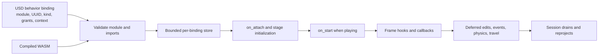

# Behavior host contracts

This page explains how the packaged player executes the [public SDK](behavior-sdk.md).
Use it to diagnose a behavior attachment, choose reasonable work limits, and
understand what a successful asynchronous call establishes. It is a contract
for experience authors; no engine source or engine test harness is required.
See [testing](../testing.md) for checks available from packaged Conductor.

## Attachment and compatibility

A compiled module is registered by UUID. Each live binding gets its own WASM
instance and persistent state; sharing a module does not share a behavior's
fields between prims. Stage-scoped bindings also have distinct identities,
even though their `ctx.entity()` value is null. The host validates imports,
module kind, and ABI compatibility before normal lifecycle dispatch.

The current ABI revision is `3`. The behavior macro generates the ABI identity;
the player rejects mismatches. After upgrading Conductor or changing the
supplied runtime, recompile your behavior sources with the matching bundled
SDK. `#[behavior]` also emits a descriptor recording
kind and available lifecycle hooks. The build tooling emits a `cdylib` guest
using `wasm32-unknown-unknown`, rather than a WASI program with arbitrary host
filesystem or process access.

Conductor stores behavior configuration on `IdtxBehaviorAPI` USD attributes.
There is no required behavior manifest sidecar: `idtx.toml` is unnecessary for
the authoring workflow in this book.

## Capability grants

The linker exposes only the granted host import buckets. A guest referencing
an ungranted import fails to link. The installed package's runtime support can
further restrict an operation; for example, HTTP requires a supplied player
with network support in addition to the binding's `net` grant and allowed
network policy. Project configuration cannot add code absent from a runtime
binary. Obtain the appropriate target runtime from the app distributor.

| Token | Authority |
|---|---|
| `input` | Named/source-filtered input reads, action resolution and modal capture. |
| `scene_query` | Prim lookup/hierarchy, visibility, composed relationships, curve queries and selected custom data. |
| `xform_write` | Bridge transform writes; also enables transform reads. |
| `stage_edit` | Deferred USD session-layer edits and prepared reference spawning. |
| `events` | Named event posting and current-event reads. |
| `xr_hmd` | Tracked pose, recenter, hand, and source snapshots. |
| `playback` | Deferred clip transport and bounded status queries. |
| `overlay` | Transient render feedback and drawing. |
| `physics` | Runtime rigid-body lookup and suspend/resume. |
| `auth_write` | Write/revoke credentials within authorized origin scopes. |
| `net` | Asynchronous host HTTP, additionally constrained by policy. |
| `widget` | Child/background registration, source-aware pointer handling, navigation/activation, focus highlights and transient input fields. |
| `level_control` | Deferred travel/cancellation and bounded experience state. |

Entity self, current time/delta, active camera, immutable binding context,
logging, hook-result reporting, and the widget event-read discriminator are
ambient imports. The widget discriminator is always linked because every
macro-generated event dispatcher needs to distinguish widget delivery from
ordinary named events. Transform reads are available when either
`scene_query` or `xform_write` is granted.

Conductor's **Verify capabilities** control builds the behavior and reports
required, missing, and unused grants. It checks the actual WASM imports against
the configured host interface without executing the behavior. A successful
**Cargo Check** establishes source compilation only; it does not establish
correct grants.

Use the exact tokens in the table. Unknown authored USD capability tokens may
be ignored rather than rejected, so a typo can leave a required operation
ungranted. Use the inspector's capability report to verify the actual set.

## Scheduling and errors

`on_attach` runs at attachment, possibly deferred by an exhausted aggregate
budget. The first playing update calls `on_start`. Behaviors with the new
`on_input_capture` hook then submit ownership before any normal input/update
consumer; the host arbitrates those claims together. Normal work follows with input edges,
`on_update`, and `on_late_update` for that instance. Authoring frames stop
started instances and run `on_editor_update`. Normal removal calls `on_stop`
if started, then `on_detach`; owning-entity destruction additionally calls
`on_destroy`. Missing exports are no-ops.

Callbacks and event fan-out share the same aggregate dispatch budget as
regular hooks. The host normally runs HTTP completions, updates, events, and
spawn completions in that phase order, with another event drain after newly
queued work. Under overload it rotates phase and instance access to the
budget. Pending delivery continuations can survive for a later frame.
Frame/input hooks are best-effort and are not replayed after invocation.
Events posted by a handler are queued for a later sweep, preventing unbounded
immediate recursion.

Modal captures arbitrate by priority and player/source/action scope, with
deterministic ties. Opening presses are guarded until neutral. Releasing a
capture while an action is held keeps that input suppressed until neutral, so
the underlying player cannot accidentally act on the same press. Retain one
token per open menu rather than acquiring on every frame, check `active()`,
and release on close. Tracking loss, unavailable targets and teardown also
expire ownership. Input capture shares the host's bounded work accounting.

Authored context changes reconcile by reattaching only the affected binding.
Its instance fields reset and attach/start hooks run again; configuration is
fixed for each callback. Malformed or oversized context is diagnosed as an
attachment failure rather than substituted with a fallback JSON value.
Composed relationship snapshots refresh separately when their owner or
forwarded dependencies change. An unchanged relationship revision stays stable.

A hook returning `Err(BehaviorError)` is reported back by SDK glue and logged
by the host. An error from `on_attach` or `on_start` marks initialization
failed and disables its work; required spawned bindings then prevent a
`Ready` completion. An ordinary later hook error is recorded/logged and does
not, by itself, permanently disable the instance. Use initialization failures
for invalid required configuration and handle expected optional conditions
inside the behavior.

The generated HTTP and spawn completion dispatchers currently discard the
handler's returned `Result`. Handle and log those callback failures explicitly;
returning `Err` from such a callback does not currently receive the lifecycle
hook's error-reporting behavior. Widget callbacks use the normal event
dispatch result path.

Guest panics, out-of-bounds access, fuel exhaustion, and other fatal traps
disable the affected instance. Wall-clock interrupt traps can arise from
scheduling delays, so the host tolerates eight such overruns; further
interrupts promote the instance to a fatal failure. An interrupted startup
hook is incomplete initialization and fails that startup. Do not use trapping
as a normal control-flow mechanism.

## Execution and deferred-work budgets

Defaults at the time of writing:

| Limit | Conductor | Runtime |
|---|---:|---:|
| Per-hook cooperative wall-clock allowance | 5 ms | 20 ms |
| Aggregate dispatch cooperative allowance | 5 ms | 20 ms |
| Per-hook fuel | 50,000,000 | 50,000,000 |
| Aggregate dispatch fuel | 200,000,000 | 200,000,000 |
| Combined initialization + ABI-probe allowance | 100 ms | 100 ms |
| Combined initialization + ABI-probe fuel | 50,000,000 | 50,000,000 |
| Linear memory per instance | 16 MiB | 16 MiB |

Fuel is deterministic WASM work metering. Epoch interruption is cooperative,
checked at guest safepoints; a 1 ms background epoch ticker bounds rounding
error but is subject to OS scheduling. It cannot preempt arbitrary blocking
native I/O inside a host import, which is why the old blocking HTTP entry
point is rejected. Compilation and import linking precede the startup budget.

One instance defaults to at most 256 pending operations and 2 MiB retained
queue bytes, shared across its deferred channels. One host defaults to 4096
pending operations, 16 MiB retained queue bytes, and 256 live instances.
Variable-length arguments default to a 64 KiB ceiling. A dispatch batch allows
1024 guest hook calls and 8192 recipient/export visits.

HTTP has an eight-request in-flight cap per instance and a default 1 MiB host
response ceiling, also clamped by network policy. The guest's callback
registry has its own bounded table. Widget registration is also bounded
host-wide: 512 handlers and 256 KiB registration bytes by default.

Queue credits stay occupied until work is drained, delivered, or cancelled.
Do not issue one new HTTP request or spawn every frame while waiting for a
completion. Keep an in-flight flag and release it in the terminal handler.
Use steady-state scene edits sparingly: authoring the same unchanged value
every frame still consumes queue/rehydration work.

The USD-authored `idtx:behavior:limits:memoryMb` setting is clamp-only: it can
lower the host ceiling and cannot raise it. Edit the Behavior inspector's
**Manifest config > memory cap (MiB)** setting when a binding needs a lower
limit.

## Deferred authoring and reference readiness

The SDK never hands a guest a live `UsdStage`. Session edits enqueue typed
commands; the session applies them and performs the relevant hydration path.
Structural edits update topology as well as rendering state. Native SDK
stubs do not exercise that pipeline.

Prepared reference spawn work carries requester identity/generation, context,
connections, and an opaque ticket. Syntax and byte limits are validated before
queueing; the session validates registration, selected parent, subtree scope,
and compatible connection types during application. `Projected` does not
imply every spawned behavior has initialized. `Ready` requires those bindings
to finish attachment and, during play, startup.

Callback spawning routes a terminal result to a registered function and
removes that handler. Requester stop/removal clears pending owned work, and an
unobservable pending spawn is removed rather than left orphaned. Use the
[spawning exercise](../tutorial/05-spawning.md) to configure a concrete parent
and a prepared prototype registration.

## Host-level events and playback

Use the public SDK rather than raw WASM imports. `events::post` requires a
concrete live target, and `events::broadcast` makes fan-out explicit. Both
validate a nonempty name of at most 256 bytes and payload of at most 64 KiB.
The older `ctx.events().emit/broadcast` handles remain compatible; a null
`emit` target follows the host's broadcast convention. Native free functions
return `NotFound`, while compatibility `Events` methods return inert `Ok(())`.

Update/late-update event posts are collected in attachment order, FIFO per
sender, and delivered before session edits. Posts from widget/event callbacks
wait for a later collection sweep. Delivery can continue across frames under
budget pressure; vanished/unloaded targets receive nothing. Queue acceptance
does not acknowledge receiver logic. The public event envelope remains target,
name and opaque bytes, without a generic sender-identity accessor.

`ctx.animations().clip(label)` addresses the calling attachment's own playback
owner; `clip_on(entity, label)` addresses an explicit owner. Stage-scoped
bindings must resolve their actor and use the explicit form. Current named
clips are authored through version-1 `idtx:animation:contractVersion` and
`clipNames` declarations, with uniform clip fields and composed target/source
relationships. Anonymous discovered groups remain addressed by owner path.
The [SDK reference](behavior-sdk.md#authored-named-clips-and-pose-ownership)
contains the exact USD contract and bounds.

Play, pause and seek acquire independent sampling ownership. Another action
on the same owner/channel interrupts the previous one; overlaps across
different owners/channels are rejected. Stop rewinds without releasing
already acquired ownership. `release()` restores containing-timeline
sampling. This prevents animation and behavior transforms from silently
competing. Queueing a release and immediately writing a pose in the same hook
does not establish the ordering; wait for the reconciled ownership state.

Transport is applied after behavior dispatch and sampled on a later animation
tick. `Clip::status/read_status` provide complete bounded JSON or an owned
typed snapshot, including current time, state, run ID and the last command's
application result/error. Status needs `playback` and at most 8192 scratch
bytes; a missing owner/clip reports `NotFound`. Native status is unavailable.
The free `playback::command` also exists; use an explicit nonempty label
because the current host rejects an empty default-clip request.

The session emits ordinary named events `animation.completed`,
`animation.interrupted` and `animation.failed` to bindings on the clip owner.
Their JSON has `owner` entity bits, `clip`, `channel`, `run_id` and `error`.
Compare a notice's run ID with durable current status before restoring an idle
animation or taking another action. Notices use bounded queues and can be
dropped under pressure; state remains queryable for recovery. The SDK now
supports authored named clips, status reads and these lifecycle notices. Clip
catalog enumeration, arbitrary marker subscription, attribute watches and
generic sender-aware routing are still absent.

## Relationship, curve and widget snapshots

Relationship queries read the forwarded targets prepared from native USD
composition. They preserve ordered slots and report Live/Invalid/Unloaded
availability, full count, written count, resolved state and revision. No USD
query or JSON path expansion occurs inside a behavior hook. Inspect truncation
and unresolved forwarding before selecting a target, and refresh handles when
the revision changes or the level ends.

Curve queries similarly read prepared `BasisCurves` geometry. Arc distances
and lengths are normalized stage-world metres, with explicit Local or
StageWorldMetres output. The current backend evaluates linear and cubic
Bézier paths. Unsupported bases/types are `TypeMismatch`; invalid geometry,
indices or sampling bounds fail rather than silently reducing accuracy.
Caller output is bounded to 256 samples per call. Native SDK stubs return
`NotFound` and do not evaluate a path.

World-widget processing separates **occlusion** from **handling**. The legacy
`Widgets::handle` boolean means the pointer is blocked, even over blank panel
content; `handle_from` exposes both flags and accepts explicit source/action.
An enabled registered child receives first refusal, then an unhandled area
can bubble to an `on_panel_click` handler. Direct activation and navigation
validate current panel membership, clipping and enabled/visible state. A
confirmation is consumed once per pointer source during dispatch. Clear a
retained focus highlight when closing a menu; it is separate from the cached
panel raster. See [widget APIs](behavior-sdk.md#panel-backgrounds-pointer-identity-and-direct-navigation).

## Verification in packaged Conductor

1. Select the prim with the behavior attachment and expand its **Behavior**
   inspector. Save the source file and authored configuration.
2. Choose **Cargo Check** and inspect the compiler result. This uses the
   bundled SDK and the installed Rust WASM toolchain.
3. Choose **Verify capabilities** and compare required, missing, and unused
   grants. Correct missing grants in **Manifest config** and verify again.
4. Use the transport to test initialization and behavior updates, then
   **Preview > Preview in Desktop** for the player/input/physics path.
5. Build a desktop experience and test travel/spawning against its generated
   `run.toml` registry. Repeat acceptance on every supported target device.

Neither inspector check executes the behavior. A correct import report cannot
establish valid scene paths, typed context, event receiver logic, or a Ready
spawn completion. Keep expected visible results and log lines with each
experience check. The [coding-agent contract](agent-guide.md) describes how to
report these separate levels of evidence.
