# Behavior SDK reference

This reference describes the behavior authoring API used by this book. Use it
with the **behavior SDK supplied in your Conductor package**. Engine source
access is unnecessary. [Setup](../setup.md) explains the package layout and
Rust toolchain needed by Conductor's compiler.

Use this page for exact author-facing signatures and [Behavior host contracts](behavior-host.md)
for execution limits, attachment, errors, and deferred work. A coding agent can
start with the [experience authoring contract](agent-guide.md), then follow
the detailed reference sections linked there.

This API edition uses guest ABI **3**. ABI compatibility alone does not mean
every older package includes all additive SDK wrappers described here.
**Cargo Check** checks your source against the installed SDK; **Verify capabilities**
builds a WASM module and checks its imports against the binding's grants.
If an API is absent, obtain a matching Conductor/runtime package or use the
documented API that your package supplies.

The SDK is `#![no_std]` and designed for allocation-free behaviors.
Conductor compiles each author entry and its helper modules into a
`wasm32-unknown-unknown` module.
The same source can compile natively for logic tests, where host calls use inert
stubs. Those stubs do not simulate a stage, input device, HTTP server, or physics.

## Start a behavior

**Always begin in Conductor’s Inspector > Behavior panel**, using
**Create Behavior…** or **Edit Code** for an existing attachment. This prepares
the Cargo and VS Code workspace containing the author source and SDK context,
so rust-analyzer can provide code completion, navigation and syntax/type checks.
Follow the [workspace workflow](../tutorial/03-behaviors.md#start-every-edit-from-the-inspector)
and use **Set up rust-analyzer** if prompted.

An author file uses ordinary line comments, a state type implementing `Default`,
and `#[behavior]` on an inherent `impl`. Conductor supplies the generated
`#![no_std]` crate wrapper and loads your entry as a normal Rust module.
Ordinary helper modules, source-relative includes and module documentation
(`//!`) are supported. Keep crate-level `#![no_std]` configuration and an
additional panic handler out of the author source.

```rust
use idtx_behavior_sdk::prelude::*;

#[derive(Default)]
pub struct ToggleVisibility {
    hidden: bool,
}

#[behavior(kind = "runtime")]
impl ToggleVisibility {
    fn on_start(&mut self, _ctx: &Ctx) -> Result<()> {
        self.hidden = false;
        Ok(())
    }

    fn on_interact(&mut self, ctx: &Ctx) -> Result<()> {
        self.hidden = !self.hidden;
        ctx.stage_edit().set_self_visibility(!self.hidden)
    }
}
```

Grant `stage_edit` to this binding. The capability is authored on the USD
behavior binding; it is not an argument to `#[behavior]`. The interaction hook
runs when the application dispatches an interaction to the owning prim; its
existence alone does not create a pointer or an input mapping.

`#[behavior]` defaults to `kind = "runtime"`; the other supported token is
`kind = "editor"`. Unknown macro arguments and kind tokens are compile errors.
The macro generates lifecycle exports, ABI identification, the persistent
instance slot, and HTTP, widget, and spawn callback dispatch. Keep one behavior
type with one annotated `impl` per compiled module. Add regular helper methods
to the same `impl` or unannotated `impl` blocks.

The generated Conductor skeleton contains `todo!()` hook bodies. Replace or
delete every placeholder before playing: executing `todo!()` traps the guest.

## Lifecycle signatures

All hooks return the SDK's `Result<()>`. Hooks are optional; remove the methods
you do not use. Instance fields persist across hooks and frames.

| Hook signature, after `&mut self` | Intended use |
|---|---|
| `on_attach(ctx: &Ctx)` | Initialize when the host attaches the binding. |
| `on_start(ctx: &Ctx)` | Initialize when that instance enters play. |
| `on_input_capture(ctx: &Ctx)` | Submit modal input ownership before normal input/update consumers. |
| `on_input(ctx: &Ctx, action: InputActionId, phase: InputPhase)` | Receive input edges before the frame update. |
| `on_update(ctx: &Ctx, dt: f32)` | Advance running behavior; `dt` is seconds. |
| `on_late_update(ctx: &Ctx, dt: f32)` | Follow the instance's regular update. |
| `on_editor_update(ctx: &Ctx, dt: f32)` | Update while authoring. |
| `on_interact(ctx: &Ctx)` | React to an application-dispatched prim interaction. |
| `on_event(ctx: &Ctx)` | Read a named event through `ctx.event()`. |
| `on_stage_event(ctx: &Ctx, event: StageEvent)` | React to stage-wide lifecycle notifications. |
| `on_stop(ctx: &Ctx)` | End a started play session. |
| `on_detach(ctx: &Ctx)` | Release the binding. |
| `on_destroy(ctx: &Ctx)` | React to removal of the owning entity. |

`StageEvent` variants are `Loaded`, `Unloading`, `PlayStart`, `PlayStop`,
`Paused`, and `Resumed`. Stage-level event broadcasts go to stage-scoped
bindings. A stage-scoped binding receives a null `ctx.entity()`; resolve concrete
prims with `Entity::find`. `StageEvent::as_token()` provides a diagnostic name.

`kind` is module/binding metadata checked at attachment and used by shipping
policy. The host's `PlayState` selects its update family. Do not assume that
declaring a kind automatically schedules a hook while the relevant transport
state is inactive. A stop/start cycle can call `on_start` again on the retained
instance; reset play-specific state there.

Under normal load, the host delivers completed HTTP work, input/update work,
named/widget events, and completed spawns in phases. It rotates phase and
instance priority under overload. Do not depend on the order of two unrelated
behaviors, or use `on_late_update` as a promise that every other behavior has
already updated. See [host scheduling](behavior-host.md#scheduling-and-errors).

## `Ctx`: entry points

| Method | Return | Meaning / required grant |
|---|---|---|
| `entity()` | `Entity` | Owning entity; null for stage scope. |
| `delta_seconds()` | `f32` | Current frame delta. |
| `time_code()` | `f64` | Current stage time code; this is not seconds. |
| `camera()` | `Option<CameraView>` | Active view camera, with stage-space ray and matrix; ambient, no grant. |
| `context::<T>(&mut scratch)` | `Result<T>` | Immutable typed binding context; ambient, no grant. |
| `stage_edit()` | `StageEdit` | Deferred USD session-layer operations; `stage_edit`. |
| `scene()` | `Scene` | Queries, named children, custom data; `scene_query`. |
| `event()` | `events::Event` | Current named event; `events`. |
| `events()` | `events::Events` | Deferred targeted/broadcast event emission; `events`. |
| `animations()` | `animations::Animations` | Deferred clip playhead transport; `playback`. |
| `xr()` | `XrHmd` | Tracked poses, joints, sources; `xr_hmd`. |
| `physics()` | `Physics` | Runtime body lookup and suspend/resume; `physics`. |
| `highlight()` | `Highlight` | Transient per-prim appearance; `overlay`. |
| `draw()` | `Draw` | Transient world-space lines and markers; `overlay`. |
| `widget()` | `Widget` | Panel-side click registration and transient fields; `widget`. |
| `widgets()` | `Widgets` | Pointer-side widget handling; `widget`. |
| `level()` | `Level` | Deferred travel and carried state; `level_control`. |

Creating a grouping handle is cheap. Its operations determine which host
imports the compiled WASM needs. Conductor's import analysis is the authority
for the final required capability set.

## Entities and transforms

The SDK's `Entity` and `Transform` types are exported by `prelude::*`:

```rust
// These types are already exported by prelude::*:
// Entity: opaque, Copy, generation-checked handle.
// Transform: Copy, Default, with these public fields:
// translation: Vec3, rotation: Quat, scale: Vec3.

use idtx_behavior_sdk::prelude::*;

fn place_authored_prim(ctx: &Ctx, position: Vec3) -> Result<()> {
    let pose = Transform { translation: position, ..Transform::default() };
    ctx.stage_edit().set_self_transform(&pose)
}
```

`Transform::default()` is zero translation, identity rotation, and unit scale.
`to_matrix()` composes scale, rotation, and translation; `from_matrix(Mat4)`
decomposes the matrix. Shear and negative scales use glam's best-effort
decomposition. Use finite values, normalized quaternions, and nonzero scales.

| Entity operation | Meaning |
|---|---|
| `Entity::find(path) -> Result<Entity>` | Resolve an absolute USD prim path. |
| `is_null() -> bool` | Test the null / stage-root handle. |
| `get_xform() -> Result<Transform>` | Read the host bridge's local transform component. |
| `world_xform() -> Result<Transform>` | Read decomposed world transform. |
| `world_matrix() -> Result<Mat4>` | Compose the world transform into a matrix. |
| `local_to_world(&pose) -> Result<Mat4>` | Treat this entity as parent: `parent_world * pose`. |
| `parent() -> Result<Entity>` | Resolve parent. |
| `child(index: u32) -> Result<Entity>` | Resolve child by index. |
| `child_count() -> u32` | Direct child count. |
| `visible() -> Result<bool>` | Effective visibility including ancestors. |
| `set_xform(&pose) -> Result<()>` | Write the behavior host's bridge transform component. |

Hierarchy, lookup, and visibility require `scene_query`. Transform reads are
linked when either `scene_query` or `xform_write` is granted. `set_xform` requires
`xform_write`.

For USD-hydrated scene prims, use `ctx.stage_edit().set_transform(entity, &pose)`
or `set_self_transform`. `Entity::set_xform` writes the host's behavior bridge
component; a hydrated prim may not have that bridge component for either local
reads or writes. `world_xform()` has a scene-backend fallback for hydrated
prims. Retain your intended local pose in behavior state or its authored context
instead of assuming that `get_xform()` can read a USD prim's local transform. The
session-layer path is the one used by the shipped player behaviors and updates
USD followed by hydration. An accepted deferred write is not immediately
observable inside the same hook.

Opaque handles belong to one live scene. They can become stale after removal,
reprojection, or level changes. Cache them only while that ownership is valid;
handle `StaleHandle` and resolve again when needed. Never persist raw entity
bits as level-carried state.

The SDK exports pinned `Vec3`, `Vec4`, `Quat`, and `Mat4`. Use these
reexports to avoid a separate glam version at the host/guest boundary. The
`math` helpers are:

| Helper | Result |
|---|---|
| `relative_transform(frame, target_world)` | `frame.inverse() * target_world`. |
| `local_in_parent(frame, offset, parent_world)` | `parent_world.inverse() * frame * offset`. |
| `ray_from_matrix(matrix)` | Stage-space origin and normalized local `-Z` direction. |

## Typed contexts and custom data

Contexts are bounded JSON contracts decoded with SDK-reexported Serde. Prefer
owned fixed-capacity strings for state you retain. Explicitly route Serde derives
to the reexport: a generated single-file behavior directly depends on the SDK,
and does not need its own `serde` dependency.

```rust
use idtx_behavior_sdk::prelude::*;

#[derive(Deserialize)]
#[serde(crate = "idtx_behavior_sdk::serde")]
struct Settings {
    speed: f32,
    label: ContextString<64>,
}

fn read_settings(ctx: &Ctx) -> Result<f32> {
    let mut scratch = [0u8; 8192];
    let settings: Settings = ctx.context(&mut scratch)?;
    log::info(settings.label.as_str());
    Ok(settings.speed)
}
```

`ContextString<N>` is `arrayvec::ArrayString<N>`; `N` bounds UTF-8 bytes, not
characters. `context::decode::<T>(bytes)` is the pure decoder for native tests.
It rejects malformed input, trailing non-whitespace data, and oversize JSON.
The maximum context size is `abi::MAX_BEHAVIOR_CONTEXT_BYTES`, currently 8192.
The scratch slice must not exceed that maximum. An undersized buffer fails
rather than returning a partial contract.

`ctx.context` reads the binding's immutable snapshot seeded before attachment.
An authored context edit is applied at a session reconciliation boundary: the
affected binding is reattached, its Rust fields reset, and attach/start hooks
run again as appropriate. Other copies of the same module retain their own
state. Values do not change within a running callback. Keep mutable gameplay
state in fields or the level-state store, and use USD relationships for object
bindings. For selected authored prim data, use:

```rust
use idtx_behavior_sdk::prelude::*;

#[derive(Deserialize)]
#[serde(crate = "idtx_behavior_sdk::serde")]
struct ExhibitMetadata {
    title: ContextString<80>,
}

fn inspect_metadata(ctx: &Ctx, exhibit: Entity) -> Result<()> {
    let mut scratch = [0u8; 8192];
    let metadata: Option<ExhibitMetadata> =
        ctx.scene().custom_data(exhibit, "idtx", &mut scratch)?;
    if let Some(metadata) = metadata {
        log::info(metadata.title.as_str());
    }
    Ok(())
}
```

`Scene::custom_data` requires `scene_query` and reads a bounded snapshot; missing
keys yield `Ok(None)`, invalid authored data yields an error. Keys must be
nonempty and at most 256 bytes. `Scene::child(parent, name)` resolves an exact
named direct child and returns `Result<Option<Entity>>`; this avoids assembling
a child path from a possibly truncated query result.
The packaged session snapshots the authored `customData` dictionary `idtx`.
Nested keys such as `"idtx:assetOverview:title"` traverse that snapshot using
colon-separated identifier segments. Missing keys yield `Ok(None)`; malformed
data, a non-object intermediate value or a decoding mismatch yields an error.
The key must be nonempty, at most 256 bytes, and each segment must be an ASCII
identifier. This does not expose arbitrary live USD properties or promise
other custom-data root keys. Use `ctx.context()` for the binding's portable
configuration contract.

This SDK has no `#[param]` field macro or public typed parameter getter.
Use the context contract above for author-facing configuration. Legacy
parameter-related attributes do not provide a supported getter in this API.

## Input

The `input` module exposes named actions, independent of keyboard or
controller details. Grant `input` and
declare the consumed action names/types on the binding; bind physical sources
in the experience's input map.

```rust
use idtx_behavior_sdk::prelude::*;

#[derive(Default)]
pub struct InputToggle {
    action: Option<input::Action>,
    hidden: bool,
}

#[behavior]
impl InputToggle {
    fn on_start(&mut self, _ctx: &Ctx) -> Result<()> {
        self.action = Some(input::action("toggle_exhibit"));
        self.hidden = false;
        Ok(())
    }

    fn on_update(&mut self, ctx: &Ctx, _dt: f32) -> Result<()> {
        if self.action.is_some_and(|action| action.pressed()) {
            self.hidden = !self.hidden;
            ctx.stage_edit().set_self_visibility(!self.hidden)?;
        }
        Ok(())
    }
}
```

This binding needs `input` and `stage_edit`. Resolve an action once at start,
then cache it for that session. `Action` is `Copy`; its `id()` is an
`InputActionId`, with `UNRESOLVED` / zero for an unknown name.

| API | Meaning |
|---|---|
| `input::action(name)` | Resolve to `Action`. |
| `Action::phase()` | `None`, `Pressed`, `Held`, or `Released`. |
| `Action::from_source(source)` | Return an action filtered to one `PointerSource`. |
| `Action::source()` | Explicit source, or the router's current independently resolved source. |
| `pressed()` | First active frame only. |
| `held()` | Pressed or held. |
| `released()` | First inactive frame only. |
| `axis()` | Scalar action value in `[-1, 1]`. |
| `axis2()` | Two-component `(f32, f32)` action value. |
| `input::axis(name)` / `axis2(name)` | Resolve and read in one call. |
| `input::mouse_delta()` | `(dx, dy)` pixels for the current frame. |
| `input::scroll()` | Current scroll delta. |

Use the `on_input` hook when edge dispatch is more convenient than polling.
Compare its `InputActionId` with a cached action's `id()`. Under overload, frame
and input hooks are best-effort; do not build a correctness-critical state
machine that assumes every input edge will survive exhausted dispatch budgets.

### Pointer sources and modal input capture

`input::PointerSource` is `Desktop`, `Left`, `Right` or `Unspecified`. Aggregate
input does not imply a particular hand; `Unspecified` means unknown or
ambiguous. Source-filtered actions have independent edges, so releasing one
controller does not fabricate an edge for another. Cache separate source
views when an experience needs both hands:

```rust
use idtx_behavior_sdk::prelude::*;

fn right_confirmation() -> input::Action {
    input::action("menu.confirm").from_source(input::PointerSource::Right)
}
```

For a modal menu, retain an `input::CaptureToken` in your behavior. Acquire it
from `on_input_capture(&mut self, ctx: &Ctx) -> Result<()>` so competing claims
arbitrate together before normal input hooks and updates. The hook sees raw
input for policy decisions; it must not activate widgets. An acquisition made
in an ordinary hook takes effect at a later arbitration boundary.

| Capture API | Contract |
|---|---|
| `CaptureToken::acquire(player: Entity, target: Entity, source: PointerSource, priority: i32, actions: &[Action]) -> Result<CaptureToken>` | Request exclusive ownership of the resolved actions for a player/source. |
| `active(&self) -> bool` | Whether this retained request currently wins arbitration. |
| `release(&mut self)` / dropping the token | Release the request; release is also enforced on teardown, target removal/unavailability and tracking loss. |

The source must be explicit, the action list nonempty with at most 32 entries,
and all actions must be resolved and declared by the binding. `target` must
be live. A null `player` asks the host to use the binding's inferred player;
an explicit player scopes the claim. Higher priorities win; ties are resolved
deterministically rather than by behavior update order. The current host
allows at most 128 retained captures, sharing deferred-work accounting.

```rust
use idtx_behavior_sdk::prelude::*;

fn capture_menu(player: Entity, panel: Entity) -> Result<input::CaptureToken> {
    let confirm = input::action("menu.confirm");
    let navigation = input::action("menu.navigate");
    input::CaptureToken::acquire(
        player, panel, input::PointerSource::Right, 10,
        &[confirm, navigation],
    )
}
```

Retain the returned token instead of acquiring one every frame. Gate normal
menu work on `active()` and release on close. The press that opens a capture
is guarded until neutral, so it cannot also confirm the menu. Releasing a
capture while an action is held suppresses that action until neutral rather
than exposing it to the underlying player. Native acquisition returns an
inert token and `active()` is false. Unfiltered native source reads are
`Unspecified`; an explicitly filtered action retains its requested source.

## Scene queries

`ctx.scene()` queries the hydrated scene snapshot with `scene_query`. Scene query rays are
in stage/world space.

```rust
use idtx_behavior_sdk::prelude::*;

fn gaze_cue(ctx: &Ctx) -> Result<()> {
    let Some(camera) = ctx.camera() else { return Ok(()); };
    let options = RayOpts::new().interaction_only().max_distance(20.0);
    if let Some(hit) = ctx.scene().raycast(
        camera.ray.origin, camera.ray.forward, &options,
    ) {
        let target = ctx.scene().collision_body(hit.entity).unwrap_or(hit.entity);
        ctx.highlight().outline_with(target, Vec4::new(0.1, 1.0, 0.4, 1.0), 4.0)?;
    }
    Ok(())
}
```

The default `RayOpts` respects visibility, requires enabled
`PhysicsCollisionAPI` colliders, accepts any USD type/purpose/channel, and has no
distance bound. The editor's viewport picking can still select a prim that
this default runtime query ignores.
`IdtxCollisionAPI` supplements the standard collider with IDTX channels and
prepared hull data; it does not activate collision by itself. Author the
standard `PhysicsCollisionAPI` gate alongside it. The old
`idtx:collision:enabled` vocabulary is unsupported.

| Builder | Effect |
|---|---|
| `of_type(token)` / `exclude_type(token)` | Include or exclude a USD type. |
| `require_collidable()` | Require enabled colliders; already the default. |
| `include_noncollidable()` | Also allow geometry without an enabled collider. |
| `include_hidden()` | Allow invisible prims. |
| `purpose(mask)` | Filter `abi::PURPOSE_*` bits. |
| `collision_channel(mask)` | Filter `abi::CHANNEL_*` bits; zero means any. |
| `interaction_only()` / `physics_only()` | Select the respective collision channel. |
| `max_distance(distance)` | Limit distance in stage units; `<= 0` is unbounded. |
| `block_widgets()` | Let world-space widget quads compete for nearest hit. |

`raycast(origin, direction, &options)` returns `Option<RayHit>`. The hit has
`entity`, `position`, `distance`, `path`, and `widget`; `is_widget()` exposes
the last flag. A `PrimPath` stores at most 256 bytes. Check `truncated()` before
using its `as_str()` as a complete path; prefer `hit.entity` for operations.

`Scene::find_by_type(token, callback)` enumerates `(path: &str, entity: Entity)`
without a guest heap and returns the count. `Scene::collision_body(hit)` walks
to the whole-asset collision root, which may differ from the physics body.

For teleport-style casts, create `ArcLaunch { origin, dir, speed, gravity,
max_time }` and call `arc_cast(&launch, &options, &mut points)`. `ArcHit` reports
`hit`, `entity`, `position`, `distance`, `point_count`, `true_point_count`, and
`path`; render only the written prefix. The current arc wire parameters carry
the visibility/type/purpose flags, but do not carry the ray's collision-channel
mask. Do not assume `physics_only()` or `interaction_only()` filters arcs.
The arc helper uses downward acceleration along the Y axis.

### Composed relationship targets

Use `ctx.scene().relationship_targets(entity, name, output)` to bind a behavior
to authored objects. The host snapshots native forwarded USD targets after
composition. References, variants and forwarding relationships therefore
remap paths in the composed occurrence; a path stored inside JSON does not.
These types are exported from `idtx_behavior_sdk::scene`, outside the prelude.

| Type/API | Meaning |
|---|---|
| `RelationshipTarget::default()` | Empty caller-buffer slot. |
| `RelationshipTarget::status() -> TargetStatus` | `Live`, `Invalid` or `Unloaded`. |
| `RelationshipTarget::entity() -> Option<Entity>` | Entity only for a live target. |
| `RelationshipTargets` | Result fields `revision: u64`, `total: usize`, `written: usize`, `resolved: bool`. |
| `RelationshipTargets::truncated()` | `written < total`; the supplied buffer did not hold all ordered targets. |

For an asset rooted at `/Exhibit`, author a binding on its button:

```usda
# Inside the reusable asset's /Exhibit/Button prim:
custom rel idtx:bindings:controller = </Exhibit/Controller>
```

This complete helper requires `scene_query` and accepts exactly one resolved
live target:

```rust
use idtx_behavior_sdk::prelude::*;
use idtx_behavior_sdk::scene::RelationshipTarget;

fn controller_for(ctx: &Ctx) -> Result<Entity> {
    let mut targets = [RelationshipTarget::default(); 1];
    let result = ctx.scene().relationship_targets(
        ctx.entity(), "idtx:bindings:controller", &mut targets,
    )?;
    if !result.resolved || result.truncated() || result.total != 1 {
        return Err(ErrorCode::InvalidArgument.into());
    }
    targets[0].entity().ok_or(ErrorCode::NotFound.into())
}
```

`NotFound` means the relationship is absent; an existing empty relationship
succeeds with total zero. Slots preserve forwarded-target order, including
unresolved entries. A property target or missing/non-live prim is `Invalid`;
a target beneath an unloaded payload is `Unloaded`. An unresolved forwarding
chain, such as a cycle, can return partial targets with `resolved == false`.
Choose a policy for those cases rather than silently accepting the first slot.

Names are nonempty and at most 256 bytes. Caller buffers hold at most
`abi::MAX_RELATIONSHIP_TARGETS`, currently 4096 entries; only
`output[..written]` is updated. There is no offset/pagination argument. The
revision remains stable for unchanged paths, availability and resolved state;
refresh cached results when it changes. Liveness is checked again when
targets are copied. Cached handles still belong to the current scene and
must not cross level teardown. Native relationship queries return `NotFound`.

### Native BasisCurves by distance

`ctx.scene().curve(entity, curve_index) -> Result<Curve>` selects an explicit
curve within a native `BasisCurves` batch. It validates the selection by
querying its length. Import `Curve`, `CurveSample` and `CurveSpace` from
`idtx_behavior_sdk::scene`; these are not prelude exports.

| Method | Contract |
|---|---|
| `Curve::length(self) -> Result<f64>` | Total arc length in normalized stage-world metres. |
| `sample_distance(self, distance: f64, space: CurveSpace) -> Result<CurveSample>` | One point and unit tangent at an arc distance in metres. |
| `sample_distances(self, distances: &[f64], space, out: &mut [CurveSample]) -> Result<()>` | Caller-buffer sampling, at most 256 distances. |
| `CurveSpace::Local` | Output points in authored curve-local units. |
| `CurveSpace::StageWorldMetres` | Output points after composed transforms, stage-unit conversion and Y-up normalization. |

`CurveSample` has `point: [f64; 3]` and `tangent: [f64; 3]`. Length and input
distances are always metres, even when output space is Local. Nonuniform
scaling affects arc length. Finite distances clamp to endpoints, including
periodic curves; perform explicit modulo by a nonzero length for looping.

```rust
use idtx_behavior_sdk::prelude::*;
use idtx_behavior_sdk::scene::{CurveSample, CurveSpace};

fn sample_path(ctx: &Ctx, path: Entity) -> Result<[CurveSample; 3]> {
    let curve = ctx.scene().curve(path, 0)?;
    let length = curve.length()?;
    let mut samples = [CurveSample::default(); 3];
    curve.sample_distances(
        &[0.0, length * 0.5, length],
        CurveSpace::StageWorldMetres, &mut samples,
    )?;
    Ok(samples)
}
```

Grant `scene_query`. Current native evaluation supports linear and cubic
Bézier BasisCurves with nonperiodic or periodic wrap. Cubic nonperiodic
curves need `3n+1` points per curve; periodic curves need `3n`. Other bases,
NurbsCurves and HermiteCurves are unsupported and report `TypeMismatch`.
An invalid batch index, geometry/tolerance limit or nonfinite request reports
`InvalidArgument`; a non-curve/missing snapshot reports `NotFound`. An undersized
output slice, more than 256 distances, NaN or infinity is rejected without
writing guest output.

The handle stores entity generation and curve index, not frozen geometry.
Authored changes are visible after the next snapshot; removal invalidates the
entity handle. A zero-length curve returns its first point and a deterministic
fallback tangent. These queries read prepared snapshots rather than calling
live USD from a hook. Native SDK curve queries return `NotFound` and do not
evaluate authored geometry.

## Session edits

`StageEdit` methods
enqueue work. The session applies that work to its USD session layer and
reprojects after behavior hooks. An `Ok(())` acknowledges queue acceptance,
not successful immediate USD mutation.

| Method | Operation |
|---|---|
| `set_transform(entity, &pose)` / `set_self_transform(&pose)` | Author local transform. |
| `set_visibility(entity, visible)` / `set_self_visibility(visible)` | Author `inherited` or `invisible`. |
| `define_prim(parent, type_name, name)` / `define_child(type_name, name)` | Define a child with a USD type; empty type is typeless. |
| `remove_prim(entity)` / `remove_self()` | Remove the target subtree from the session edit path. |
| `attach_hud(camera, name, image, [width, height], opacity)` | Create a centered `IdtxHud` child. |
| `attach_self_hud(name, image, size_px, opacity)` | Attach a HUD below self. |
| `attach_crosshair(image, size_px)` | Centered `Crosshair` at full opacity. |
| `set_widget_value(child_name, value)` | Author a string readout below this panel. |

HUD size `[0, 0]` uses native image pixels. Widget names are panel-relative
namespace paths such as `"Row/Value"`; target an `IdtxWidgetFieldString` when
writing a string value. These readouts become session-layer USD opinions.
For secret or editable transient input values, use `Widget::set_value` instead.

The current public SDK does not have a general `set_attribute`, asset-reference
mutation, or unrestricted USD handle. Define richer reusable structures as
prepared prototypes and spawn them through the bounded interface below.

## Reference spawning and callbacks

Reference spawning selects a **registered, prepared prototype ID**, not an
arbitrary file path or network URL. Preparation belongs to the runtime/cook
pipeline. The guest supplies a parent, new child name, local transform, owned
typed context, and optionally attribute connections.

```rust
use idtx_behavior_sdk::prelude::*;

#[derive(Serialize)]
#[serde(crate = "idtx_behavior_sdk::serde")]
struct PanelContext {
    title: &'static str,
}

#[derive(Default)]
pub struct SpawnPanel {
    panel: Option<Entity>,
}

#[behavior]
impl SpawnPanel {
    fn on_start(&mut self, ctx: &Ctx) -> Result<()> {
        let pose = Transform {
            translation: Vec3::new(0.0, 1.0, -2.0),
            ..Transform::default()
        };
        ctx.stage_edit().spawn_reference_async(
            ctx.entity(), "InfoPanel", "info_panel", &pose,
            &PanelContext { title: "Welcome" }, Self::panel_finished,
        )?;
        Ok(())
    }

    fn panel_finished(&mut self, _ctx: &Ctx, result: SpawnResult) -> Result<()> {
        match result.status() {
            SpawnStatus::Ready => self.panel = Some(Entity::from_wire(result.entity)),
            SpawnStatus::Failed => {
                log::warn("Info panel failed to become ready");
                self.panel = None;
            }
            _ => {} // Callback delivery supplies only terminal states.
        }
        Ok(())
    }
}
```

This source compiles against the SDK, but running it requires a prepared
`info_panel` registration in the runtime manifest and a concrete owner prim.
Grant `stage_edit`. The
callback type is `fn(&mut B, &Ctx, SpawnResult) -> Result<()>`. A handler cannot
capture a closure environment; retain application state in behavior fields.

| API | Return / behavior |
|---|---|
| `spawn_reference(parent, name, prototype_id, &pose, &context)` | `Result<SpawnTicket>`; poll later. |
| `spawn_reference_with_connections(..., connections)` | Same, with connection envelope. |
| `spawn_status(ticket)` | `Result<SpawnResult>`; successful terminal reads consume the result. |
| `spawn_reference_async(..., handler)` | Ticket immediately, one terminal callback while requester remains live. |
| `spawn_reference_with_connections_async(..., connections, handler)` | Callback form with connections. |

The state progression is:

```mermaid
stateDiagram-v2
    [*] --> Accepted: request validates and queues
    Accepted --> Projected: reference and context applied; entity hydrated
    Accepted --> Failed: apply or projection fails
    Projected --> Ready: required bindings initialize
    Projected --> Failed: initialization fails or target disappears
    Ready --> [*]: callback delivered or terminal status consumed
    Failed --> [*]: callback delivered or terminal status consumed
```



`Projected` means an entity exists; `Ready` additionally waits for its required
behavior bindings to attach, and to complete `on_start` when playing.
`SpawnResult` stores wire `entity`, `state`, and `error_code`; use `status()`,
`error()`, and `is_terminal()`. Handle synchronous request errors separately
from the callback's terminal failure. A synchronously rejected request never
registers a handler or produces a completion. Stop/detach/destruction cancels
requester-owned pending work; do not expect a callback after the requester has
gone away. Do not poll a callback-owned ticket as well.

Current bounds are 8192 bytes of context, 16384 bytes of context/connection
envelope, and 16 connections per request. Child names must be ASCII USD
identifiers; prototype IDs accept alphanumeric characters, `_`, `-`, and `.`
and are limited to 256 bytes. Transform validation requires finite components,
a normalized quaternion within the host tolerance, and nonzero scale.
Project/runtime prototype registration is stricter than raw spawn validation:
registered IDs must be ASCII identifiers, so use `info_panel` rather than a
hyphenated name. A stage-scoped binding's null self is not a usable spawn
parent; resolve a concrete parent with `Entity::find` or attach to that parent.
The guest spawn callback registry has 64 slots; host queue/ticket limits can
reject a request earlier.

Connections use `AttributeConnection { child, property, source }`.
`child` is relative to the spawned root, `property` is its destination attribute,
and `source` is an attribute path. For example:

```rust
use idtx_behavior_sdk::prelude::*;

fn connection_example() -> AttributeConnection<'static> {
    AttributeConnection {
        child: "Row/Value",
        property: "idtx:widget:value",
        source: "Compute/Temperature.outputs:result",
    }
}
```

A relative source is resolved against the selected spawn parent. Absolute
attribute paths are also accepted by syntax validation; session-side checks
enforce the permitted subtree and compatible types. Traversal segments,
variants, empty segments, and non-identifier property namespaces are rejected.
Connections and context are applied with the reference transaction.

## Widgets

Widget interaction has two roles: a behavior on an `IdtxWidgetPanel` registers
handlers, while a pointer behavior supplies ray hits. Both need `widget`;
pointer scene casts also need `scene_query`.

```rust
use idtx_behavior_sdk::prelude::*;

#[derive(Default)]
pub struct WelcomePanel;

#[behavior]
impl WelcomePanel {
    fn on_start(&mut self, ctx: &Ctx) -> Result<()> {
        #[cfg(target_arch = "wasm32")]
        ctx.widget().on_click("StartButton", Self::start_clicked)?;
        let _ = ctx;
        Ok(())
    }

    fn start_clicked(&mut self, ctx: &Ctx, _click: &WidgetClick) -> Result<()> {
        ctx.level().goto("gallery")
    }
}
```

Add `level_control` for this particular handler. Paths such as
`"Footer/StartButton"` address nested panel elements.
`WidgetClick::element()`, `kind()`, and `uv()` provide the clicked path, click
kind, and top-left-origin panel UV. `source()` reports `input::PointerSource`;
`Unspecified` means unknown/ambiguous. `is_panel_background()` distinguishes
`PanelClick` from child `Click`. The callback signature is
`fn(&mut B, &Ctx, &WidgetClick) -> Result<()>`. The generated dispatcher routes
clicks; a hand-written `on_event` dispatcher is unnecessary. The guest registry
holds 32 distinct `(path, kind)` handlers per behavior type.
This SDK edition's macro generates `WidgetHandlerRegistry` only for WASM,
while `Widget::on_click` requires the trait on every target. The example gates
registration to WASM so its source also builds for native author-logic tests.
Test native handler logic by calling `start_clicked` directly; actual widget
registration/delivery needs the WASM host.

For a camera/pointer behavior:

```rust
use idtx_behavior_sdk::prelude::*;

fn handle_widget_ray(ctx: &Ctx) -> Result<()> {
    let Some(camera) = ctx.camera() else { return Ok(()); };
    let options = RayOpts::new().block_widgets().max_distance(10.0);
    if let Some(hit) = ctx.scene().raycast(camera.ray.origin, camera.ray.forward, &options) {
        if hit.is_widget() && ctx.widgets().handle(hit) {
            return Ok(());
        }
        // Continue this pointer's world interaction policy here.
    }
    Ok(())
}
```

`Widgets::handle` draws the cue and processes the declared `widgets.click`
action. Its boolean now reports **occlusion**, even when no handler ran.
A visible blank panel can therefore block world interaction while returning
no gameplay callback. Merely hovering does not execute a click. Only eligible
visible world panels participate in the opted-in ray path.

### Panel backgrounds, pointer identity and direct navigation

`Widget::on_panel_click(Self::handler)` registers a panel-background handler.
A child with its own enabled registered handler gets first refusal; an
unhandled child/label or blank panel area can bubble to `PanelClick` instead.
For that event, `element()` is empty and `is_panel_background()` is true. Use
the same WASM registration guard as `on_click`. `Scroll` and `Secondary` remain
reserved event kinds; this edition implements `Click` and `PanelClick`.

| Pointer API | Meaning |
|---|---|
| `handle_from(hit, source, click_action) -> WidgetInteractionResult` | Explicit pointer identity and action; result fields are `occluded` and `handled`. |
| `activate(panel, path, source, confirm_action) -> bool` | Activate a named child on a confirmation press after validating current visibility, clipping, membership and enabled state. |
| `navigate(panel, container, previous, stick: [f32; 2], step: i32) -> ArrayString<256>` | Stable panel-relative selected child; `step = 0` uses stick navigation, `-1/+1` cycle keyboard focus. |
| `highlight(panel, path) -> Result<()>` | Session-owned focus highlight without re-rasterizing the panel; empty path clears it. |

Declare the click/confirm/navigation logical actions on the caller and bind
their physical sources. Source-filtered action reads and modal capture can
keep a controller menu from also moving its player. Explicit confirmation is
separate from navigation; a hover or stick selection must not activate the
chosen button. Radial navigation uses authored dead zone/hysteresis and
positive stick Y as up. Invalid/unavailable navigation yields an empty path.

```rust
use idtx_behavior_sdk::prelude::*;

fn route_right_pointer(ctx: &Ctx, hit: RayHit) -> bool {
    let click = input::action("widgets.click")
        .from_source(input::PointerSource::Right);
    let result = ctx.widgets().handle_from(hit, input::PointerSource::Right, click);
    // World actions must stop at an occluding panel, regardless of handling.
    result.occluded
}

fn focus_and_confirm(ctx: &Ctx, panel: Entity, previous: &str) -> Result<()> {
    let navigation = input::action("menu.navigate")
        .from_source(input::PointerSource::Right);
    let confirm = input::action("menu.confirm")
        .from_source(input::PointerSource::Right);
    let (x, y) = navigation.axis2();
    let selected = ctx.widgets().navigate(panel, "Menu", previous, [x, y], 0);
    ctx.widgets().highlight(panel, selected.as_str())?;
    if !selected.is_empty() {
        let _handled = ctx.widgets().activate(
            panel, selected.as_str(), input::PointerSource::Right, confirm,
        );
    }
    Ok(())
}
```

Grant `widget` and `input` for these action reads; a raycast also needs
`scene_query`. Retain the selected path in state for navigation hysteresis.
Only one confirmation per pointer source is consumed during a dispatch frame.
An ambiguous `Unspecified` confirmation is not assigned to the right hand.
The focus highlight is retained while its owning binding remains live;
clear it on menu close. Native navigation returns empty, handling/activation
return false/default flags, and highlighting is inert.

`ctx.widget().set_value(name, value)` and `value(name)` manage transient fields
owned by the behavior: at most 16 fields, names up to 128 bytes, values up to
1024 UTF-8 bytes. An empty value removes the field. Use this surface for
credentials and input text that must not become USD opinions. Use
`StageEdit::set_widget_value` for an authored display readout.

## XR poses and hand tracking

`ctx.xr()` reads the latest host snapshot; it does not poll hardware from the
guest. Grant `xr_hmd` and handle missing tracking with `Option`.

| API | Meaning |
|---|---|
| `get_pose(space)` | `Option<Transform>`. |
| `get_pose_xform(space)` | Raw ABI transform form. |
| `recenter()` | Ground translation offset used by the pawn rebase policy. |
| `hand_joints(side)` | Optional 26-joint `HandJoints` snapshot. |
| `input_source(side)` | Independent controller and hand-tracking flags. |

`XrSpace` is `Hmd`, `LeftHand`, `RightHand`, `LeftAim`, or `RightAim`; hand
spaces here denote grip poses. Aim and grip are distinct. `XrSide` selects left
or right. Test `input_source(side).has_controller()` and `.has_hand()`; the
flags can both be true. Synthesized hand aim/grip poses do not themselves tell
you the hardware source.

With the shipped player hierarchy, tracked poses are local to play space under
the pawn. Put them into stage space before raycasting after player locomotion
or snap turning. This follows the shipped XR behavior pattern:

```rust
use idtx_behavior_sdk::prelude::*;

fn right_aim_ray(ctx: &Ctx) -> Result<()> {
    let Some(aim) = ctx.xr().get_pose(XrSpace::RightAim) else { return Ok(()); };
    // Attach this behavior to an aim prim directly below the pawn.
    ctx.stage_edit().set_self_transform(&aim)?;
    let world = ctx.entity().parent()?.local_to_world(&aim)?;
    let (origin, direction) = math::ray_from_matrix(world);
    let _hit = ctx.scene().raycast(origin, direction, &RayOpts::new().max_distance(20.0));
    Ok(())
}
```

This example requires `xr_hmd`, `stage_edit`, and `scene_query`. If an identity
group separates the pointer from the pawn, compose that hierarchy accordingly.
Always make the frame of a pose explicit; some low-level comments use
"stage space" for tracked-space values while shipped behaviors apply the pawn
transform before world queries.

`HandJoints` provides `raw()`, `position(index)`, `transform(index)`, and
`pinch_anchor()`. A joint getter returns `None` for untracked or out-of-range
indices. The pinch anchor uses the thumb/index midpoint and wrist orientation.
Common SDK constants are `HAND_JOINT_PALM`, `HAND_JOINT_WRIST`,
`HAND_JOINT_THUMB_TIP`, `HAND_JOINT_INDEX_PROXIMAL`, and `HAND_JOINT_INDEX_TIP`.
SDK availability does not imply that a particular device or platform backend
supplies every signal; verify the real device path.

## Runtime physics control

`Physics::body(entity)` walks from a hit collider to a rigid-body root and
returns `Option<Entity>`. `suspend(entity)`, `resume(entity)`, and
`set_simulated(entity, bool)` enqueue runtime commands. These APIs require
`physics`. Actual simulation also needs a runtime built with physics support
and a hydrated `UsdPhysicsScene` with the relevant bodies.

For grabbing, resolve the body, suspend it, author its pose through `StageEdit`
while held, and resume it on release. Suspension makes a tracked dynamic body
kinematic so the solver does not overwrite the held pose; resumption carries
the grab motion into throw velocity. Requests against a static/untracked body
are host-side no-ops. The editor viewport does not simulate runtime physics;
test this in the out-of-process Runtime preview and on the device.

## Transient visual feedback

`Highlight` and `Draw` enqueue per-frame renderer commands with `overlay`.
Reissue a visible cue each frame that it is needed; these operations do not
change saved material or USD data.

| API | Effect |
|---|---|
| `highlight(entity, color)` | Wireframe-box cue. |
| `tint(entity, color)` | Surface tint; alpha controls strength. |
| `outline(entity, color)` | Silhouette with default thickness. |
| `outline_with(entity, color, thickness_px)` | Silhouette with explicit pixel thickness. |
| `clear(entity)` | Clear highlight cue. |
| `material_override(entity, material_name)` / `clear_material(entity)` | Transient runtime material override. |
| `outline_param(name, value)` | Named global outline/postprocess parameter. |
| `Draw::line(a, b, color, width)` | World-space line. |
| `Draw::polyline(points, color, width)` | Connected sampled points. |
| `Draw::disc(center, normal, radius, color)` | Ring/landing marker. |

Colors are linear `Vec4` RGBA. Highlighting an `Xform`/group expands to its
descendant geometry. This supports whole-asset cues from collision-root hits.
An accepted material override or postprocess name still depends on a matching
renderer implementation; this method is not a material-creation API.

## Named events and animation

`ctx.event()` provides `target()`, `read_name(&mut bytes)`, and
`read_payload(&mut bytes)` while `on_event` runs. Name and payload getters return
the **true** length; reject or explicitly handle a length larger than your
buffer before decoding it. The event context is invalid after the hook.

```rust
use idtx_behavior_sdk::prelude::*;

#[derive(Default)]
pub struct EventReceiver;

#[behavior]
impl EventReceiver {
    fn on_event(&mut self, ctx: &Ctx) -> Result<()> {
        let mut name = [0u8; 64];
        let length = ctx.event().read_name(&mut name);
        if length > name.len() { return Err(ErrorCode::InvalidArgument.into()); }
        if &name[..length] == b"exhibit.opened" {
            log::info("Exhibit opened");
        }
        Ok(())
    }
}
```

Grant `events`. Prefer `events::post(target, name, payload)` for a concrete
live target and `events::broadcast(name, payload)` for an intentional
broadcast. `post` rejects a null target. Both validate a nonempty name of at
most 256 bytes and payload of at most 64 KiB before the host call.
Compatibility handles `ctx.events().emit/broadcast` remain available;
`emit` with a null target follows the host's broadcast convention.

Delivery is deferred: update/late-update posts are collected in attachment
order, FIFO per sender, and delivered before session edits are applied.
Widget/event-handler posts wait for a later collection sweep. Budget pressure
can spread delivery over frames; removed/unloaded targets receive nothing.
Queue success is not acknowledgement of a receiver handling the name. The
public event envelope still has target, name and opaque bytes, without a
generic sender-identity accessor. Native free-function posting returns
`NotFound`; the compatibility `Events` methods remain inert `Ok(())`.

The `animations` module exposes `ctx.animations().clip(label)` for the caller's own binding,
and `clip_on(entity, label)` for an explicit owner. `Clip` has these methods:

| Method | Effect |
|---|---|
| `play()` | Start/resume the playhead; a finished non-looping clip restarts. |
| `pause()` | Hold the current playhead. |
| `stop()` | Stop and rewind to start. |
| `release()` | Release independent ownership and restore the containing timeline's sampling. |
| `seek(time_code: f64)` | Seek within clip bounds; the wire value uses `f32` precision. |
| `set_speed(speed: f32)` | Set multiplier; a negative value plays in reverse. |
| `set_looping(looping: bool)` | Enable or disable looping. |
| `read_status(&mut scratch) -> Result<usize>` | Copy complete bounded JSON status; return bytes written. |
| `status(&mut scratch) -> Result<animations::PlaybackStatus>` | Decode an owned typed snapshot. |

```rust
use idtx_behavior_sdk::prelude::*;

fn open_animated_exhibit(ctx: &Ctx, owner: Entity, clip_label: &str) -> Result<()> {
    let animations = ctx.animations();
    let clip = animations.clip_on(owner, clip_label);
    clip.set_looping(false)?;
    clip.play()?;
    events::post(owner, "exhibit.opened", &[])
}
```

Grant `playback` and `events` for that helper. Commands enqueue now and the
session applies them after hooks; sampling settles on a later animation tick.
Read status after that boundary. `Ok(())` acknowledges queue acceptance; a
missing clip or ownership conflict can still reject application. Labels must
be nonempty and at most 256 bytes; transport values must be finite. `seek`
uses time codes carried at `f32` precision and clamped to the clip range.

The free function `playback::command(target, clip, PlaybackCommandKind, value)`
exposes the same deferred transport, including `Release`. Its native stub
returns `NotFound`. Although its SDK comment mentions an empty default clip,
the current packaged host rejects empty labels. Use an explicit nonempty
label, or the `Clip` methods above. Native `Clip` transport methods remain
inert `Ok(())`; native status queries return `NotFound`.

### Authored named clips and pose ownership

The host now supports versioned named action declarations on an editable
`Xform` or `SkelRoot` owner. A plain transform animation can declare `open`
without a skeletal source:

```usda
#usda 1.0
(
    defaultPrim = "Actor"
    upAxis = "Y"
    metersPerUnit = 1
    timeCodesPerSecond = 24
    startTimeCode = 0
    endTimeCode = 24
)
def Xform "Actor"
{
    custom uniform int idtx:animation:contractVersion = 1
    custom uniform token[] idtx:animation:clipNames = ["open"]
    custom rel idtx:animation:open:targets = </Actor/Body>
    custom uniform timecode idtx:animation:open:start = 0
    custom uniform timecode idtx:animation:open:end = 24
    custom uniform double idtx:animation:open:speed = 1
    custom uniform bool idtx:animation:open:loop = false
    custom uniform bool idtx:animation:open:autoPlay = false
    custom uniform token idtx:animation:open:channel = "body"
    def Cube "Body"
    {
        double size = 0.3
        double3 xformOp:translate.timeSamples = { 0: (0, 1, -2), 24: (0, 2, -2) }
        uniform token[] xformOpOrder = ["xformOp:translate"]
    }
}
```

`contractVersion` is 1. Clip names are unique ASCII identifiers of at most
256 bytes, with at most 128 clips per owner. Each clip needs 1..64 live target
roots within its owner and finite `start/end` time codes with end greater
than start. Properties use the exact uniform types above. Speed defaults to
1; looping/autoplay default false; channel defaults to `body`. The stage's
time-code rate must be finite and positive.

An optional `custom rel idtx:animation:open:source` selects at most one
`SkelAnimation`. Native binding validates compatible skeleton joints and
consumers inside the selected target roots. References remap relationship
targets to the actor occurrence. Instance proxies/prototype prims are not
editable playback owners/targets. Multiple autoplay clips on one owner/channel
are invalid. Cooking validates inactive declared clips as well as active ones.

Play, pause and seek acquire independent sampling ownership. Pausing a
following clip captures the containing timeline's current pose. Another clip
on the same owner/channel interrupts the previous clip; overlapping targets
across different owners/channels are rejected rather than chosen by update
order. Stop rewinds while retaining existing ownership; release returns
targets to the containing timeline. Independent ownership can prevent runtime
transform writes, so release and wait for reconciliation before a behavior
takes pose control. Authored changes still refresh declarations without
unnecessarily resetting unrelated playheads.

Anonymous discovered animations remain addressable by composed owner path.
Named declarations give reusable behaviors a stable authored label. A bare
discovered skeletal source with no bound consumers cannot be independently
played; declare the actor clip that selects its targets/source.

### Status and animation lifecycle events

Import the typed status as `idtx_behavior_sdk::animations::PlaybackStatus`
when naming it explicitly; it is not in the prelude. Both status methods need
`playback`. The caller supplies at most 8192 scratch bytes. Undersized output
or oversized JSON fails rather than returning a partial snapshot; missing
owner/clip returns `NotFound`. The returned typed strings own their data.

| Status field | Type / meaning |
|---|---|
| `owner` | `ContextString<1024>`; composed owner path. |
| `clip`, `channel` | `ContextString<256>` each. |
| `source` | `ContextString<1024>`; effective skeletal source path, empty for transform-only clips. |
| `state` | `ContextString<32>`; `following`, `playing`, `paused`, `stopped`, `completed` or `invalid`. |
| `error`, `last_command_error` | `ContextString<2048>`; declaration/sample error and most recent application error. |
| `current`, `start`, `end`, `time_codes_per_second`, `speed` | `f64`. |
| `looping`, `independent` | `bool`. |
| `run_id`, `last_command_sequence` | `u64`; play-run identity and last drained command sequence. |
| `last_command_applied` | `Option<bool>`; no recorded outcome, accepted application or rejected application. |

The host posts `animation.completed` for a completed non-looping run,
`animation.interrupted` for replaced/removed ownership, and
`animation.failed` for invalid binding or native sampling failure. They arrive
through normal `on_event` delivery to bindings on the playback owner. Their
JSON payload has `owner: u64` (live entity bits, not a persistent ID),
`clip`, `channel`, `run_id: u64` and `error`. Events share bounded work queues
and may be dropped under pressure; durable status remains queryable. Compare
the payload's run ID with current status before acting on a late completion.

```rust
use idtx_behavior_sdk::prelude::*;

#[derive(Deserialize)]
#[serde(crate = "idtx_behavior_sdk::serde")]
struct AnimationNotice {
    clip: ContextString<256>,
    run_id: u64,
}

#[derive(Default)]
pub struct OpenOnce;

#[behavior]
impl OpenOnce {
    fn on_start(&mut self, ctx: &Ctx) -> Result<()> {
        ctx.animations().clip("open").play()
    }

    fn on_event(&mut self, ctx: &Ctx) -> Result<()> {
        let mut name = [0u8; 64];
        let n = ctx.event().read_name(&mut name);
        let name = name.get(..n).ok_or(ErrorCode::InvalidArgument)?;
        if name != b"animation.completed" { return Ok(()); }
        let mut payload = [0u8; 8192];
        let n = ctx.event().read_payload(&mut payload);
        let payload = payload.get(..n).ok_or(ErrorCode::InvalidArgument)?;
        let notice: AnimationNotice = idtx_behavior_sdk::context::decode(payload)?;
        if notice.clip.as_str() != "open" { return Ok(()); }
        let mut scratch = [0u8; 8192];
        let status = ctx.animations().clip("open").status(&mut scratch)?;
        if status.run_id == notice.run_id && status.state.as_str() == "completed" {
            log::info("Open clip completed; restoring the containing timeline");
            ctx.animations().clip("open").release()?;
        }
        Ok(())
    }
}
```

Attach that behavior to the declared Actor owner with `playback` and `events`.
The small notice decoder intentionally ignores other JSON fields. Use owned
bounded fields for any payload values retained beyond the hook. For recovery
from a dropped lifecycle event, query current status during an update and
deduplicate by run ID in your own state.

The SDK still has no clip-catalog enumeration, arbitrary marker subscription,
attribute watch or generic sender-aware routing API. Named action declarations,
status reads and these lifecycle events are available now. See
[host integration](behavior-host.md#host-level-events-and-playback).

## Level travel and carried state

`ctx.level()` requires `level_control`. Travel methods enqueue a request for
the runtime's transition driver; the hook does not open a stage or block until
the new level is loaded. Targets are registered **level IDs**, not paths.

| Method | Contract |
|---|---|
| `goto(target)` | Use the destination's default spawn. |
| `goto_with_spawn(target, spawn)` | Use a named destination spawn. |
| `cancel()` | Request cancellation of an in-flight transition. |
| `set_state(key, &[u8])` | Write bounded experience state shared across levels. |
| `read_state(key, &mut [u8])` | `Result<Option<usize>>`; read complete stored bytes. |

Keys are nonempty and at most 128 UTF-8 bytes. One value is at most 16 KiB; the
store is capped at 64 KiB and 128 keys. An undersized read buffer returns an
error without a partial value. Carried state belongs to the running experience,
not a save-game file. Encode stable values rather than entity handles:

```rust
use idtx_behavior_sdk::prelude::*;

fn enter_gallery(ctx: &Ctx, score: u32) -> Result<()> {
    ctx.level().set_state("score", &score.to_le_bytes())?;
    ctx.level().goto_with_spawn("gallery", "entrance")
}
```

## Asynchronous HTTP and authentication

`net` APIs are in the SDK on every guest build; the supplied runtime must
include network support and the binding must be granted `net`. Network policy
must also allow the destination. Granting a capability alone does not authorize
egress; project configuration cannot add missing support to a runtime package.

```rust
use idtx_behavior_sdk::prelude::*;

#[derive(Default)]
pub struct FetchStatus {
    ready: bool,
}

#[behavior]
impl FetchStatus {
    fn on_start(&mut self, _ctx: &Ctx) -> Result<()> {
        net::request_async(
            "GET", "https://api.example.test/status", "", &[], Self::received,
        )
    }

    fn received(&mut self, _ctx: &Ctx, response: HttpResponse) -> Result<()> {
        self.ready = response.is_success();
        let mut body = [0u8; 1024];
        let length = response.read_body(&mut body);
        if length > body.len() {
            self.ready = false;
            log::warn("Status response exceeds behavior buffer");
        }
        Ok(())
    }
}
```

The example URL is a placeholder to replace with an allowed service.
`request_async(method, url, content_type, body, handler)` returns after
validation/queueing. Empty content type sends no `Content-Type`; empty body
sends no body. `post_json_async(url, json_text, handler)` is a convenience.
The handler type is `fn(&mut B, &Ctx, HttpResponse) -> Result<()>`.
`HttpResponse::status()` is a `u16`, `is_success()` tests 2xx, and
`read_body()` returns the true length. Status zero means transport failure.
The response context is available only during its callback; copy needed data
into behavior-owned fields. Synchronous request rejection means no later
callback.
The macro's HTTP and spawn completion dispatchers currently discard a
handler's returned `Result`; log and handle callback errors explicitly.
The guest HTTP handler registry holds 16 entries; the host's default in-flight
cap is eight per instance.

The legacy `net::request` and `post_json` blocking methods exist for ABI
compatibility, but the packaged WASM player rejects them with `CapabilityDenied`.
Use asynchronous methods. Their inert native stubs do not prove the request
would work in a runtime.

`net::json_string_field(json, key)` is a minimal scanner returning a borrowed,
still-escaped string slice. It does not validate full JSON structure or
nesting. `aas::value_from_aas_json(json, path)` is the SDK helper for AAS paths.
Use a typed `context::decode` contract when full bounded JSON validation is
required and the data fits its limits.
The AAS path grammar supports object keys, `name[index]`,
`name[idShort=value]`, and `@value` searches through AAS child containers.
It returns raw scalar text or still-escaped string contents borrowed from the
input, and implements a subset of the host's AAS accessor.

Authentication methods need `auth_write` and an explicit configured
`[network] auth_origins` group. The same origin-scoped credentials can serve
remote USD resolution, behavior HTTP, and OpenExec. A network allowlist by
itself grants no credential write or sharing authority.

| Auth API | Meaning |
|---|---|
| `revision()` | Non-secret generation; detect stale login results. |
| `set_token(token)` | Store bearer token for authorized origin group. |
| `set_user_credentials(user, password)` | Store basic credentials for that group. |
| `set_token_for_host(origin, token)` / `set_token_for_hosts(origins, token)` | Select authorized origin subset. |
| `set_user_credentials_for_host(...)` / `set_user_credentials_for_hosts(...)` | Basic-credential variants. |
| `clear()` | Revoke credentials for the authorized group. |

Origin selectors can be full HTTP(S) origins including port; legacy bare
authorities assume HTTPS. The guest cannot read back credentials. Capture
`auth::revision()` when starting a login and ignore a late completion if logout
or a newer login changes it. Never log tokens or put them into USD context.

## Errors, logging, and native tests

`BehaviorError` wraps `abi::ErrorCode`; use `.code()` to inspect it and `?` to
propagate it. Codes are `Ok`, `StaleHandle`, `NotFound`, `TypeMismatch`,
`CapabilityDenied`, `ReadOnly`, and `InvalidArgument`. See
[host error handling](behavior-host.md#scheduling-and-errors) before deciding
which errors should abort initialization.

`log::error`, `warn`, `info`, `debug`, and `trace` accept `&str`;
`log::log(level, message)` accepts the numeric level. Logging is always linked
and uses the host's tracing stream on WASM. The SDK has no allocator-based
`format!` facility; use static messages or bounded formatting storage.
For allocation-free base64 work, the crate root reexports `base64`, its `Engine`
trait, and the `STANDARD` and `URL_SAFE` engines; use their slice-based methods
with caller-owned storage. These utility exports are not in `prelude::*`.

Native tests should call pure helpers and context decoders. The main stub
defaults are identity transforms, no entity lookup, no camera or XR poses,
inactive input/capture, ray misses, no carried state, and inert writes.
Relationship/curve queries and animation status return `NotFound`. The
free `events::post/broadcast` and `playback::command` functions return
`NotFound`; compatibility `Events`/`Clip` transport methods remain inert
`Ok(())`. Native direct widget activation returns false and navigation cannot
resolve scene widgets. Native async
HTTP/spawn calls do not invoke handlers. The polling spawn APIs return
`NotFound` without a host, while native callback spawning returns a default
ticket. Test callback logic by calling your handler directly with a prepared
value; test actual scheduling and scene effects through the WASM host/runtime.

Use the packaged Conductor's Behavior inspector for the required validation
workflow: **Cargo Check**, **Verify capabilities**, then the playback/runtime
checks in [testing](../testing.md). A successful native logic test is an
additional calculation/contract check, not a substitute for those steps.

For an optional symbol index, Rustdoc can read the bundled SDK directly. Run
the following from your experience directory after replacing the SDK path
with the path from [setup](../setup.md):

```powershell
# Portable Conductor example; use your installation's actual location.
cargo doc --manifest-path 'C:/Tools/idtx-conductor/behavior-sdk/idtx-behavior-sdk/Cargo.toml' --no-deps --target-dir '.idtx/sdk-doc' --open
```

For macOS, the SDK manifest is normally inside
`IDTX Conductor.app/Contents/Resources/behavior-sdk/idtx-behavior-sdk/Cargo.toml`.
The output above is `.idtx/sdk-doc/doc/idtx_behavior_sdk/index.html` in your
writable experience directory. The Markdown reference remains usable without
generating Rustdoc or reading the bundled SDK implementation.
