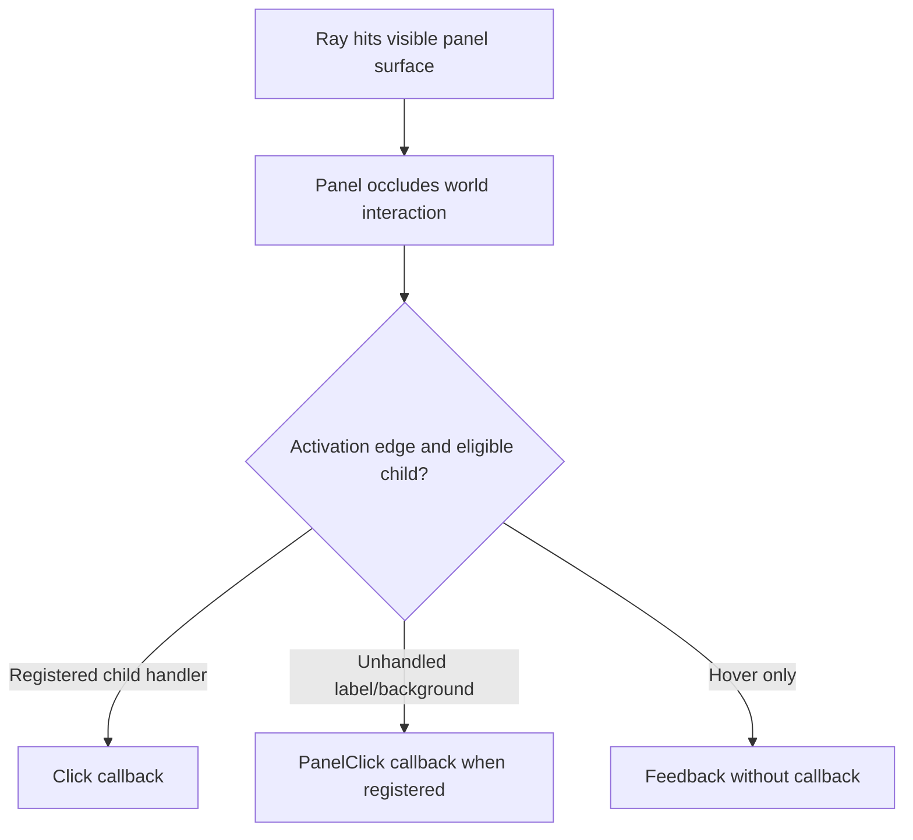

# Polygon panels, radial menus and input routing

The base [Signal Room console](../example/usd-files.md) demonstrates rectangular buttons and a readout. Current packages also support polygon clipping, radial button layout, explicit pointer identity, panel-background clicks and programmatic navigation. This page supplies a small extension using the same project and pointer.

There is no dedicated radial/polygon widget editor in this edition. Edit the USD properties in a text editor, reopen the layer in Conductor, check the behavior and use Runtime preview for interaction. A rendered panel alone does not create pointer routing or logical input bindings.

## Add the extension to Signal Room

Save this complete layer as **extensions/widgets.usda** in your working copy. Add `@../extensions/widgets.usda@` to Hub's `subLayers` metadata, preserving existing entries and the station reference. Its Menu uses the source file listed next; Message demonstrates a polygon surface.

```usda
#usda 1.0
(
    defaultPrim = "World"
    metersPerUnit = 1
    upAxis = "Y"
)
def Xform "World"
{
    def IdtxWidgetPanel "Menu" (prepend apiSchemas = ["IdtxBehaviorAPI"])
    {
        double3 xformOp:translate = (0, 1.3, -2)
        uniform token[] xformOpOrder = ["xformOp:translate"]
        float2 idtx:widget:size = (0.8, 0.8)
        int2 idtx:widget:resolution = (512, 512)
        uniform token idtx:widget:space = "world"
        uniform token idtx:widget:billboard = "none"
        float idtx:widget:background:opacity = 0
        token idtx:behavior:kind = "runtime"
        string idtx:behavior:name = "radial_panel"
        string idtx:behavior:version = "0.1.0"
        string idtx:behavior:uuid = "handbook-radial-panel-v1"
        asset idtx:behavior:source = @../behaviors/radial.rs@
        uniform token[] idtx:behavior:capabilities = ["input", "widget", "stage_edit"]
        uniform token[] idtx:behavior:inputs = ["menu.next:button", "menu.previous:button", "menu.confirm:button"]
        def IdtxWidgetContainer "Items"
        {
            uniform token idtx:widget:layout = "radial"
            float2 idtx:widget:radial:center = (0.5, 0.5)
            float idtx:widget:radial:innerRadius = 0.15
            float idtx:widget:radial:outerRadius = 0.48
            float idtx:widget:radial:startAngle = -60
            float idtx:widget:radial:sweepAngle = 360
            float idtx:widget:radial:gapAngle = 5
            float idtx:widget:radial:deadZone = 0.25
            float idtx:widget:radial:hysteresisAngle = 4
            def IdtxWidgetButton "Inspect"
            {
                int idtx:widget:order = 0
                string idtx:widget:label = "Inspect"
                color3f idtx:widget:color = (0.15, 0.35, 0.65)
            }
            def IdtxWidgetButton "Choose"
            {
                int idtx:widget:order = 1
                string idtx:widget:label = "Choose"
                color3f idtx:widget:color = (0.12, 0.5, 0.3)
            }
            def IdtxWidgetButton "Return"
            {
                int idtx:widget:order = 2
                string idtx:widget:label = "Return"
                color3f idtx:widget:color = (0.45, 0.25, 0.5)
            }
        }
        def IdtxWidgetFieldString "State"
        {
            string idtx:widget:value = "READY"
            float idtx:widget:fontSize = 26
            float2 idtx:widget:position = (0.34, 0.45)
        }
    }
    def IdtxWidgetPanel "Message"
    {
        double3 xformOp:translate = (1.65, 1.2, -2.5)
        uniform token[] xformOpOrder = ["xformOp:translate"]
        float2 idtx:widget:size = (0.8, 0.6)
        int2 idtx:widget:resolution = (512, 384)
        float2[] idtx:widget:background:vertices = [
            (0, 0), (1, 0), (1, 0.7), (0.7, 0.7),
            (0.7, 1), (0.4, 0.7), (0, 0.7)
        ]
        int[] idtx:widget:background:triangleIndices = [
            0, 1, 2, 0, 2, 3, 0, 3, 5, 0, 5, 6, 3, 4, 5
        ]
        color3f idtx:widget:background:color = (0.1, 0.16, 0.3)
        float idtx:widget:background:opacity = 0.95
        def IdtxWidgetLabel "Text"
        {
            string idtx:widget:text = "Polygon panel"
            float idtx:widget:fontSize = 32
            float2 idtx:widget:position = (0.08, 0.2)
        }
    }
}
```

Polygon vertices are normalized top-left-origin panel coordinates in [0,1]; indices are zero-based triangle triples, accepting either winding. Every triangle must be nondegenerate. Limits are 4096 vertices and 8192 triangles. Both arrays empty retain the original rectangle. Invalid topology creates an empty surface, with no rectangular fallback.

All child drawing and interaction are clipped to the triangulated surface. Concavities, separate pieces and holes work when the supplied triangles encode them. Background opacity affects only the background; panel/element opacity has its own hierarchy. A transparent background makes the radial panel's corners, gaps and center visually transparent, but does not itself turn the rectangular panel into a ring-shaped interaction surface. Use polygon topology when a matching interaction hole is required.

## Handle menu and background clicks

Save **behaviors/radial.rs**:

```rust
use idtx_behavior_sdk::prelude::*;
use idtx_behavior_sdk::arrayvec::ArrayString;
use idtx_behavior_sdk::input::PointerSource;

#[derive(Default)]
pub struct RadialPanel {
    selected: ArrayString<256>,
}

#[behavior(kind = "runtime")]
impl RadialPanel {
    fn on_start(&mut self, ctx: &Ctx) -> Result<()> {
        self.selected.clear();
        #[cfg(target_arch = "wasm32")]
        {
            ctx.widget().on_click("Items/Inspect", Self::clicked)?;
            ctx.widget().on_click("Items/Choose", Self::clicked)?;
            ctx.widget().on_click("Items/Return", Self::clicked)?;
            ctx.widget().on_panel_click(Self::background_clicked)?;
        }
        ctx.stage_edit().set_widget_value("State", "READY")
    }

    fn on_update(&mut self, ctx: &Ctx, _dt: f32) -> Result<()> {
        let source = PointerSource::Desktop;
        let next = input::action("menu.next").from_source(source);
        let previous = input::action("menu.previous").from_source(source);
        let step = i32::from(next.pressed()) - i32::from(previous.pressed());
        if step != 0 {
            self.selected = ctx.widgets().navigate(
                ctx.entity(), "Items", &self.selected, [0.0, 0.0], step,
            );
        }
        ctx.widgets().highlight(ctx.entity(), &self.selected)?;
        let confirm = input::action("menu.confirm").from_source(source);
        if confirm.pressed() && !self.selected.is_empty() {
            let _ = ctx.widgets().activate(
                ctx.entity(), &self.selected, source, confirm,
            );
        }
        Ok(())
    }

    fn clicked(&mut self, ctx: &Ctx, click: &WidgetClick) -> Result<()> {
        let path = click.element();
        let value = match path.as_str() {
            "Items/Inspect" => "INSPECT",
            "Items/Choose" => "CHOOSE",
            "Items/Return" => "RETURN",
            _ => "UNKNOWN",
        };
        ctx.stage_edit().set_widget_value("State", value)
    }

    fn background_clicked(&mut self, ctx: &Ctx, click: &WidgetClick) -> Result<()> {
        if click.is_panel_background() {
            ctx.stage_edit().set_widget_value("State", "PANEL")?;
        }
        Ok(())
    }

    fn on_stop(&mut self, ctx: &Ctx) -> Result<()> {
        self.selected.clear();
        ctx.widgets().highlight(ctx.entity(), "")
    }
}
```

Append these actions to the existing **input_map.toml**, preserving the player and `widgets.click` bindings:

```toml
[actions."menu.next"]
kind = "button"
bindings = ["Key/E"]

[actions."menu.previous"]
kind = "button"
bindings = ["Key/Q"]

[actions."menu.confirm"]
kind = "button"
bindings = ["Key/Enter"]
```

The source needs `input`, `widget` and `stage_edit`, as granted in the layer. The existing Signal Room Pointer supplies mouse rays and `widgets.click`. `on_panel_click` registers a `PanelClick` handler separate from child `Click` paths. An enabled child with a registered handler receives first refusal; labels and unhandled background areas can bubble to the panel handler. `WidgetClick::source()` reports Desktop, Left, Right or Unspecified. Unspecified means unknown/ambiguous and must not be treated as a particular hand.

## Radial layout and navigation contracts

Only immediate child buttons become sectors. Their `idtx:widget:order`, then namespace path, determines order; disabled buttons retain their slots. Radius fractions use the smaller containing-layout dimension and require `0 <= innerRadius < outerRadius <= 0.5`. Angles use degrees, zero up and increasing clockwise. Sweep is positive and at most 360 degrees. Invalid settings draw nothing.

Gap angle defines constant perpendicular spacing between sector edges at the inner radius, or outer radius when the inner radius is zero. A gap as wide as its slot makes that sector empty. Dead zone and hysteresis control stick navigation.

`Widgets::navigate(panel, container, previous, stick, step)` returns a stable panel-relative child path. Pass `step` +1/-1 to cycle by keyboard, as above; pass zero with a Y-up stick value for radial selection. Retain the previous path for hysteresis. `highlight(panel, path)` adds transient feedback, with empty path clearing it. `activate(panel, path, source, confirm)` requires an explicit confirmation edge and validates visibility, membership, clipping and enabled state. Native stubs select nothing and do not dispatch callbacks.

For a modal menu that must temporarily own controller actions, use the [input capture contract](behavior-sdk.md#input): acquire a `CaptureToken` in `on_input_capture`, retain it while open and release/drop it on close. Scope actions to the actual source with `Action::from_source`. An ordinary always-visible panel, as above, does not need modal capture.

## Distinguish occlusion from callback delivery

The current `ctx.widgets().handle(hit)` returns whether the panel **occludes** the pointer, including unhandled panel areas. Stop world interaction when it returns true. It does not mean a callback ran. For explicit identity and separate results, use `handle_from(hit, source, click_action)`: its `WidgetInteractionResult` has `occluded` and `handled` fields. The pointer code needs `widget`, its ray needs `scene_query`, and an explicit action needs `input` plus an authored input declaration.



## Checkpoint

Save and reopen Hub. Select Menu and run **Cargo Check** then **Verify capabilities**. Use **Preview > Preview in Desktop**: the three sectors should render, mouse clicks should change the readout, E/Q should move the highlight, Enter should activate the highlighted enabled item, and a label/blank panel click should show PANEL. Check that an occluding panel blocks a world object behind it even without a callback. Check polygon clipping around Message's pointed corner.

Then cook and repeat in the finished package. For XR, supply controller/gesture bindings and the actual Left/Right source in your navigation/pointer behavior. This page's keyboard navigation is explicitly Desktop. Compilation and layout inspection alone do not prove callback delivery, tracking or device comfort.
