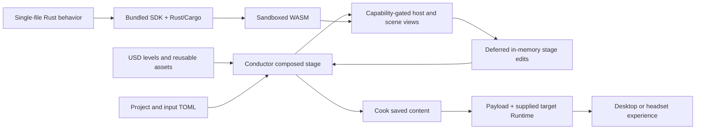
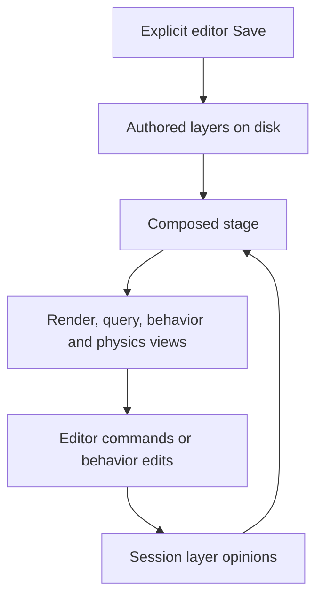

# 1. Understand the system

USD is the scene authority. Conductor opens a composed USD stage and projects its geometry, transforms and authored IDTX properties into the views used for rendering, scene queries and behavior execution. Your project remains USD and text files. Behavior code runs in a WASM sandbox and calls the host through the packaged SDK.

## Use the authoring app and Runtime together

Conductor manages projects and levels, inspects and edits stage content, opens behavior source in your editor, checks bindings and builds experiences. **Preview > Preview in Desktop/XR** launches a separate supplied Runtime. The finished package uses that same class of Runtime to provide player input, runtime physics and level transitions.

Some distributions also contain Inspector or Poser. They are optional stage inspection/authoring tools. This book’s reproduction path uses Conductor and its supplied Runtime throughout.

## Keep three kinds of data clear

**Authored USD** contains transforms, geometry, materials, cameras, lights, sampled animation, IDTX schema prims and behavior attachments. References place a reusable asset at a prim path. Sublayers add opinions at existing paths. Payloads defer expensive content. Variants choose authored alternatives.

**Project TOML** contains stage-independent settings: levels, startup and transfer stages, player selection, shared layers, spawn prototype registrations, units, network policy, behavior limits and build settings. The separate input_map.toml maps physical input to logical actions.

**Runtime state** contains behavior instance fields, current input, physics state, highlights, temporary drawings and carried transition values. Runtime stage edits write in-memory USD opinions so the scene and other systems observe them. These edits do not save a revised source asset to disk.

Save authored changes before previewing or cooking. A viewport can show a temporary session opinion that has not been saved to the layer the cook will read. Reopening the project is a useful check that intended edits persist.

## Understand the frame boundary

A behavior hook reads the current host view and can queue edits. The host drains deferred work, updates the composed stage and refreshes affected scene views. A queued reference spawn is not immediately queryable. Its asynchronous callback provides the terminal Ready/Failed result after reconciliation; wait for Ready before resolving descendants.

Use a single owner for an object’s pose. USD animation, a behavior and runtime physics can each drive transforms. For example, the base beacon is behavior-driven; a falling prop should be dynamic physics; a sampled mover should have a deliberate animation/kinematic configuration.

Behavior instances and entity handles are tied to the current level. A transition tears those down and creates fresh instances in the destination. Use the documented bounded level-state store for values that must survive the switch, then resolve fresh handles in on_start. That store is process state, not a persistent save file.

## Author reusable content for composition

Signal Room uses metres, Y-up and source content under /World. Reusable assets declare defaultPrim. The supplied player composes at /World/Player. Level bodies may be re-rooted when Conductor builds an assembly, so a reusable behavior should find siblings/children from ctx.entity() rather than assume an absolute source path.

A behavior attachment combines source module, runtime/editor kind, capability grants, authored JSON context and input declarations. Context stays fixed during a hook; a valid authored context edit reattaches at reconciliation, resets instance fields and reruns initialization. Bind scene objects through USD relationships when composition must remap their targets. Their snapshots update after composition changes; code must refresh its own cached binding when appropriate. The [agent guide](reference/agent-guide.md) and [host reference](reference/behavior-host.md) define these contracts; the [complete example](example/index.md) shows the matching Rust, USD and TOML files.

Named animation clips can own a target subtree independently of the containing timeline. Play/Pause/Seek acquire that ownership, Stop rewinds it, and Release restores the containing timeline. Settled playback status and lifecycle events describe application outcomes. Events post deferred messages to composed relationship targets; a receiver can request playback without either behavior knowing an absolute source-stage path. [The animation exercise](tutorial/06-animation-and-routing.md) follows this flow.

**Next:** [Prepare the development environment](setup.md).
