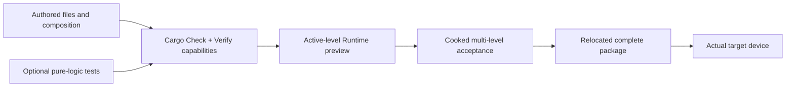

# 5. Test the experience at each boundary

A compilation check establishes that your Rust source matches the installed SDK. A capability check establishes that the binding grants the imports the module needs. Runtime acceptance establishes input, host calls and visible scene behavior. A relocated cooked package establishes the delivery closure. Device acceptance establishes real tracking, installation, lifecycle and sustained performance. Keep a result for each boundary relevant to your release.



The required workflow below uses the installed Conductor and the supplied Runtime. Optional pure-logic tests use a small author-owned Cargo harness and the bundled SDK. No engine test suite is required.

## 1. Inspect authored files and composition

Open the project through **Project > Open Project…**. Check Hub and Lab separately in Conductor:

- Both levels are registered, and Hub is the explicit startup level.
- The station reference resolves; the Console, Beacon and Pointer exist.
- USD metadata uses Y-up and metres, with a valid defaultPrim.
- Behavior source paths resolve relative to their authoring layer.
- Room overrides supply valid typed JSON and distinct destination IDs.
- The Console's composed beacon relationship has exactly one live target in each source/preview/cooked namespace.
- The logical input map contains the supplied player actions and widgets.click.

Save changes, close and reopen the relevant level to verify intended authored edits survive. An unsaved session-layer opinion can otherwise hide a missing disk edit. A syntactically valid TOML or USD file is only the first step; Conductor must resolve its actual dependencies.

## 2. Check each behavior binding

Start edits by selecting the owning prim and using **Inspector > Behavior > Create Behavior…** or **Edit Code**. Confirm the generated VS Code workspace has rust-analyzer completion and syntax/type diagnostics; use **Set up rust-analyzer** if prompted. Save all entry and helper files, then use **Cargo Check** followed by **Verify capabilities** in the Inspector. Repeat for Console and Pointer, and for SpawnDemo when enabling that extension. If inherited controls are disabled, open the owning asset and check its bindings there. Retain the full diagnostic on failure.

rust-analyzer’s checks on save give early source diagnostics. Inspector Cargo Check validates saved source compilation. Verify capabilities builds the guest and compares its imports with the binding’s authored grants. Fix source errors, missing Rust targets, unsupported APIs or missing grants at this boundary. Editor completion and diagnostics do not replace these binding checks; neither Inspector control executes on_start, tests a scene lookup or performs gameplay.

A grant is only one part of authorization. HTTP also needs the project network policy and compatible Runtime support. XR/physics methods need an actual backend and scene setup. Deferred operations can be accepted by the queue and still fail when applied. [Host contracts](reference/behavior-host.md) explain these distinctions.

## 3. Run the active level

Use editor behavior playback for quick behavior iterations. Use **Preview > Preview in Desktop** for the supplied player, active-camera queries, mouse input, widgets, deferred stage edits and runtime physics. **Preview > Preview in XR** uses the supplied XR Runtime and backend.

| Action | Expected Signal Room result |
|---|---|
| Open Hub | Blue beacon and console; no unresolved reference diagnostic |
| Start runtime preview | Beacon rotates and State reads RUNNING |
| Aim at Beacon | Green outline while pointed at it |
| Click Pause / Run | Exactly one state change per click; motion and readout agree |
| Hold the mouse button | No repeated toggling from a held input |
| Stop and start a fresh preview | Predictable initialization; a new process starts RUNNING |
| Preview Lab separately | Amber beacon, Lab title and its room-specific context |

**Active-level preview does not provide the complete cooked level registry.** Do not use a failed Next room action here to diagnose the project’s multi-level travel. Build the complete experience for that check. The editor viewport also does not establish rigid-body simulation; use Runtime preview when adding physics.

## 4. Test the cooked desktop experience

Choose **Build > Build Desktop Experience**, confirm the latest build completed, and launch the finished package. An old output folder can remain after a failed build; read the completion result before treating it as current.

| Sequence | Expected result / boundary |
|---|---|
| Launch the finished package | Hub loads as the startup level, player controls work |
| Pause Hub, then click Next room | Lab loads; its beacon remains paused |
| Run Lab, then return to Hub | Hub loads with RUNNING readout and rotating beacon |
| Repeat travel and interaction | Fresh entity lookups and callbacks work after every teardown |
| Enable the optional specimen extension and rebuild | One specimen is created; terminal Ready/Failed result explains the outcome |
| After Ready, query spawned descendants | Queries succeed after deferred composition, without stale handles |
| Close and reopen the package | Carried state resets; it is not a save file |
| Copy the entire finished package elsewhere and repeat | Assets, WASM, plugins and native libraries resolve from the copied package |

Inspect generated run.toml to confirm hub/lab IDs and payload-relative level paths. Keep the source project closed during relocation testing. If practical, test on a clean machine where the authoring project and SDK were never installed. The delivered player should not need Rust or Conductor.

## 5. Test on each delivery device

Install the actual artifact: finished desktop folder/app, PCVR package, Quest APK or signed Vision Pro device app. A staging tree or simulator run does not establish a device installation. See [target preparation](delivery/targets.md).

Verify startup and scale, camera height, logical input actions, tracking loss/recovery, level round trips, spawn completion, suspend/resume and a sustained interactive session. Check readable widgets at the intended viewing distance. Record the device, OS, Runtime release and observed performance. Repeat the checks when changing the Runtime, player, input map or relevant content.

If the supplied Runtime supports screenshot/metrics options, use the [capture guide](appendices/screenshots.md) for bounded smoke checks. A successful headless frame verifies only that invocation’s scene and rendering path; it does not establish headset input or transitions you did not exercise.

## Optional: test the example’s pure Rust logic

The Console source includes three meaningful tests: frame-rate-independent rotation, bounded debugger pauses/negative deltas, and typed-context rejection of invalid data. Run them with an author-owned harness if you want a fast logic check outside Conductor.

Create tests/logic/Cargo.toml under your **experience project**, replacing the dependency path with your installed SDK path. Forward slashes work on Windows:

```toml
[package]
name = "signal-room-logic-tests"
version = "0.1.0"
edition = "2024"

[workspace]

[lib]
path = "lib.rs"

[dependencies]
idtx-behavior-sdk = { path = "C:/IDTX/Conductor/behavior-sdk/idtx-behavior-sdk" }
```

Create tests/logic/lib.rs:

```rust
include!("../../behaviors/console.rs");
```

From the experience root, run:

```sh
cargo test --manifest-path tests/logic/Cargo.toml --target-dir .idtx/logic-tests
```

The small workspace table keeps the harness independent of any surrounding Cargo workspace. Cargo writes output under .idtx/logic-tests in your writable project. You can use the same pattern for pure helpers in your own behaviors. Do not add this harness to USD attachments or copy its artifacts into a release.

Native SDK wrappers return inert defaults: no camera, no live entity lookup, inactive input and inert writes. These tests prove calculations and decoding. Use WASM Runtime acceptance to establish callbacks, scene mutation, input dispatch, spawning and travel.

## Record the result

For the newer APIs, add the acceptance checks below when your experience uses them. Keep the checks tied to observable results rather than queue acceptance:

| API boundary | Check |
|---|---|
| Composed relationships | Resolve targets after references/payloads and forwarding; distinguish missing/empty/invalid/unloaded, partial forwarding and truncated output; retarget and refresh cached entities. |
| Context updates | Edit valid context during authoring and observe reattachment/reset at reconciliation; malformed context reports an attachment failure. |
| Named clip playback | Validate owner/name/targets, range and channel; inspect later status, command error and run ID; exercise Pause/Stop/Release and ownership conflicts. |
| Playback events | Check completed/interrupted/failed on the clip owner; bounded event delivery can drop a message, so retain a status recovery path. |
| Targeted named events | Bind a receiver through a USD relationship; verify ordered deferred delivery and that callback posts wait for a later sweep. |
| Curve sampling | Verify selected batch, arc distance, endpoint clamping, composed scale and output frame; check short buffers and stale/unsupported curves. |
| Source-aware widgets/input | Exercise desktop/left/right independently; verify background bubbling and distinct occluded/handled results; a modal capture must prevent unintended consumers and require release before confirm. |

Follow the [animation and routing exercise](tutorial/06-animation-and-routing.md) and [widget reference](reference/widgets.md) for concrete setups. Native stubs do not establish these host outcomes.

Keep a short acceptance record with project revision, Conductor/SDK/Runtime release, target, content stamp, actions performed and results. Record omitted checks explicitly. A compile pass and a screenshot are useful evidence with different scopes; neither implies a complete release pass.

**Next:** [Cook the experience](delivery/cooking.md).
