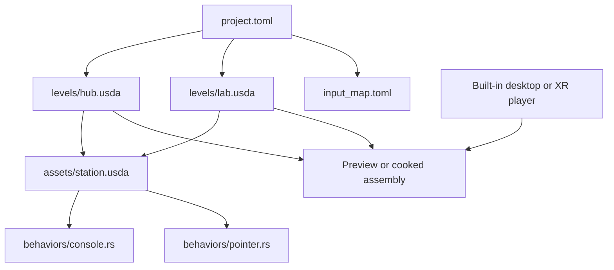

# The example: Signal Room

Signal Room is a two-room experience with one reusable USD station and two Rust behaviors. Hub has a blue beacon rotating at 1.5 radians per second; Lab has an amber beacon rotating at 0.75 radians per second. A world-space console pauses the beacon and travels between rooms while retaining the pause/run state.

Everything authored for this project is distributed with the handbook. You need the packaged IDTX Conductor application, its matching behavior SDK and runtime, and the [authoring prerequisites](../setup.md).

## Create your working project

Choose a writable project directory. In this book, `project/` always means your chosen directory. Use either of these routes:

1. Copy the handbook package's `examples/signal-room/` folder to your chosen location.
2. Save the [complete source listings](../example/index.md) under their stated paths. The optional standard-Python materializer on that page performs the same reconstruction.

Launch the installed Conductor app, choose **Project > Open Project…**, and select `project/project.toml`. Hub opens because `default_stage` selects `levels/hub.usda`. Do this through Open Project so Conductor loads the project registry and input map as well as the stage.

```toml
version = 1
name = "Signal Room"
default_stage = "levels/hub.usda"
start_level = "levels/hub.usda"
levels = ["levels/hub.usda", "levels/lab.usda"]
asset_roots = ["assets"]

[unit_scale]
meters_per_unit = 1.0
```

This excerpt shows the core manifest; use the [complete file](../example/project-files.md) for reconstruction. Omitting `player_stage` selects the built-in player. Conductor supplies the desktop or XR variant during composition, so neither level contains a copied rig.

## Learn the file relationships



The level layers reference one station. Stronger level opinions change its color, title and configuration. Editing the shared station affects both rooms; editing Lab's override affects Lab. Rust source paths are authored in the station and stay relative to its location.

## Features you will exercise

| Feature | Example use |
|---|---|
| USD references and overrides | One station asset, two room configurations |
| Applied IDTX schemas | Behavior bindings, interaction colliders and widget panels |
| Single-file Rust compilation | Console and Pointer sources checked through Conductor |
| Typed immutable context | Per-room speed and destination ID |
| Runtime transforms | Beacon rotation through deferred session edits |
| Scene queries and overlays | Camera ray selection and green beacon outline |
| Logical input and callbacks | Desktop/XR activation reaches the same panel buttons |
| Level control and carried state | Cooked Hub/Lab travel preserves Pause/Run |
| Player composition | Shared built-in desktop/XR rig |
| Prepared prototypes and readiness | Optional green specimen spawn in Lab |

The [SDK reference](../reference/behavior-sdk.md) covers additional APIs, including events, animation playback, physics, asynchronous HTTP and auth. Each entry identifies its capabilities and current limits.

## Establish the first checkpoint

With Hub open, inspect these source-stage prims in the scene tree:

1. `/World/Beacon`: cube geometry with collision and interaction metadata.
2. `/World/Console`: widget panel with `signal_console` and its typed context.
3. `/World/Console/Toggle` and `/World/Console/Travel`: panel-relative buttons.
4. `/World/Pointer`: the `signal_pointer` behavior binding.

Select Console, open its Behavior inspector, run **Cargo Check**, then **Verify capabilities**. Repeat for Pointer. Cargo Check compiles the guest source; Verify capabilities builds WASM and checks the actual imports against the binding's grants. Resolve failures before playback.

Choose **Preview > Preview in Desktop** to test the current room with the composed player. Look at the beacon to see its outline, then aim at **Pause / Run** and click. Use **Preview > Stop Preview** before switching stages. For XR, select **Preview > Preview in XR** with the required runtime and hardware available.

Test **Next room** after **Build > Build Desktop Experience** and launch the resulting package. Current-stage preview does not populate the full cooked level registry. [Interaction and travel](04-interactions.md) provides the acceptance sequence.


*Reference render from a desktop runtime smoke run after 30 frames. The Console updated its readout to RUNNING. The capture used a stationary authored camera and compiled modules; it illustrates the expected scene and does not establish packaged UI, pointer input or cooked travel. Your preview uses the built-in player and may frame the room differently.*

Next: [Author the USD world](02-usd-world.md).
