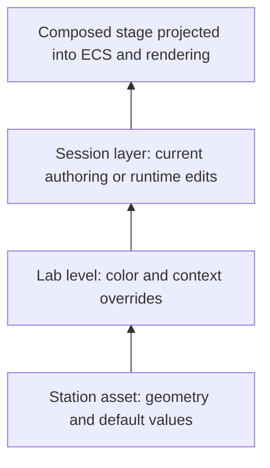

# Author the USD world

Signal Room separates reusable content from level-specific opinions. The [complete USD files](../example/usd-files.md) contain the reusable `assets/station.usda` layer and the `levels/hub.usda` and `levels/lab.usda` overrides. Save them under your project root before opening the project in Conductor.

## Create a valid level root

Every example level uses a `World` default prim, Y-up coordinates and metre units. The project manifest uses the same units.

```usda
#usda 1.0
(
    defaultPrim = "World"
    metersPerUnit = 1
    upAxis = "Y"
    customLayerData = {
        dictionary idtx = {
            string displayName = "Hub"
            string schemaVersion = "1"
            token stageKind = "level"
        }
    }
)
def Xform "World" (prepend references = @../assets/station.usda@</World>)
{
}
```

The IDTX stage-kind tag belongs to the root layer's `customLayerData`. It tells Conductor that this file is a level; it is distinct from a prim's applied schemas. `defaultPrim` tells an external reference which root content to compose when it does not name a target explicitly.

## Place a readable scene

The station contains a floor, a plinth, a beacon, a directional light and a camera. Geometry sits around Z = -3, in front of a player looking along -Z from the origin. The panel sits near eye height. The authored camera supports scene inspection; the runtime composition adds its player camera.

```usda
def Cube "Beacon" (
    prepend apiSchemas = ["PhysicsCollisionAPI", "IdtxCollisionAPI"]
)
{
    double size = 1
    double3 xformOp:translate = (0.8, 1.3, -3)
    double3 xformOp:scale = (0.45, 0.7, 0.45)
    uniform token[] xformOpOrder = ["xformOp:translate", "xformOp:scale"]
    color3f[] primvars:displayColor = [(0.15, 0.7, 1)]
    uniform token[] idtx:collision:channel = ["Interaction"]
}
```

`PhysicsCollisionAPI` provides standard collider metadata. `IdtxCollisionAPI` adds the interaction-query channel. A visible mesh without a suitable query collider will not necessarily answer an interaction ray. The sample has no `PhysicsScene`, so it does not run a rigid-body simulation; collision queries and physics simulation are separate concerns.

## Override a room without duplicating the asset

Lab adds stronger opinions over the referenced station:

```usda
def Xform "World" (prepend references = @../assets/station.usda@</World>)
{
    over "Beacon" {
        color3f[] primvars:displayColor = [(1, 0.4, 0.1)]
    }
    over "Console" {
        custom string idtx:behavior:context = '{"speed_radians":0.75,"target_level":"hub"}'
        over "Title" {
            string idtx:widget:text = "LAB - AMBER SIGNAL"
        }
    }
}
```

`over` authors an opinion on a prim supplied by another layer. It does not duplicate the station geometry. The behavior source path remains anchored to `station.usda`, where that asset-path opinion was authored. Moving the level file does not re-anchor that source to the level's directory.



Edits in the session layer are strongest. Save through the editor when you intend an authoring change to persist, then reopen the project to check the saved result. Runtime behavior state is tested separately from saved authoring data.

## Keep paths ready for composition

The stage alone exposes `/World/Beacon`. A cooked per-level assembly re-roots its level body to `/World/level`, making that prim `/World/level/Beacon`. Combined preview composition uses `/World/Levels/<level-stem>`, another holder layout. Avoid hard-coding the original absolute path inside reusable behavior code.

Signal Room binds Console to Beacon with `rel idtx:behavior:beacon = </World/Beacon>` in the station asset. USD remaps this target when composing the asset under another holder, and the SDK returns the live composed entity. Path strings embedded in JSON are not remapped this way. The behavior chapter shows the bounded relationship query and its validation.

The `Spawn` Xform in the station is also inherited by both levels. In a per-level assembly it becomes `/World/level/Spawn`, the current default spawn convention. A named spawn uses `Spawn_<name>`; `goto_with_spawn("lab", "north")` asks for `/World/level/Spawn_north` and falls back to the default if absent.

## Checkpoint

Use Conductor to open `project/levels/hub.usda` and `project/levels/lab.usda` as stage tabs within the project. Confirm the blue/amber color and title difference, the same geometry layout and identical source attachments. Change one shared value in a copied station, such as the plinth color, and confirm it appears in both rooms. Change Lab's context speed and confirm Hub's authored value remains 1.5.


*Headless runtime smoke render of Lab. Its stronger level opinions change the shared station's beacon color, title and context. The smoke wrapper supplies a stationary local camera and compiled modules; this picture does not establish player input or a cooked level transition.*

For the authoring contracts behind these files, see [USD composition](../composition/usd.md) and [player and level composition](../composition/player-and-levels.md).

Next: [Implement the behaviors](03-behaviors.md).

