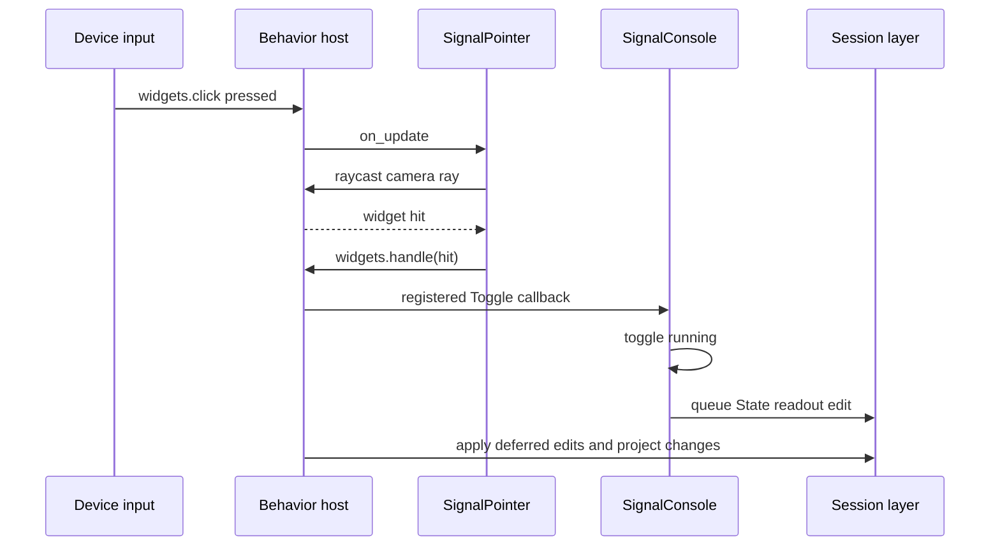

# Connect interaction and travel

The pointer and console have separate jobs. The pointer decides what the player is looking at. The console owns its buttons and state. The host connects them through widget interaction events.

## Map physical inputs to one logical click

The [complete input map](../example/project-files.md) declares a literal `widgets.click` action:

```toml
[actions."widgets.click"]
kind = "button"
bindings = [
    "Mouse/Left",
    "Controller/MetaQuest/RightTrigger",
    "Controller/MetaQuest/A",
    "Gesture/pinch/right",
    "Gesture/pinch/left",
]
```

The quotes preserve the action's dot as part of its name. The Pointer attachment declares `"widgets.click:button"` in `idtx:behavior:inputs` so the host resolves it. `Gesture/*` sources require the corresponding runtime gesture recognition and available tracked hands. A binding does not synthesize unavailable device input.

The same map also supplies every action consumed by the built-in player: `move_forward`, `move_right`, `look`, `move`, `turn` and `teleport`. Keep these when extending the sample; otherwise a bundled player can fail action validation or lose movement.

## Route the camera ray

The [complete Pointer source](../example/behavior-files.md) uses the active camera, with no hard-coded camera path:

```rust
let Some(camera) = ctx.camera() else { return Ok(()); };
let options = RayOpts::new()
    .interaction_only()
    .block_widgets()
    .max_distance(10.0);
if let Some(hit) = ctx.scene().raycast(camera.ray.origin, camera.ray.forward, &options) {
    if hit.is_widget() && ctx.widgets().handle(hit) { return Ok(()); }
    let target = ctx.scene().collision_body(hit.entity).unwrap_or(hit.entity);
    ctx.highlight().outline_with(target, Vec4::new(0.1, 1.0, 0.65, 1.0), 4.0)?;
}
```

`block_widgets` lets a panel participate in ray occlusion. `handle` performs the host's hit cue and click processing and returns whether the panel occludes the pointer, including areas with no registered child handler. The pointer then returns; a delivered child click invokes its registered callback. A regular geometry hit receives a transient outline. Reissue transient overlays each frame while the cue should remain visible.

For independent desktop/left/right pointers, use `handle_from(hit, source, click)` and inspect its separate `occluded` and `handled` flags. `Action::from_source` preserves per-source edges. `WidgetClick::source` reports provenance, and `on_panel_click` handles background/bubbled activation. Use `on_input_capture` and a retained `CaptureToken` for modal controls that must arbitrate ownership before consumers run; the SDK and widget references provide the complete contracts.

The current simple widget rasterizer gives each explicitly positioned leaf the remaining panel width. Signal Room places its two buttons on separate vertical rows; putting two positioned buttons at the same Y value would overlap their hit rectangles. Confirm the rendered controls before evaluating callback behavior.



Pointer has `scene_query`, `widget` and `overlay` grants. Console has the grants for its own callbacks and edits. Widget callback routing uses the widget bucket; it does not require you to write a separate `on_event` handler or grant named-event capabilities solely for these clicks.

## Request travel and carry state

The Travel handler records one byte and asks the runtime to switch level:

```rust
fn travel_clicked(&mut self, ctx: &Ctx, _click: &WidgetClick) -> Result<()> {
    ctx.level().set_state("beacon.running", &[u8::from(self.running)])?;
    ctx.level().goto(self.target.as_str())
}
```

The target is the cooked level ID, `hub` or `lab`. The cook derives these holders from the source file stems; the runtime resolves IDs case-sensitively from the registered `levels/<id>/level.usdz` paths. IDs are not arbitrary stage file paths. Use the registry emitted into `run.toml` to confirm the final names after a cook, especially if level stems collide or require sanitization.

`goto` queues the request. The runtime resolves and loads the destination outside the behavior hook, then swaps the session. The destination Console's `on_start` reads `beacon.running` from the shared store. It does not reuse an entity handle from the previous session. Keep cross-level state as data and resolve new scene entities after attachment.

The sample has no `transfer_level`, so this is a hard cut. A transition stage can provide a loading mask; see [player and level composition](../composition/player-and-levels.md). Carried state is experience-lifetime state, not a save-game file; restarting the packaged app starts a fresh experience.

## Verify the interaction in increasing scope

| Check | Expected observation | What it establishes |
|---|---|---|
| Open Hub and Lab | Shared station, distinct title/color/context | USD composition and authored overrides |
| Cargo Check and Verify capabilities for each binding | Successful checks; no missing grants | Guest source, macro and host-import compatibility |
| Editor playback | Beacon rotates and stops; readout can be inspected | Behavior iteration in the editor profile |
| Preview > Preview in Desktop | Movement, hover outline and Pause/Run work | Active camera, device input, widgets and deferred edits |
| Cooked desktop package | Hub → Lab → Hub works; paused state survives | Full level registry, runtime session swaps and carried state |
| Target device package | Same button behavior and room traversal | Actual device input, renderer and packaged runtime |

Editor viewport camera/input behavior differs from the runtime player. Use runtime preview to judge the actual pointer and player control. Current-stage preview does not contain the full project transition table. Choose **Build > Build Desktop Experience** and launch the generated bundle to test the Travel button.

For a reproducible acceptance pass, start the cooked package fresh. Pause in Hub, travel to Lab, confirm an amber beacon stays paused, run it, return to Hub, and confirm the blue beacon is running. Close and restart: the initial state is running again.

Use the [SDK reference](../reference/behavior-sdk.md) for input, widgets and level-control signatures, and [player and level composition](../composition/player-and-levels.md) for transition and spawn conventions.

Continue with [composition](../composition/project.md), the [testing ladder](../testing.md) and [cooking](../delivery/cooking.md).

