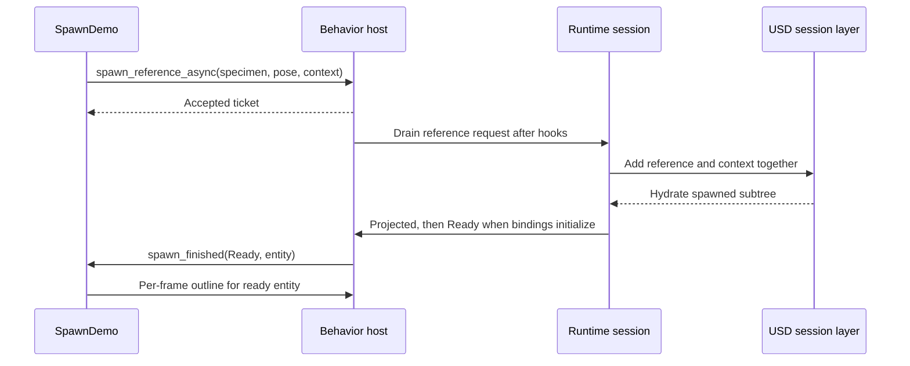

# Optional exercise: spawn a prepared USD asset

Extend Signal Room so entering the Lab creates a green specimen sphere. This
exercise demonstrates prototype preparation, USD reference composition,
owned typed context, asynchronous readiness, and transient visual feedback.
The complete files are in
[the complete optional extension files](../example/spawn-files.md).
Start from your working copy of the base project.

## 1. Enable the Lab extension

Add one `subLayers` entry to the existing layer metadata in `levels/lab.usda`:

```usda
#usda 1.0
(
    defaultPrim = "World"
    metersPerUnit = 1
    upAxis = "Y"
    subLayers = [@../extensions/spawn-demo.usda@]
    # Keep the existing customLayerData dictionary here.
)
```

Keep the existing `/World` reference to `station.usda` and its Lab overrides.
The extension adds a `Spawner` Xform under the level's `/World`; its behavior
source is `extensions/spawn_demo.rs`, resolved relative to the extension
layer. In a composed player assembly the same prim appears beneath the Lab
holder, for example `/World/Levels/lab/Spawner`. The behavior uses
`ctx.entity()` so it works at either occurrence path.

## 2. Register the prepared specimen

Add this table to the end of `project.toml`:

```toml
[runtime_prototypes.specimen]
asset = "extensions/specimen.usda"
prim = "/Specimen"
```

Registration selects a source asset and concrete root prim; it does not create
an entity. Preview/cook prepares the registered asset and installs its stable
ID in the runtime manifest. The behavior can then request `"specimen"`; it
cannot choose arbitrary USD files or URLs.

Use ASCII identifier IDs such as `specimen` or `info_panel`. The raw SDK's
spawn validation accepts some additional characters, but the project and
runtime registration validator requires letters/underscore followed by
letters, digits, or underscores. Prototype asset paths may not contain `..`,
and the selected prim must be an absolute prim path without properties or
variants.

The provided
[`specimen.usda`](../example/spawn-files.md)
defines `/Specimen/Shape`, a green sphere with an interaction collider. It
contains no behavior, keeping this first readiness exercise small. A future
prototype can bring its own behaviors; `Ready` then also waits for the required
spawned bindings to initialize.

## 3. Follow the callback behavior

The complete source is
[`spawn_demo.rs`](../example/spawn-files.md).
Its binding in
[`spawn-demo.usda`](../example/spawn-files.md)
grants `stage_edit`, `scene_query`, and `overlay`: spawning writes the session
layer, visibility checks query the scene, and the outline is transient render
feedback.

```rust,ignore
// Excerpt inside SpawnDemo::on_start. The complete file defines these values
// and the matching callback method.
match ctx.stage_edit().spawn_reference_async(
    parent, "Specimen", "specimen", &pose, &context, Self::spawn_finished,
) {
    Ok(_ticket) => { self.pending = true; Ok(()) }
    Err(error) => {
        log::error("Signal specimen request rejected before queueing");
        Err(error)
    }
}
```

`parent` is this behavior's concrete owner. The new child is `Specimen`, its
prototype ID is `specimen`, and its local pose places it at `(1.8, 1.2, -3.0)`
relative to the identity spawner. The Serde contract serializes
`{"label":"Signal specimen","room":"lab"}` into the spawned root's
`idtx:behavior:context`. Serialization owns the data for the deferred request;
the host does not retain references into temporary guest variables.

The method returns a ticket after queue acceptance. The callback type is
`fn(&mut SpawnDemo, &Ctx, SpawnResult) -> Result<()>`. The generated macro
dispatch invokes the registered function on terminal completion. `Ready`
stores `result.entity` as an SDK `Entity`; `Failed` logs the failure and clears
pending state. The behavior does not poll `spawn_status` or issue another
request every frame. A synchronous rejection creates no callback. Handle
callback failures explicitly: the current macro discards the HTTP/spawn
handler's returned `Result`.



The reference and context live in the session layer. The prepared asset stays
reusable. `Ready` is stronger than “an entity handle exists”; `Projected`
only acknowledges projection. Completion can take later frames, so never
assume that `on_start` can immediately look up the new child.

## 4. Compile, preview, and observe

Save the updated manifest and Lab layer in your working `project/` folder, then
reopen the project in Conductor so it reads the prototype registration. Open
`levels/lab.usda`, select `/World/Spawner`, and run **Cargo Check** followed by
**Verify capabilities** in the Behavior inspector.

Use **Preview > Preview in Desktop** with Lab active to test the extension. For
XR, use **Preview > Preview in XR**. For a Hub-to-Lab transition, choose
**Build > Build Desktop Experience**, launch the cooked package and click
**Next room**.
The green sphere should appear
to the right of the beacon and gain a green silhouette once its callback has
stored the ready entity. The spawner is an invisible grouping prim; the spawned
shape is the visible result.

Conductor's in-editor transport can compile/run the source, but prototype
preparation is wired through Preview/cook and the runtime manifest. Verify the
registered spawn with the out-of-process Runtime preview or a cooked package.
Opening the same layer outside its project does not supply the prepared
`specimen` registry.

The source logs request acceptance and readiness separately. If it fails
during application, inspect the runtime log and registration: the spawner can
attach successfully while a missing prototype prevents the reference from
being applied.

## 5. Test the boundary and cook the extension

Run **Cargo Check** and **Verify capabilities** for the optional binding, then
test it in runtime preview and a cooked package. Native async spawn stubs return a default ticket and never deliver
a completion; this source additionally rejects the native context's null self
at startup. Successful native compilation cannot establish that the sphere
was referenced or hydrated. Verify these runtime outcomes manually:

| Scenario | Expected result |
|---|---|
| Enter Lab with registration and sublayer enabled | One green sphere, accepted log, then ready log and outline. |
| Enter Lab without `runtime_prototypes.specimen` | Terminal failure; no ready outline or repeated requests. |
| Leave Lab while request is pending | Requester-owned pending work is cancelled with level teardown. |
| Return to Lab | A fresh level instance spawns its specimen once. |
| Stop and restart a retained session | Startup resets pending/entity fields; session-owned cleanup removes earlier spawns. |

Follow the delivery chapter's normal cook path with the updated project.
The prototype registration must survive into `run.toml`; the prepared
prototype asset must exist in the payload. Test the cooked package offline:
this specimen needs no network access, and its sphere, context, behavior WASM,
and prototype are all local inputs.

For another iteration, attach a small behavior to `/Specimen` that reads the
typed context and deliberately returns an initialization error for invalid
data. Verify that the requester receives `Failed`, rather than treating a
projected-but-uninitialized specimen as `Ready`. The
[SDK spawning reference](../reference/behavior-sdk.md#reference-spawning-and-callbacks)
documents optional connections and the polling alternative.
