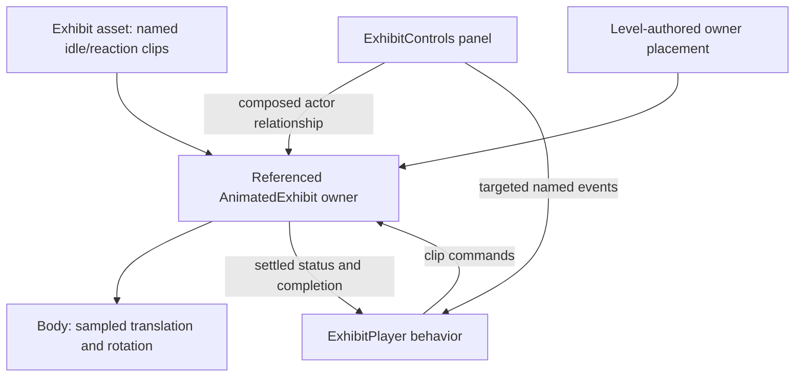
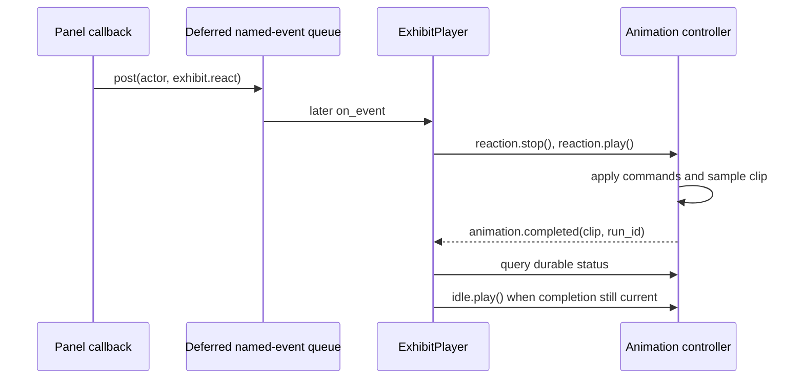

# Optional exercise: authored clips and event routing

Extend your writable Signal Room project with an orange animated exhibit and a second control panel. This exercise uses the current SDK's **composed relationship queries**, **targeted events**, **named clip playback**, **status snapshots**, **completion notifications** and **release** operation. The base beacon stays behavior-driven; this new exhibit is USD-animation-driven.

The companion files are in [the animation-routing extension](../../examples/animation-routing/README.md). Every authored file is also listed below. This extension requires a Conductor/SDK/Runtime distribution that supplies the APIs documented in the updated [SDK reference](../reference/behavior-sdk.md). ABI version 3 alone does not identify those additive APIs.

## 1. Add the four authored files

Copy the extension's assets/, behaviors/ and extensions/ files into the corresponding directories of your **working Signal Room project**. They use new filenames. Keep the base project.toml and input_map.toml; the existing camera Pointer routes clicks to both panels.

Add this sublayer to the metadata of levels/hub.usda, preserving its existing metadata, station reference and overrides:

```usda
# Add inside the existing parenthesized layer metadata:
subLayers = [@../extensions/animation-routing.usda@]
```

If the level already has subLayers, append this entry to that array. You can enable it in Lab instead, or in both levels. Save and reopen the project in Conductor so the active level composition includes the extension.

## 2. Separate actor placement from animated content

The asset declares two named clips on /Exhibit and samples only its Body child. The extension references that asset as /World/AnimatedExhibit and authors its static placement on the owner. Clip samples do not overwrite that placement. Native USD relationship composition remaps the clip target from /Exhibit/Body to the referenced occurrence's Body path.

Both clips use channel body. Playing reaction replaces idle on that owner/channel; the completed reaction holds its endpoint until the behavior explicitly starts idle again. This is exclusive ownership, without animation blending. The source relationship is omitted because these clips sample ordinary transform attributes. A skeletal clip can instead select a composed SkelAnimation source; see [the animation contract](../reference/behavior-sdk.md#named-events-and-animation).

At 24 time codes per second, idle spans time codes 0–24 and loops. Reaction spans 48–72, a one-second rise and spin. The values are time codes, not elapsed seconds. The declarations are custom USD properties, rather than a separate animation API schema: contractVersion 1, clipNames and each clip's uniform range/policy plus composed targets.



## 3. Bind the panel with a USD relationship

The panel's JSON context contains the **name of a relationship**, idtx:bindings:actor. The relationship itself carries the actor target. This keeps object binding in native USD composition: source /World paths remap to the correct occurrence under the preview or cooked level holder. A path string embedded in JSON has no such remapping.

The panel queries the relationship on each update/click. It requires a resolved, exactly-one-target result and a live entity. Missing/empty/multi-target/unloaded bindings fail explicitly. The fixed one-entry buffer does not silently select the first target from a longer list. More complex experiences should also use the reported revision and target status when designing their refresh/error policy.

The panel sends events::post(actor, name, bytes) to that concrete owner. It does not broadcast an experience-wide command or call another behavior recursively. The actor receives the event through on_event and queues playback changes. Posts from widget callbacks wait for the host's next event collection sweep. Playback commands settle after dispatch, and animation sampling updates the scene on a later tick.

## 4. Observe applied state rather than queue acceptance

ExhibitControls reads both named playheads through clip_on(actor, name).status(scratch). The typed snapshots own their strings, so the same scratch buffer can be reused for the second read. The readout shows IDLE, playing/paused/completed for an owned reaction, or FOLLOWING after release. The sample polls its small readout; a larger panel should cache the displayed text and write only when it changes.

ExhibitPlayer filters animation.completed by clip and run_id, then checks the reaction's durable status before resuming idle. This prevents a delayed notification from an earlier run from restarting an actor that has already changed state. Pause, Stop and Seek do not produce completion events. Completion and command notifications can be deferred/dropped under queue pressure; durable status remains queryable. Production-critical state machines should reconcile status as well as consume notifications. This teaching example uses the completion event for the idle transition, so its corresponding checkpoint is part of acceptance.

The actor also reads animation.command notifications and logs an unapplied command’s error. Those notifications identify the issuing request by sequence, clip and target, while status retains last_command_sequence, last_command_applied and last_command_error for an existing clip. A successful play() return establishes queue acceptance; the applied result is a later observation.

Release differs from Pause or Stop. Pause keeps an independently owned pose, Stop rewinds an active clip, and Release returns its target to the containing USD timeline. With the containing timeline paused, FOLLOWING can show a stationary pose. With it running, the authored stage samples continue to change; FOLLOWING does not mean animation is disabled.



## 5. Check the extension in Conductor and Runtime

Open the amended Hub and inspect AnimatedExhibit and ExhibitControls. Run **Cargo Check** and **Verify capabilities** for both new bindings. The player needs playback and events. The panel needs scene_query, widget, stage_edit, events and playback. It inherits the existing Pointer's physical click path; no additional input action is needed.

Use **Preview > Preview in Desktop** with the amended level active. Move/aim at the left-side ANIMATION EXHIBIT panel and observe the orange cube on the right. The scene starts idle. React / Restart replaces idle with the rise/spin; after natural completion the behavior resumes idle. Hold current pose pauses the active clip. Release to timeline shows FOLLOWING.

| Action / variation | Expected checkpoint |
|---|---|
| Start a fresh preview | Orange cube gently bobs; panel settles to IDLE |
| Click React / Restart | Rise/spin runs once, then idle resumes |
| Click React again during the reaction | A new explicitly restarted run begins; stale completion does not take over |
| Click Hold current pose | Active independent pose holds; panel reports paused |
| Click React after Hold | Reaction restarts and completes normally |
| Click Release to timeline | Both playheads follow the containing timeline; panel reports FOLLOWING |
| Break/remove the actor relationship | Binding/query error is visible; another actor is not selected implicitly |
| Author an invalid clip target/range | Inspect runtime status/diagnostic; Build rejects invalid named clip declarations |
| Enable the sublayer in both rooms and cook | Each composed occurrence binds its own actor and panel after travel |

Use **Build > Build Desktop Experience** to test Hub → Lab → Hub with the extension enabled where intended. Runtime preview has only the active level, while the cooked package supplies the transition registry. Repeat applicable acceptance on each actual target device. Native SDK calls do not animate USD or deliver these events.

## Complete authored files

Save the following exactly under their stated project-relative paths, or copy the companion extension. Paths within each layer resolve relative to the layer that authors them. No engine checkout or engine-dependent helper is required.

## assets/animated-exhibit.usda

<!-- animation-routing-file: assets/animated-exhibit.usda -->

```usda
#usda 1.0
(
    defaultPrim = "Exhibit"
    metersPerUnit = 1
    upAxis = "Y"
    timeCodesPerSecond = 24
    framesPerSecond = 24
    startTimeCode = 0
    endTimeCode = 72
)

def Xform "Exhibit"
{
    custom uniform int idtx:animation:contractVersion = 1
    custom uniform token[] idtx:animation:clipNames = ["idle", "reaction"]
    custom rel idtx:animation:idle:targets = </Exhibit/Body>
    custom uniform timecode idtx:animation:idle:start = 0
    custom uniform timecode idtx:animation:idle:end = 24
    custom uniform bool idtx:animation:idle:loop = true
    custom uniform bool idtx:animation:idle:autoPlay = false
    custom uniform token idtx:animation:idle:channel = "body"
    custom rel idtx:animation:reaction:targets = </Exhibit/Body>
    custom uniform timecode idtx:animation:reaction:start = 48
    custom uniform timecode idtx:animation:reaction:end = 72
    custom uniform bool idtx:animation:reaction:loop = false
    custom uniform bool idtx:animation:reaction:autoPlay = false
    custom uniform token idtx:animation:reaction:channel = "body"

    def Cube "Body"
    {
        double size = 0.55
        color3f[] primvars:displayColor = [(1.0, 0.4, 0.15)]
        double3 xformOp:translate.timeSamples = {
            0: (0, 0, 0),
            12: (0, 0.15, 0),
            24: (0, 0, 0),
            48: (0, 0, 0),
            60: (0, 0.7, 0),
            72: (0, 0, 0),
        }
        double xformOp:rotateY.timeSamples = {
            0: 0, 24: 0, 48: 0, 60: 180, 72: 360,
        }
        uniform token[] xformOpOrder = ["xformOp:translate", "xformOp:rotateY"]
    }
}
```

## behaviors/exhibit-player.rs

<!-- animation-routing-file: behaviors/exhibit-player.rs -->

```rust
use idtx_behavior_sdk::prelude::*;

#[derive(Deserialize)]
#[serde(crate = "idtx_behavior_sdk::serde")]
struct Completion {
    clip: ContextString<256>,
    run_id: u64,
}

#[derive(Deserialize)]
#[serde(crate = "idtx_behavior_sdk::serde")]
struct CommandResult {
    applied: bool,
    error: ContextString<2048>,
}

#[derive(Default)]
pub struct ExhibitPlayer;

#[behavior(kind = "runtime")]
impl ExhibitPlayer {
    fn on_start(&mut self, ctx: &Ctx) -> Result<()> {
        ctx.animations().clip("idle").play()
    }

    fn on_event(&mut self, ctx: &Ctx) -> Result<()> {
        let mut name = [0u8; 256];
        let length = ctx.event().read_name(&mut name);
        let name = name.get(..length).ok_or(ErrorCode::InvalidArgument)?;
        match name {
            b"exhibit.react" => {
                // Stop then Play explicitly restarts a running/completed action.
                ctx.animations().clip("reaction").stop()?;
                ctx.animations().clip("reaction").play()?;
            }
            b"exhibit.pause" => {
                let mut scratch = [0u8; 8192];
                let reaction = ctx.animations().clip("reaction").status(&mut scratch)?;
                if reaction.independent {
                    ctx.animations().clip("reaction").pause()?;
                } else {
                    ctx.animations().clip("idle").pause()?;
                }
            }
            b"exhibit.release" => {
                // Restore the containing USD timeline, rather than holding a pose.
                ctx.animations().clip("reaction").release()?;
                ctx.animations().clip("idle").release()?;
            }
            b"animation.completed" => {
                let mut payload = [0u8; 2048];
                let length = ctx.event().read_payload(&mut payload);
                let bytes = payload.get(..length).ok_or(ErrorCode::InvalidArgument)?;
                let notice: Completion = idtx_behavior_sdk::context::decode(bytes)?;
                if notice.clip.as_str() == "reaction" {
                    let mut scratch = [0u8; 8192];
                    let status = ctx.animations().clip("reaction").status(&mut scratch)?;
                    // Discard a delayed notification from an earlier playback run.
                    if status.run_id == notice.run_id && status.state.as_str() == "completed" {
                        ctx.animations().clip("idle").play()?;
                    }
                }
            }
            b"animation.command" => {
                let mut payload = [0u8; 4096];
                let length = ctx.event().read_payload(&mut payload);
                let bytes = payload.get(..length).ok_or(ErrorCode::InvalidArgument)?;
                let result: CommandResult = idtx_behavior_sdk::context::decode(bytes)?;
                if !result.applied { log::warn(result.error.as_str()); }
            }
            b"animation.failed" => log::warn("Exhibit animation binding failed"),
            _ => {}
        }
        Ok(())
    }

    fn on_stop(&mut self, ctx: &Ctx) -> Result<()> {
        ctx.animations().clip("reaction").release()?;
        ctx.animations().clip("idle").release()
    }
}
```

## behaviors/exhibit-controls.rs

<!-- animation-routing-file: behaviors/exhibit-controls.rs -->

```rust
use idtx_behavior_sdk::prelude::*;
use idtx_behavior_sdk::scene::RelationshipTarget;

#[derive(Deserialize)]
#[serde(crate = "idtx_behavior_sdk::serde")]
struct ControlsConfig {
    actor_relationship: ContextString<64>,
}

#[derive(Default)]
pub struct ExhibitControls {
    relationship: ContextString<64>,
}

#[behavior(kind = "runtime")]
impl ExhibitControls {
    fn on_start(&mut self, ctx: &Ctx) -> Result<()> {
        let mut scratch = [0u8; 256];
        let config: ControlsConfig = ctx.context(&mut scratch)?;
        if config.actor_relationship.is_empty() {
            return Err(ErrorCode::InvalidArgument.into());
        }
        self.relationship = config.actor_relationship;
        // Reject absent, unresolved, unloaded or multi-target bindings explicitly.
        self.actor(ctx)?;
        #[cfg(target_arch = "wasm32")]
        {
            ctx.widget().on_click("React", Self::react_clicked)?;
            ctx.widget().on_click("Pause", Self::pause_clicked)?;
            ctx.widget().on_click("Release", Self::release_clicked)?;
        }
        ctx.stage_edit().set_widget_value("State", "READY")
    }

    fn on_update(&mut self, ctx: &Ctx, _dt: f32) -> Result<()> {
        let actor = self.actor(ctx)?;
        let mut scratch = [0u8; 8192];
        let reaction = ctx.animations().clip_on(actor, "reaction").status(&mut scratch)?;
        let idle = ctx.animations().clip_on(actor, "idle").status(&mut scratch)?;
        let text = if reaction.state.as_str() == "invalid" || idle.state.as_str() == "invalid" {
            "INVALID"
        } else if reaction.independent {
            reaction.state.as_str()
        } else if idle.independent {
            if idle.state.as_str() == "playing" { "IDLE" } else { idle.state.as_str() }
        } else {
            "FOLLOWING"
        };
        // This small example polls state; larger panels can update only on change.
        ctx.stage_edit().set_widget_value("State", text)
    }

    fn actor(&self, ctx: &Ctx) -> Result<Entity> {
        let mut targets = [RelationshipTarget::default(); 1];
        let result = ctx.scene().relationship_targets(
            ctx.entity(), self.relationship.as_str(), &mut targets,
        )?;
        if !result.resolved || result.total != 1 || result.written != 1 {
            return Err(ErrorCode::InvalidArgument.into());
        }
        targets[0].entity().ok_or_else(|| ErrorCode::NotFound.into())
    }

    fn react_clicked(&mut self, ctx: &Ctx, _click: &WidgetClick) -> Result<()> {
        events::post(self.actor(ctx)?, "exhibit.react", &[])
    }

    fn pause_clicked(&mut self, ctx: &Ctx, _click: &WidgetClick) -> Result<()> {
        events::post(self.actor(ctx)?, "exhibit.pause", &[])
    }

    fn release_clicked(&mut self, ctx: &Ctx, _click: &WidgetClick) -> Result<()> {
        events::post(self.actor(ctx)?, "exhibit.release", &[])
    }
}
```

## extensions/animation-routing.usda

<!-- animation-routing-file: extensions/animation-routing.usda -->

```usda
#usda 1.0
(
    defaultPrim = "World"
    metersPerUnit = 1
    upAxis = "Y"
    timeCodesPerSecond = 24
    framesPerSecond = 24
    startTimeCode = 0
    endTimeCode = 72
)

over "World"
{
    def Xform "AnimatedExhibit" (
        prepend references = @../assets/animated-exhibit.usda@</Exhibit>
        prepend apiSchemas = ["IdtxBehaviorAPI"]
    )
    {
        double3 xformOp:translate = (2.2, 1.0, -3.0)
        uniform token[] xformOpOrder = ["xformOp:translate"]
        token idtx:behavior:kind = "runtime"
        string idtx:behavior:name = "ExhibitPlayer"
        string idtx:behavior:version = "1.0.0"
        string idtx:behavior:uuid = "handbook-exhibit-player-v1"
        asset idtx:behavior:source = @../behaviors/exhibit-player.rs@
        uniform token[] idtx:behavior:capabilities = ["playback", "events"]
    }
    def IdtxWidgetPanel "ExhibitControls" (prepend apiSchemas = ["IdtxBehaviorAPI"])
    {
        double3 xformOp:translate = (-2.8, 1.4, -3.0)
        uniform token[] xformOpOrder = ["xformOp:translate"]
        float2 idtx:widget:size = (1.45, 1.0)
        int2 idtx:widget:resolution = (768, 512)
        token idtx:behavior:kind = "runtime"
        string idtx:behavior:name = "ExhibitControls"
        string idtx:behavior:version = "1.0.0"
        string idtx:behavior:uuid = "handbook-exhibit-controls-v1"
        asset idtx:behavior:source = @../behaviors/exhibit-controls.rs@
        uniform token[] idtx:behavior:capabilities = ["scene_query", "widget", "stage_edit", "events", "playback"]
        string idtx:behavior:context = '{"actor_relationship":"idtx:bindings:actor"}'
        custom rel idtx:bindings:actor = </World/AnimatedExhibit>
        def IdtxWidgetLabel "Title"
        {
            string idtx:widget:text = "ANIMATION EXHIBIT"
            float idtx:widget:fontSize = 32
            float2 idtx:widget:position = (0.05, 0.02)
        }
        def IdtxWidgetFieldString "State"
        {
            string idtx:widget:value = "READY"
            float idtx:widget:fontSize = 32
            float2 idtx:widget:position = (0.05, 0.17)
        }
        def IdtxWidgetButton "React"
        {
            string idtx:widget:label = "React / Restart"
            float2 idtx:widget:position = (0.05, 0.36)
        }
        def IdtxWidgetButton "Pause"
        {
            string idtx:widget:label = "Hold current pose"
            float2 idtx:widget:position = (0.05, 0.58)
        }
        def IdtxWidgetButton "Release"
        {
            string idtx:widget:label = "Release to timeline"
            float2 idtx:widget:position = (0.05, 0.80)
        }
    }
}
```
